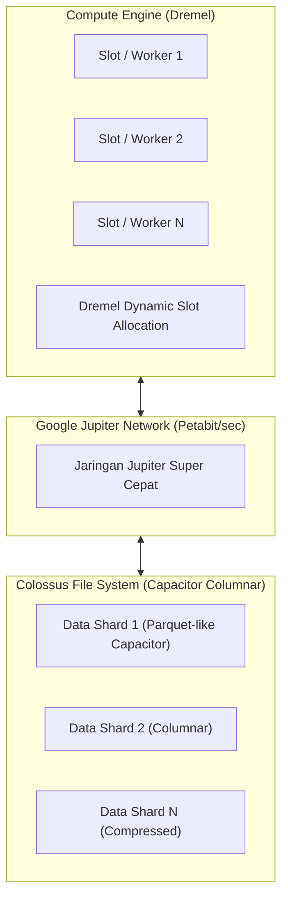
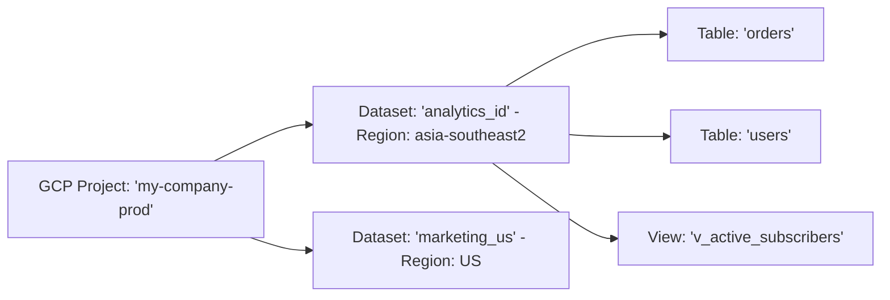

# 📊 Google BigQuery - Modul 01: Arsitektur & Konsep Inti

Google BigQuery adalah *Enterprise Data Warehouse* cloud berbasis serverless (*fully managed*) yang dirancang untuk menganalisis data berukuran Terabyte hingga Petabyte dalam hitungan detik menggunakan bahasa standar SQL (GoogleSQL).

---

## 1. Arsitektur Pemisahan Storage & Compute

Berbeda dengan database relasional tradisional yang compute dan storage-nya menyatu dalam 1 mesin fisik, BigQuery memisahkan **Storage** dan **Compute** secara total melalui jaringan internal berkecepatan Petabit milik Google (**Jupiter Network**).

### Komponen Kunci BigQuery:
1. **Dremel (Compute Engine)**: Mesin eksekusi query multi-tenant yang membagi query SQL besar menjadi pohon eksekusi pohon (*execution tree*) dan membagikannya ke ribuan virtual CPU yang disebut **Slots**.
2. **Capacitor (Storage Format)**: Format penyimpanan data berbasis kolom (*columnar storage*) milik Google yang mengompresi data secara masif dan memungkinkan pembacaan kolom tertentu tanpa membaca seluruh baris.
3. **Jupiter Network**: Jaringan serat optik internal data center Google yang mampu mentransfer data antar storage dan compute dengan throughput hingga 1 Petabit per detik.
4. **Colossus**: Sistem file terdistribusi global generasi penerus Google File System (GFS).

---

## 2. Hierarki Organisasi Resource

Struktur data di BigQuery disusun dalam tingkatan hierarkis berikut:

$$\mathbf{Google\ Cloud\ Project} \longrightarrow \mathbf{Dataset\ (Region)} \longrightarrow \mathbf{Table\ /\ View\ /\ Materialized\ View}$$

- **Project**: Menentukan akun billing, kuota, dan IAM permission level tertinggi.
- **Dataset**: Wadah (*container*) tabel yang terikat pada lokasi geografis tertentu (misal: `asia-southeast2` Jakarta atau multi-region `US`/`EU`). Tabel di dalam dataset tidak bisa dipindah region tanpa replikasi data.
- **Table**: Berisi skema, partisi, clustering, dan data baris/kolom aktual.

---

## 3. Model Biaya (Pricing Model): On-Demand vs Editions (Slots)

BigQuery membebankan biaya berdasarkan dua komponen utama: **Analisis (Query)** dan **Storage**.

### A. Compute: On-Demand Pricing ($6.25 per TB Scanned)
- Cocok untuk startup atau traffic query yang fluktuatif.
- Gratis 1 TB analisis pertama setiap bulan.
- Anda hanya membayar untuk **jumlah byte data yang dipindai (*scanned*) oleh query**.
- Jika Anda menjalankan `SELECT *` pada tabel berukuran 2 TB, Anda membayar $12.50 per query, meskipun hasilnya hanya 5 baris!

### B. Compute: BigQuery Editions (Kapasitas Slot)
- Cocok untuk enterprise dengan beban query konstan dan anggaran terprediksi.
- Tersedia dalam tier: **Standard**, **Enterprise**, dan **Enterprise Plus**.
- Membayar berdasarkan jumlah *Slot-Hours* (CPU virtual) yang dipesan, bukan berdasarkan byte yang discan.

### C. Storage Pricing
- **Active Storage**: Data yang dimodifikasi dalam 90 hari terakhir (~$0.02 per GB per bulan).
- **Long-term Storage**: Data yang tidak dimodifikasi sama sekali selama 90 hari berturut-turut. Google **otomatis memotong harganya sebesar 50%** menjadi ~$0.01 per GB per bulan tanpa degradasi performa!
