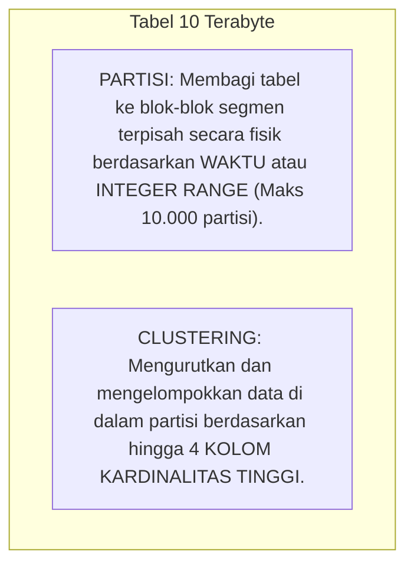

# 📊 Google BigQuery - Modul 03: Partisi & Clustering

Karena model billing On-Demand BigQuery didasarkan pada **jumlah byte yang dipindai**, menjalankan query pada tabel 50 Terabyte tanpa optimasi bisa menelan biaya ratusan dolar sekali jalan. **Partisi (*Partitioning*)** dan **Clustering** adalah dua senjata utama untuk memangkas byte scan hingga $99\%$.

---

## 1. Perbedaan Mendasar: Partisi vs Clustering



| Fitur | Partitioning | Clustering |
|---|---|---|
| **Kriteria Kolom** | Tanggal, Timestamp, Waktu Ingestion, atau Rentang Angka Integer. | Kolom bertipe string, numerik, boolean, timestamp dengan kardinalitas tinggi. |
| **Batas Kolom** | Hanya **1 kolom** per tabel. | Hingga **4 kolom** terurut. |
| **Estimasi Biaya** | Estimasi byte scan diketahui **sebelum query dieksekusi** (*Dry-run*). | Estimasi penghematan byte scan diketahui **hanya saat query dieksekusi**. |
| **Batas Maksimal** | 10.000 partisi per tabel. | Tidak terbatas. |
| **Biaya Maintenance** | Otomatis diatur engine. | Otomatis di-recluster di background (*free auto-clustering*). |

---

## 2. Membuat Partitioned Table

### A. Partisi Berdasarkan Kolom Tanggal/Timestamp
```sql
CREATE OR REPLACE TABLE `my_project.analytics.events` (
  event_id STRING,
  user_id INT64,
  event_name STRING,
  created_at TIMESTAMP
)
PARTITION BY DATE(created_at)
-- Wajibkan filter partisi agar query tidak boros tanpa sengaja:
OPTIONS (
  require_partition_filter = TRUE,
  partition_expiration_days = 365 -- Hapus partisi otomatis setelah 1 tahun
);
```

### B. Manfaat Partition Pruning dalam Query
Saat query menyertakan filter tanggal, BigQuery hanya membaca file partisi yang relevan (*Partition Pruning*):

```sql
-- Query ini HANYA memindai data tanggal 20 November 2026 (misal 500 MB)
-- BUKAN seluruh tabel 5 Tahun (10 Terabyte)!
SELECT
  event_name,
  COUNT(1) AS total_event
FROM `my_project.analytics.events`
WHERE DATE(created_at) = '2026-11-20'
GROUP BY event_name;
```

> [!CAUTION]
> Jangan membungkus kolom partisi di dalam fungsi yang merusak pruning, seperti `WHERE FORMAT_DATE('%Y-%m-%d', created_at) = '...'`. Gunakan perbandingan langsung atau `DATE(created_at)`.

---

## 3. Membuat Clustered Table

Clustering bekerja mirip dengan *Compound Index* di database relasional. Data dengan nilai berdekatan akan disimpan secara fisik berdampingan di disk storage Capacitor.

```sql
CREATE OR REPLACE TABLE `my_project.analytics.orders` (
  order_id STRING,
  customer_id INT64,
  status STRING,
  amount NUMERIC,
  order_date DATE
)
-- Urutan clustering SANGAT PENTING: Kolom paling sering difilter diletakkan paling kiri
CLUSTER BY customer_id, status;
```

---

## 4. Kombinasi Sakti: Partisi + Clustering

Arsitektur tabel production kelas dunia di BigQuery selalu memadukan **Partitioning** untuk dimensi waktu dan **Clustering** untuk dimensi entitas bisnis:

```sql
CREATE OR REPLACE TABLE `my_project.logs.web_traffic` (
  session_id STRING,
  user_id INT64,
  country_code STRING,
  device_type STRING,
  page_url STRING,
  timestamp TIMESTAMP
)
PARTITION BY DATE(timestamp)
CLUSTER BY country_code, device_type, user_id;
```

### Simulasi Efisiensi Biaya Nyata:

```mermaid
flowchart LR
    A["Tabel Mentah Utuh<br/><b>10.000 GB (10 TB)</b><br/>Biaya Scan: $62.50"]
    B["Setelah Filter Partisi Tanggal<br/><b>100 GB</b><br/>Biaya Scan: $0.62"]
    C["Setelah Filter Cluster Kolom<br/><b>1.5 GB</b><br/>Biaya Scan: $0.009"]

    A -->|WHERE DATE(timestamp) = '2026-11-20'| B
    B -->|AND country_code = 'ID' AND device_type = 'MOBILE'| C
```

Dari biaya \$62.50 sekali eksekusi, terpangkas menjadi kurang dari **1 sen (\$0.009)** dengan kecepatan query di bawah 1 detik!
