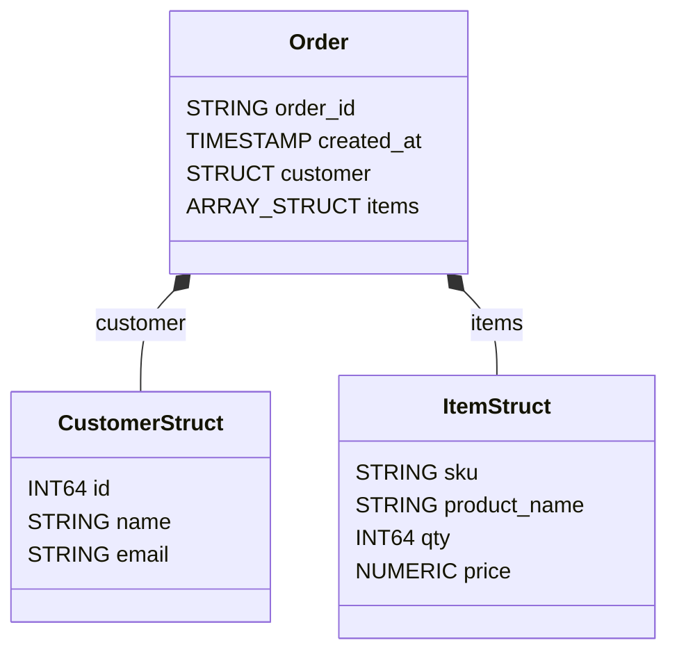

# 📊 Google BigQuery - Modul 04: Nested & Repeated Fields

Dalam database relasional tradisional, kita memecah tabel menjadi puluhan entitas ternormalisasi (`orders`, `order_items`, `customers`, `products`) lalu menggabungkannya dengan `JOIN`. Di BigQuery, operasi `JOIN` pada dataset miliaran baris memicu **Network Data Shuffling** yang sangat boros kuota slot compute.

Solusi arsitektur BigQuery adalah **Denormalisasi Dokumen** menggunakan kombinasi tipe data **`STRUCT` (Nested)** dan **`ARRAY` (Repeated)**.

---

## 1. Konsep STRUCT vs ARRAY

| Tipe Data | Padanan JSON | Deskripsi |
|---|---|---|
| **`STRUCT`** | Objek `{}` | Kumpulan beberapa field bersarang dengan nama dan tipe data berbeda (*Nested Field*). |
| **`ARRAY`** | Daftar `[]` | Kumpulan nilai dengan tipe data yang sama yang berulang (*Repeated Field*). |
| **`ARRAY<STRUCT>`** | Array Objek `[{}]` | Pola paling sakti: 1 baris invoice menyimpan seluruh daftar item barang di dalamnya! |



---

## 2. Membuat Tabel dengan STRUCT & ARRAY

```sql
CREATE OR REPLACE TABLE `my_project.ecommerce.orders` (
  order_id STRING,
  created_at TIMESTAMP,
  -- STRUCT: Objek tunggal bersarang
  customer STRUCT<
    id INT64,
    name STRING,
    email STRING
  >,
  -- ARRAY<STRUCT>: Daftar barang berulang di dalam baris order
  items ARRAY<STRUCT<
    sku STRING,
    product_name STRING,
    qty INT64,
    price NUMERIC
  >>
);
```

---

## 3. Querying: Dot Notation & UNNEST

### A. Mengakses Field STRUCT (Dot Notation)
Mengakses field di dalam `STRUCT` semudah mengakses kolom biasa:
```sql
SELECT
  order_id,
  customer.name AS nama_pembeli,
  customer.email AS email_pembeli
FROM `my_project.ecommerce.orders`;
```

### B. Membongkar ARRAY dengan `UNNEST()`
Karena `items` berupa array, kita tidak bisa langsung melakukan kalkulasi agregasi pada kolomnya sebelum membongkarnya menjadi baris individu menggunakan **`UNNEST()`**:

```sql
SELECT
  o.order_id,
  o.customer.name,
  item.sku,
  item.product_name,
  item.qty,
  item.price,
  (item.qty * item.price) AS subtotal
FROM `my_project.ecommerce.orders` AS o
-- Koma (,) atau CROSS JOIN UNNEST membongkar array items:
CROSS JOIN UNNEST(o.items) AS item
WHERE item.price > 100000;
```

---

## 4. Agregasi Kembali dengan ARRAY_AGG & STRUCT

Jika Anda ingin mengelompokkan data kembali menjadi array terstruktur:

```sql
SELECT
  customer_id,
  -- Kumpulkan seluruh riwayat order user menjadi 1 array objek terurut:
  ARRAY_AGG(
    STRUCT(order_id, amount, order_date)
    ORDER BY order_date DESC
    LIMIT 5 -- Hanya simpan 5 order terakhir
  ) AS recent_orders
FROM `my_project.ecommerce.flat_orders`
GROUP BY customer_id;
```

---

## 5. Fungsi Bantuan ARRAY Lainnya

```sql
SELECT
  order_id,
  -- 1. Hitung jumlah item dalam array:
  ARRAY_LENGTH(items) AS total_jenis_barang,

  -- 2. Ambil item pertama (Index berbasis 0):
  items[OFFSET(0)].product_name AS item_pertama,

  -- 3. Ambil item pertama (Index berbasis 1):
  items[ORDINAL(1)].product_name AS item_pertama_ordinal,

  -- 4. Gabungkan array string menjadi 1 teks:
  ARRAY_TO_STRING(['Jakarta', 'Bandung', 'Surabaya'], ', ') AS kota_gabungan
FROM `my_project.ecommerce.orders`;
```

> [!NOTE]
> Dengan menyimpan relasi parent-child dalam satu tabel menggunakan `ARRAY<STRUCT>`, BigQuery dapat membaca seluruh data invoice tanpa perlu melakukan `JOIN` jaringan antar tabel yang lambat!
