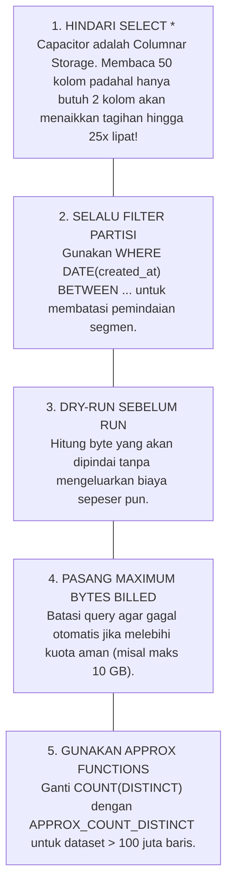
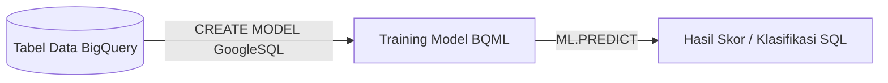

# 📊 Google BigQuery - Modul 05: Optimasi Biaya & Best Practices

Sifat BigQuery yang sangat cepat seringkali membuat developer terlena. Tanpa pemahaman arsitektur, satu query analitik yang ceroboh pada tabel log Petabyte bisa menghabiskan tagihan jutaan rupiah dalam beberapa detik. Di modul ini, kita merangkum protokol keamanan biaya dan fitur tingkat lanjut.

---

## 1. 5 Aturan Emas Optimasi Biaya Query



### Praktik: Dry-Run via GCP CLI (`bq`)
Untuk mengetahui berapa megabyte data yang akan discan sebelum query beneran jalan:
```bash
bq query \
  --use_legacy_sql=false \
  --dry_run \
  "SELECT user_id, SUM(amount) FROM \`my_project.analytics.orders\` GROUP BY user_id"

# Output Terminal:
# Query successfully validated. Assuming the run?
# This query will process 1.45 GB when run.
```

### Memasang Batas Maksimal Biaya di Query (Safety Net)
```sql
-- Jika query ternyata memindai lebih dari 5 Gigabyte, gagalkan eksekusi!
-- Parameter ini bisa dipasang di driver Python/Node.js/Go:
-- job_config.maximum_bytes_billed = 5 * 1024 * 1024 * 1024
```

---

## 2. Materialized Views: Hasil Agregasi Pra-Kalkulasi

Jika dashboard bisnis Anda menampilkan grafik penjualan harian yang sama berulang kali setiap jam, jangan scan tabel mentah terus menerus. Buat **Materialized View (MV)**:

```sql
CREATE MATERIALIZED VIEW `my_project.analytics.mv_daily_sales`
PARTITION BY order_date
CLUSTER BY store_id
AS
SELECT
  order_date,
  store_id,
  COUNT(1) AS total_orders,
  SUM(amount) AS total_revenue
FROM `my_project.analytics.orders`
GROUP BY order_date, store_id;
```

### Keajaiban Smart Query Rewriting:
Jika ada analis menjalankan query pada tabel sumber:
```sql
SELECT SUM(amount) FROM `my_project.analytics.orders` WHERE order_date = '2026-11-20';
```
Optimizer BigQuery secara otomatis membelokkan query tersebut ke `mv_daily_sales` tanpa merubah kode SQL! Hasilnya keluar instan dalam 200 ms dan biaya scan hampir 0 byte!

---

## 3. BigQuery BI Engine: In-Memory Caching

Untuk visualisasi data di Looker Studio, Tableau, atau Metabase:
- **BI Engine** adalah layer akselerasi in-memory terdistribusi.
- Mampu memuat kolom yang sering diakses langsung ke RAM cache Google Cloud.
- Menghasilkan respon dashboard **sub-second** tanpa memicu pemindaian storage Capacitor berulang.

---

## 4. BigQuery ML (BQML): AI & Machine Learning di SQL

Anda tidak perlu mengekspor data ke file CSV, mendownloadnya ke Google Colab, atau menyalakan cluster Python Pandas untuk membangun model Machine Learning sederhana. BigQuery memiliki built-in **BigQuery ML**!



### Contoh: Melatih Model Regresi Linier untuk Prediksi Nilai Transaksi
```sql
-- 1. Latih Model
CREATE OR REPLACE MODEL `my_project.ml.model_prediksi_belanja`
OPTIONS(
  model_type = 'linear_reg',
  input_label_cols = ['total_belanja']
) AS
SELECT
  usia,
  gender,
  total_kunjungan_web,
  lama_membership_bulan,
  total_belanja
FROM `my_project.analytics.customer_training_data`;

-- 2. Evaluasi Model (Lihat Akurasi, R2, RMSE)
SELECT * FROM ML.EVALUATE(MODEL `my_project.ml.model_prediksi_belanja`);

-- 3. Jalankan Prediksi untuk Pelanggan Baru!
SELECT
  customer_id,
  predicted_total_belanja
FROM ML.PREDICT(
  MODEL `my_project.ml.model_prediksi_belanja`,
  (
    SELECT customer_id, usia, gender, total_kunjungan_web, lama_membership_bulan
    FROM `my_project.analytics.new_customers`
  )
);
```
Semuanya berjalan 100% di dalam infrastruktur terdistribusi BigQuery tanpa perlu server ML eksternal!
