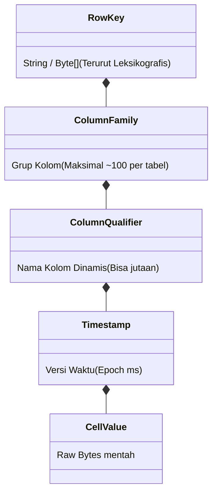
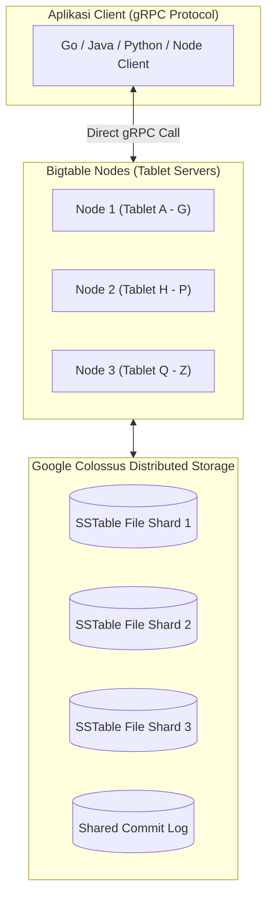

# ⚡ Google Cloud Bigtable - Modul 01: Arsitektur & Model Data Inti

Google Cloud Bigtable adalah database NoSQL bertipe *Wide-Column Store* yang dirancang untuk beban kerja penulisan dan pembacaan masif (*Massive Throughput*) dengan latensi sangat rendah (**sub-10 milidetik**) pada skala Terabyte hingga Petabyte. Bigtable adalah mesin penyimpanan yang mentenagai layanan raksasa Google seperti **Google Search, Google Maps, YouTube Analytics, dan Gmail**.

---

## 1. Model Data: Peta Multidimensi Terurut

Bigtable secara formal didefinisikan sebagai:
> *"A sparse, distributed, persistent multidimensional sorted map."*

Secara matematis, setiap sel (*cell*) data diakses melalui 4 koordinat:

$$\mathbf{(Row\ Key,\ Column\ Family,\ Column\ Qualifier,\ Timestamp)} \longrightarrow \mathbf{Byte\ Value}$$

### Penjelasan Elemen Model Data:
1. **Row Key**: Primary key tunggal berupa string biner (maksimal 4KB). Seluruh baris di Bigtable **diurutkan secara leksikografis (ASCII)** berdasarkan Row Key ini.
2. **Column Family**: Grup kolom logis yang disimpan bersama di storage fisik. Kebijakan kompresi dan Garbage Collection ditentukan di level Family (disarankan $\le 100$ family per tabel).
3. **Column Qualifier**: Nama kolom di dalam Family. Dibuat secara dinamis saat data ditulis tanpa perlu deklarasi skema di awal (*schemaless column*).
4. **Timestamp**: Setiap perpotongan baris dan kolom bisa menyimpan beberapa versi data berdasarkan waktu UTC milidetik.
5. **Cell Value**: Nilai mentah berupa array biner (`bytes`). Bigtable tidak peduli apakah data itu string, integer, JSON, atau protobuf terkompresi.

---

## 2. Ilustrasi Tabel Wide-Column

Bayangkan sebuah tabel pelacak telemetri armada kendaraan:

| Row Key (Truk + Timestamp) | Family: `telemetry` -> `speed` | Family: `telemetry` -> `fuel` | Family: `meta` -> `driver` |
|---|---|---|---|
| `TRUCK#101#20261120T1000` | `[t2: 78 km/h]` `[t1: 72 km/h]` | `[t2: 65%]` | `[t1: "Budi"]` |
| `TRUCK#101#20261120T1005` | `[t1: 82 km/h]` | `[t1: 63%]` | `[t1: "Budi"]` |
| `TRUCK#202#20261120T0900` | `[t1: 60 km/h]` | `[t1: 90%]` | `[t1: "Siti"]` |

---

## 3. Arsitektur Terdistribusi: Tablet & Colossus

Sama seperti BigQuery, Bigtable memisahkan compute dan storage secara penuh:

### Bagaimana Bigtable Mengatur Data:
- **Tablet**: Kumpulan baris yang bersebelahan berdasarkan rentang Row Key (*Row Key Range*).
- **Node**: Bigtable Node tidak menyimpan data secara persisten di hard disk lokalnya! Node hanya bertindak sebagai pointer/router compute yang melayani operasi read/write untuk sekumpulan Tablet yang dialokasikan padanya.
- **SSTable & Colossus**: Data sebenarnya disimpan dalam file **SSTable** (*Sorted String Table*) yang immutable di sistem penyimpanan Colossus.
- **Auto-Split & Rebalance**: Ketika sebuah Tablet tumbuh terlalu besar (> 100-200GB) atau menerima traffic terlalu tinggi, Bigtable otomatis membelah (*split*) tablet tersebut menjadi dua dan memindahkannya ke Node lain dalam hitungan detik tanpa downtime!
