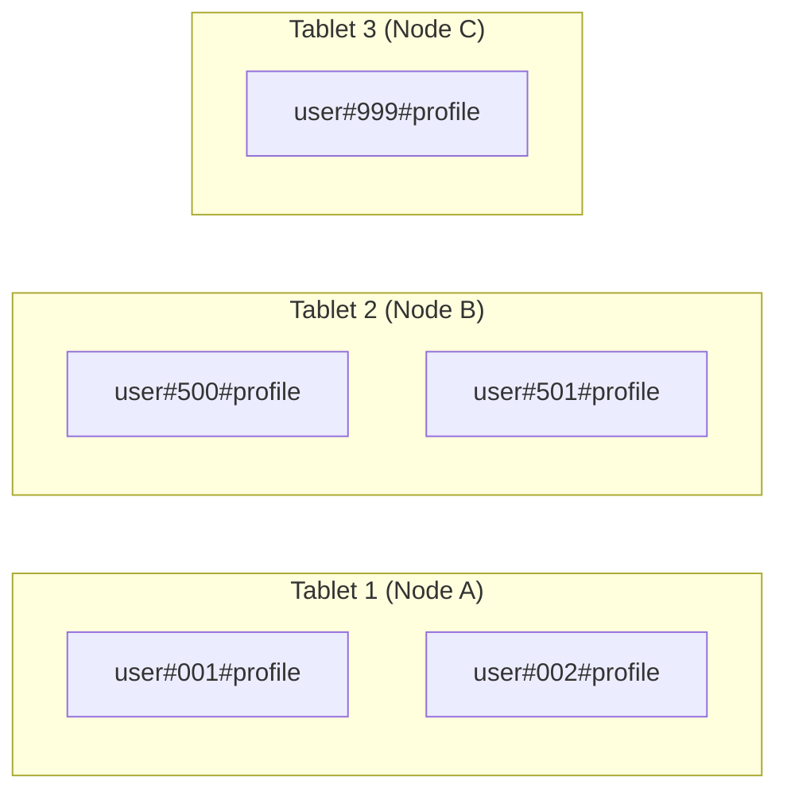
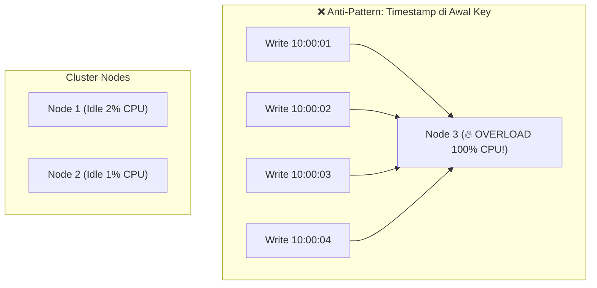

# ⚡ Google Cloud Bigtable - Modul 02: Desain Row Key Sakti

Di Bigtable, **tidak ada Secondary Index**. Tidak ada perintah `CREATE INDEX`. Satu-satunya cara data diindeks dan dialokasikan ke mesin server adalah melalui **Row Key**. 

Salah mendesain Row Key akan mengakibatkan satu node server meledak kelebihan beban (*Hotspotting*) sementara node lain menganggur, menghancurkan performa cluster Anda.

---

## 1. Konsep Pengurutan Leksikografis (ASCII)

Bigtable mengurutkan Row Key seperti kamus kata (dari kiri ke kanan per byte karakter).

Contoh perbandingan string leksikografis:
- `"1"` < `"10"` < `"2"` < `"20"` < `"3"` (Karakter `'10'` muncul SEBELUM `'2'`!)
- `"sensor-101"` muncul sebelum `"sensor-20"` jika panjang string tidak disamakan (*zero-padded*).



---

## 2. Musuh Nomor Satu: Hotspotting (Anti-Patterns)

**Hotspotting** terjadi ketika sebagian besar operasi read atau write terkonsentrasi hanya pada satu Tablet / satu Node tertentu.



### 3 Pola Row Key yang DILARANG KERAS:
1. ❌ **ID Berurutan (Sequential)**: `1`, `2`, `3`, `4`... Semua write baru selalu menabrak tablet paling ujung kanan.
2. ❌ **Timestamp Mentah di Awal**: `20261120-100000#sensor1`. Karena waktu selalu bertambah ke depan, semua request detik ini masuk ke 1 node yang sama!
3. ❌ **Domain Name Biasa**: `google.com`, `apple.com`. Ubah format menjadi reverse domain: `com.google`, `com.apple` agar domain dengan TLD sama mengelompok rapi.

---

## 3. Pola Desain Row Key yang Benar (Best Practices)

### A. Gunakan Pembatas (*Delimiter*) Konsisten
Gunakan karakter seperti pagar (`#`) atau titik dua (`:`) untuk memisahkan segmen dimensi data:
$$\mathbf{company\_id\ \#\ device\_id\ \#\ reverse\_timestamp}$$

### B. Salting (Hash Prefix) untuk Write Throughput Raksasa
Jika Anda menulis 1.000.000 metrik per detik, tambahkan hash prefix (misal MD5 modulo 10) di awal key agar data tersebar merata ke seluruh tablet:
```
# Format: [salt_0-9]#[device_id]#[timestamp]
0#sensor_99#1700000000
1#sensor_12#1700000000
2#sensor_45#1700000000
```

### C. Reverse Timestamp untuk Data Time-Series (Sensor & IoT)
Secara default, scan rentang baris diurutkan dari nilai terkecil ke terbesar (*Ascending*). Jika Anda menyimpan log sensor, Anda hampir selalu ingin membaca **data paling baru terlebih dahulu**.

Gunakan trik **Reverse Timestamp**:
$$\text{Reverse Timestamp} = \text{Long.MAX\_VALUE} - \text{Current Timestamp}$$

```
Contoh (Long.MAX_VALUE = 9223372036854775807):
Waktu 10:00 (timestamp: 1000) -> Key: 9223372036854774807
Waktu 10:05 (timestamp: 1300) -> Key: 9223372036854774507 (Lebih KECIL, muncul PALING ATAS!)
```

```
Row Key:
DEVICE#101#9223372036854774507 (Waktu 10:05 - Paling Baru)
DEVICE#101#9223372036854774807 (Waktu 10:00 - Lebih Lama)
```

Dengan desain ini, query pembacaan data sensor 1 jam terakhir cukup melakukan scan rentang baris maju (*Forward Scan*) yang sangat cepat dan langsung membaca data terbaru tanpa perlu reverse scan!
