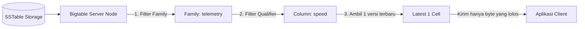

# ⚡ Google Cloud Bigtable - Modul 03: Operasi Read, Write & Filters

Interaksi dengan Bigtable dilakukan melalui protokol **gRPC (HTTP/2 biner)** menggunakan Google Cloud Client SDK (tersedia untuk Go, Java, Python, Node.js, C++). Semua operasi penulisan pada baris tunggal (*Single-Row Mutation*) dijamin **100% atomik**.

---

## 1. Operasi Penulisan (Write & Mutasi)

### A. Single Row Mutation (Menulis Kolom)
```go
// Contoh penulisan di Go (cloud.google.com/go/bigtable)
mut := bigtable.NewMutation()

// Set nilai kolom: family, qualifier, timestamp, value (bytes)
mut.Set("telemetry", "speed", bigtable.Now(), []byte("85.5"))
mut.Set("telemetry", "fuel", bigtable.Now(), []byte("72%"))
mut.Set("meta", "driver_name", bigtable.Now(), []byte("Eka"))

// Tulis ke baris row key tertentu:
err := tbl.Apply(ctx, "TRUCK#101#20261120T1000", mut)
```

### B. Bulk / Batch Writes (`ApplyBulk`)
Jika Anda mengimpor data dalam jumlah jutaan baris, jangan panggil `Apply` satu per satu. Gunakan `ApplyBulk` untuk menggabungkan mutasi banyak baris dalam 1 connection stream:
```go
rowKeys := []string{"KEY#1", "KEY#2", "KEY#3"}
muts := []*bigtable.Mutation{mut1, mut2, mut3}
errors, err := tbl.ApplyBulk(ctx, rowKeys, muts)
```

---

## 2. Operasi Pembacaan: Single Read vs Range Scan

### A. Single Row Read
Mengambil 1 baris tertentu secara presisi berdasarkan Row Key (latensi < 5 ms):
```go
row, err := tbl.ReadRow(ctx, "TRUCK#101#20261120T1000")
```

### B. Prefix & Range Scan (Membaca Rentang Baris)
Karena Row Key terurut, membaca ribuan baris yang bersebelahan sangat efisien:

```go
// Membaca semua data truk nomor 101:
prefixRange := bigtable.PrefixRange("TRUCK#101#")

err := tbl.ReadRows(ctx, prefixRange, func(row bigtable.Row) bool {
    fmt.Printf("Membaca baris: %s\n", row.Key())
    return true // Lanjutkan ke baris berikutnya
})
```

---

## 3. Server-Side Filter Pipeline (`RowFilter`)

Salah satu fitur paling hebat dari Bigtable adalah kemampuan memfilter data **di server sebelum byte-nya dikirimkan lewat jaringan ke aplikasi Anda**. Ini menghemat CPU client dan bandwidth secara drastis!



### Filter Populer yang Sering Digunakan:
1. **`LatestNFilter(1)`**: Hanya ambil 1 nilai terbaru dari setiap kolom (buang riwayat versi timestamp lama).
2. **`FamilyFilter("telemetry")`**: Hanya baca family tertentu, abaikan family lainnya.
3. **`ColumnFilter("speed")`**: Hanya baca kolom dengan qualifier tertentu (bisa memakai regex).
4. **`ValueFilter("^[0-9]+$")`**: Filter nilai sel berdasarkan pencocokan regex biner.
5. **`StripValueFilter()`**: Buang isi sel, hanya kembalikan row key dan metadata kolom (sangat cepat untuk menghitung eksistensi baris).

### Menggabungkan Filter dengan `Chain` (Logika AND):
```go
// Buat rantai filter: Family 'telemetry' AND Column 'speed' AND 1 versi terbaru
filter := bigtable.ChainFilters(
    bigtable.FamilyFilter("telemetry"),
    bigtable.ColumnFilter("speed"),
    bigtable.LatestNFilter(1),
)

row, err := tbl.ReadRow(ctx, "TRUCK#101#20261120T1000", bigtable.RowFilter(filter))
```

---

## 4. Modifikasi Atomik Tingkat Lanjut

### A. `CheckAndMutateRow` (Conditional Mutation / CAS)
Mengeksekusi penulisan **hanya jika** kondisi filter terpenuhi secara atomik (mirip `UPDATE ... WHERE` atau *Compare-and-Swap*):

```go
// KASUS: Hanya beri bonus jika saldo saat ini > 100000
condMut := bigtable.NewCondMutation(
    bigtable.ValueFilter("ACTIVE"), // Syarat: status harus ACTIVE
    mutTrue,                        // Jika terpenuhi, jalankan ini
    nil                             // Jika tidak, batalkan!
)
matched, err := tbl.CheckAndMutate(ctx, "USER#123", condMut)
```

### B. `ReadModifyWriteRow` (Atomic Increment Counter)
Menambah angka counter tanpa risiko *race condition* antar worker:
```go
rmw := bigtable.NewReadModifyWrite()
rmw.Increment("stats", "view_count", 1) // Tambah 1 ke kolom biner secara atomik
row, err := tbl.ApplyReadModifyWrite(ctx, "ARTICLE#99", rmw)
```
