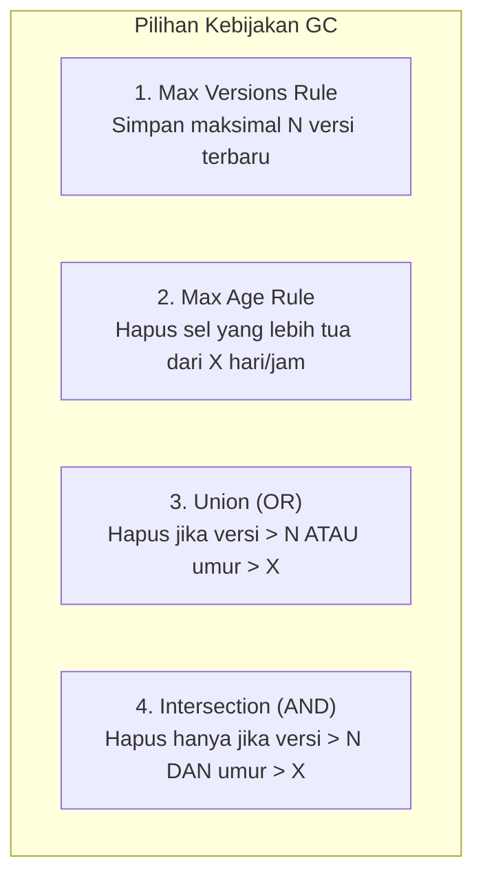

# ⚡ Google Cloud Bigtable - Modul 04: Garbage Collection & Matriks Keputusan

Dalam Bigtable, operasi penulisan data tidak pernah menimpa (*overwrite*) data lama secara langsung, melainkan membuat versi baru (*new version timestamp*). Tanpa tata kelola yang tepat, biaya penyimpanan disk Colossus bisa membengkak. Modul ini membahas Garbage Collection, visualisasi hotspot, dan arsitektur komparatif.

---

## 1. Kebijakan Garbage Collection (GC)

Kebijakan Garbage Collection diterapkan di level **Column Family** untuk membersihkan sel-sel versi lama secara otomatis di latar belakang saat proses *Compaction* file SSTable.



### Konfigurasi Kebijakan GC via CLI (`cbt`):
```bash
# 1. Hanya simpan 1 versi terbaru (buang riwayat lama):
cbt setgcpolicy my-table telemetry maxversions=1

# 2. Hapus data yang lebih tua dari 30 hari (untuk log/telemetri):
cbt setgcpolicy my-table telemetry maxage=30d

# 3. Kebijakan Kombinasi (Intersection: Simpan minimal 2 versi, tapi hapus jika > 60 hari):
cbt setgcpolicy my-table meta "maxversions=2 and maxage=60d"
```

> [!WARNING]
> Menghapus data melalui `cbt delete` atau kedaluwarsa GC tidak langsung membebaskan disk detik itu juga. Data ditandai dengan *tombstone* dan byte fisik baru dibersihkan saat Bigtable menjalankan *Major Compaction*. Namun, aplikasi Anda dijamin tidak akan bisa membaca data tersebut lagi secara instan!

---

## 2. Key Visualizer: Mendeteksi Hotspot Secara Visual

**Key Visualizer** adalah tool diagnostik interaktif bawaan Google Cloud Console yang menampilkan visualisasi 2 dimensi (*Heatmap*) aktivitas read/write cluster Anda:

- **Sumbu Horizontal (X)**: Waktu (Jam / Menit).
- **Sumbu Vertikal (Y)**: Rentang Row Key (dari ASCII terkecil ke terbesar).
- **Warna Panas (Kuning / Merah Terang)**: Menunjukkan traffic operasi I/O atau latensi yang sangat tinggi.

```
Visualisasi Pola Heatmap:
---------------------------------------------------------------
Pola Ideal (Distribusi Merata):
|   .   .   :   .   .   .   :   .   | -> Warna gelap merata (Beban tersebar)
|   .   .   :   .   .   .   :   .   |

Pola Bahaya 1: Garis Horizontal Terang (Hot Row Key)
|===================================| -> 1 Row Key diserang jutaan traffic terus-menerus!
|   .   .   :   .   .   .   :   .   |

Pola Bahaya 2: Garis Diagonal Miring (Sequential Key / Timestamp di Depan)
|         /                         | -> Pola miring membuktikan penulisan berurutan,
|       /                           |    tablet berpindah-pindah satu demi satu!
---------------------------------------------------------------
```

---

## 3. Matriks Keputusan: Bigtable vs Database GCP Lainnya

Seringkali developer bingung kapan harus menggunakan Bigtable, BigQuery, Cloud Spanner, atau Firestore. Gunakan panduan arsitektur berikut:

| Kriteria | ⚡ Cloud Bigtable | 📊 BigQuery | 🌐 Cloud Spanner | 🔥 Firestore |
|---|---|---|---|---|
| **Tipe Database** | NoSQL Wide-Column | Serverless Data Warehouse | Relational SQL Global | NoSQL Document Store |
| **Beban Kerja Utama** | High-throughput streaming, IoT, deteksi fraud | Query analitik agregasi masif (OLAP) | Transaksi finansial skala global (OLTP) | Aplikasi mobile / web real-time syncing |
| **Target Latensi** | **< 10 milidetik** (Single digit ms) | Detik hingga Menit | < 10 milidetik | Puluhan milidetik |
| **Throughput Target** | Jutaan QPS (Read/Write) | Terabyte/Petabyte scan | Ratusan ribu QPS ACID | Ribuan QPS |
| **Kemampuan Query** | Lookup Row Key & Range Scan | SQL analitik penuh, JOIN, Windowing | Standar SQL ACID multi-tabel | Simple filtering, compound index |
| **Biaya Minimum** | Relatif tinggi (~$400+/bln untuk minimum cluster prod) | $0 (Serverless bayar per query / scan) | Relatif tinggi (biaya node/processing unit) | Sangat hemat (ada free tier generous) |

### Ringkasan Keputusan:
- Butuh query analitik SQL agregasi bulanan? $\rightarrow$ **BigQuery**.
- Butuh transaksi ACID kartu kredit yang sinkron multi-benua? $\rightarrow$ **Cloud Spanner**.
- Butuh sinkronisasi data instan ke aplikasi Android/iOS/Web? $\rightarrow$ **Firestore**.
- Butuh menelan 500.000 log IoT per detik dengan latensi baca sub-10ms? $\rightarrow$ **Cloud Bigtable**!
