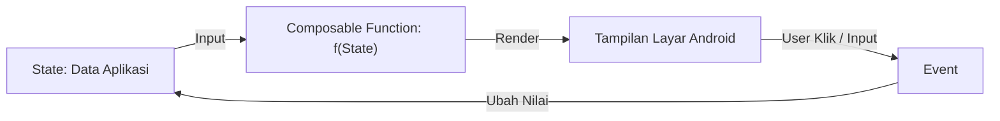
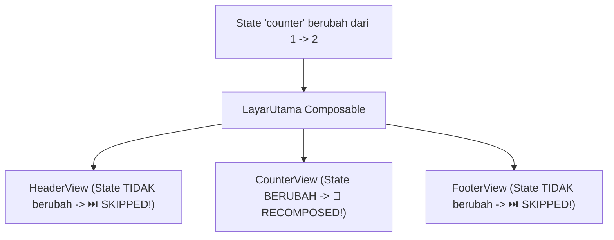

# 📱 Jetpack Compose - Modul 01: Mental Model, Siklus Hidup & Recomposition

Jetpack Compose adalah toolkit modern Google untuk membangun antarmuka pengguna Android secara **deklaratif**. Menggantikan sistem XML View yang sudah berusia belasan tahun, Compose memungkinkan developer mendeskripsikan antarmuka UI murni menggunakan bahasa Kotlin.

---

## 1. Pergeseran Paradigma: Imperatif (XML) vs Deklaratif (Compose)

Di era XML (Imperatif), kita membuat file XML terpisah, memanggil `findViewById()`, lalu secara manual memanggil setter untuk mengubah tampilan (`textView.setText(...)`, `button.setVisibility(View.GONE)`). Pendekatan ini sering memicu inkonsistensi state jika ada data yang lupa di-update.

Di Jetpack Compose (Deklaratif), UI dideskripsikan sebagai **fungsi matematika murni dari State**:

$$\mathbf{UI} = f(\mathbf{State})$$



Ketika nilai State berubah, Compose mengeksekusi ulang fungsi Composable secara otomatis (**Recomposition**) untuk memperbarui elemen layar yang terpengaruh.

---

## 2. Anatomi Fungsi Composable

Setiap fungsi UI di Compose wajib memiliki anotasi **`@Composable`**:

```kotlin
import androidx.compose.material3.Text
import androidx.compose.runtime.Composable

@Composable
fun KartuPengguna(nama: String, role: String) {
    Text(text = "Halo, $nama! Role Anda: $role")
}
```

### Karakteristik Penting Fungsi `@Composable`:
1. **Bisa dipanggil berulang kali dan sangat cepat**: Compose Compiler mengoptimalkan fungsi agar dieksekusi dalam hitungan fraksi milidetik.
2. **Bisa dieksekusi secara paralel**: Composable dapat berjalan di thread background yang berbeda-beda. Hindari membaca variabel global mutable di dalam fungsi!
3. **Bisa dieksekusi dalam urutan sembarang**: Jangan mengasumsikan Composable baris 1 pasti selesai sebelum Composable baris 2.

---

## 3. Rahasia Recomposition & Skipping

**Recomposition** adalah proses pemanggilan ulang fungsi composable ketika input state-nya berubah.

Namun, apakah seluruh layar di-render ulang dari awal? **TIDAK**. 
Compose memiliki fitur **Smart Recomposition (Skipping)**:



Compose Compiler secara cerdas menganalisis parameter fungsi. Jika parameter suatu composable bersifat stabil (*Stable*) dan nilainya tidak berubah sejak recomposition sebelumnya, Compose **melewati (*skips*) fungsi tersebut tanpa biaya CPU sama sekali**!

---

## 4. Manajemen State Lokal: `remember` vs `rememberSaveable`

### A. Mengapa Butuh `remember`?
Karena fungsi composable dipanggil berulang kali saat recomposition, variabel biasa akan ter-reset ke nilai awal setiap kali layar berkedip!
Fungsi **`remember`** bertugas menyimpan objek di dalam memori Composition Tree agar selamat dari recomposition:

```kotlin
@Composable
fun TombolCounter() {
    // remember menyimpan nilai counter di memori Composition:
    var count by remember { mutableStateOf(0) }

    Button(onClick = { count++ }) {
        Text("Diklik $count kali")
    }
}
```

---

### B. Kapan Wajib Menggunakan `rememberSaveable`?
Meskipun `remember` menjaga state selama recomposition, `remember` **AKAN HILANG jika terjadi Configuration Change** (seperti layar diputar dari Portrait ke Landscape, ganti tema Dark Mode, atau Android membunuh proses aplikasi di background / *Process Death*).

Gunakan **`rememberSaveable`** untuk menyimpan state ke dalam Android `Bundle`:

```kotlin
@Composable
fun FormInputNama() {
    // rememberSaveable selamat saat HP diputar ke horizontal (Rotate Screen)!
    var namaInput by rememberSaveable { mutableStateOf("") }

    TextField(
        value = namaInput,
        onValueChange = { namaInput = it },
        label = { Text("Masukkan Nama Anda") }
    )
}
```

| Situasi | Variabel Biasa (`var x = 0`) | `remember { ... }` | `rememberSaveable { ... }` |
|---|---|---|---|
| **Recomposition Layar** | ❌ Ter-reset ke 0 | ✅ **Selamat (Tersimpan)** | ✅ **Selamat (Tersimpan)** |
| **Rotasi Layar (Rotate)** | ❌ Ter-reset ke 0 | ❌ Ter-reset ke 0 | ✅ **Selamat (Tersimpan)** |
| **Process Death (RAM Penuh)** | ❌ Ter-reset ke 0 | ❌ Ter-reset ke 0 | ✅ **Selamat (Tersimpan)** |
