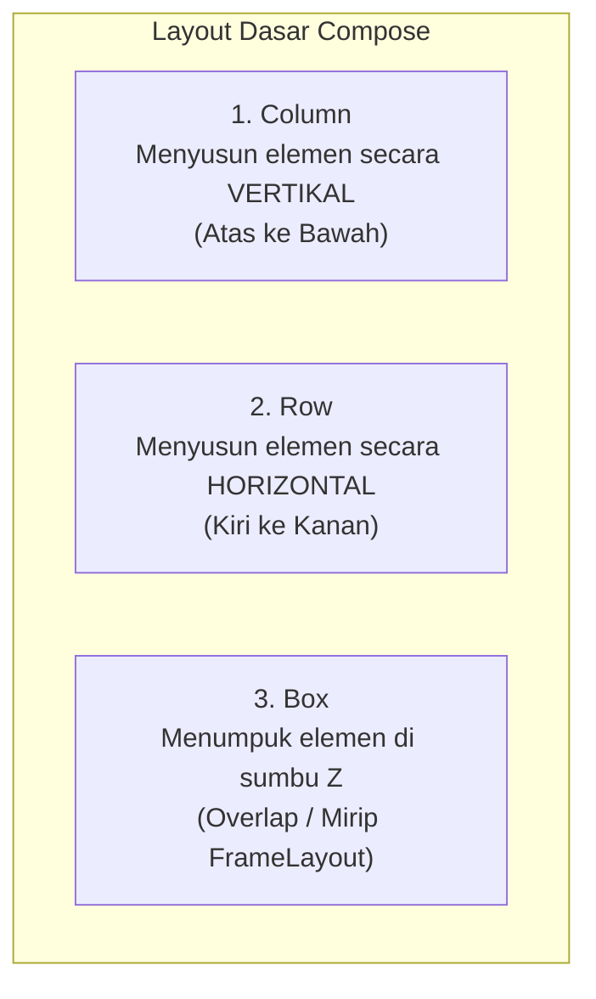
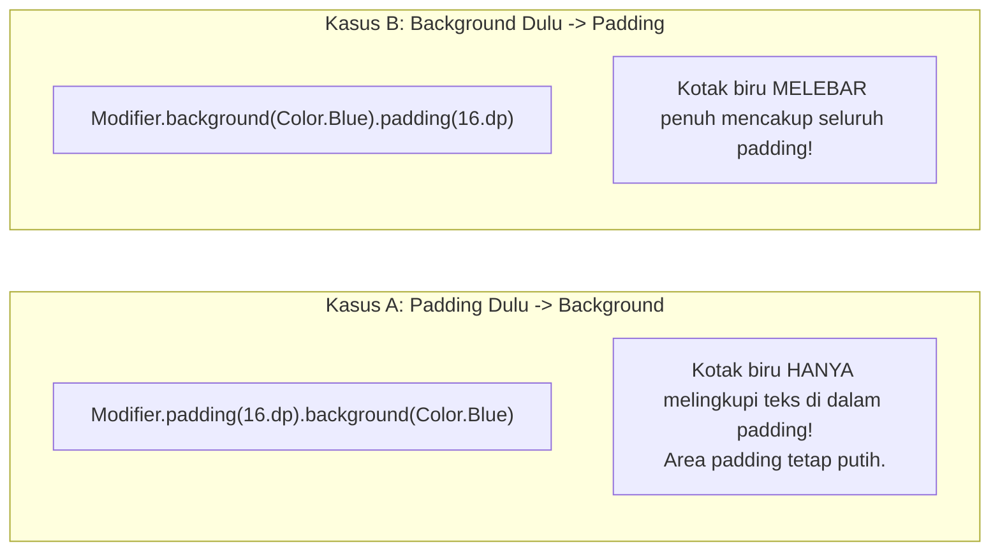

# 📱 Jetpack Compose - Modul 03: Layouts, Modifiers & Scaffold

Di Jetpack Compose, tata letak antarmuka dibangun dengan menyusun komponen penampung dasar (**`Column`**, **`Row`**, **`Box`**), memperkaya perilakunya menggunakan **`Modifier`**, dan membungkus layar dengan arsitektur standar Material Design 3 melalui **`Scaffold`**.

---

## 1. 3 Komponen Penampung Dasar



### A. Column & Row: Alignment vs Arrangement
Seringkali developer pemula bingung membedakan antara *Alignment* dan *Arrangement*:

- **Arrangement**: Mengatur distribusi ruang kosong di sepanjang **Sumbu Utama (*Main Axis*)**.
  - Pada `Column`: Sumbu vertikal (atas-bawah).
  - Pada `Row`: Sumbu horizontal (kiri-kanan).
  - Pilihan populer: `Arrangement.SpaceBetween`, `Arrangement.SpaceEvenly`, `Arrangement.spacedBy(12.dp)`.
- **Alignment**: Mengatur posisi elemen di sepanjang **Sumbu Silang (*Cross Axis*)**.
  - Pada `Column`: Sumbu horizontal (`Alignment.CenterHorizontally`, `Alignment.Start`).
  - Pada `Row`: Sumbu vertikal (`Alignment.CenterVertically`, `Alignment.Bottom`).

```kotlin
Row(
    modifier = Modifier.fillMaxWidth(),
    horizontalArrangement = Arrangement.SpaceBetween, // Main Axis
    verticalAlignment = Alignment.CenterVertically    // Cross Axis
) {
    Text("Total Tagihan")
    Text("Rp 500.000", fontWeight = FontWeight.Bold)
}
```

### B. Box (Menumpuk Elemen di Sumbu Z)
```kotlin
Box(modifier = Modifier.size(200.dp)) {
    // 1. Gambar ditaruh di lapisan terbawah:
    Image(
        painter = painterResource(id = R.drawable.banner),
        contentDescription = "Banner",
        modifier = Modifier.fillMaxSize()
    )

    // 2. Badge diskon ditaruh menumpuk di pojok kanan atas:
    Text(
        text = "DISKON 50%",
        color = Color.White,
        modifier = Modifier
            .align(Alignment.TopEnd)
            .background(Color.Red, shape = RoundedCornerShape(4.dp))
            .padding(horizontal = 8.dp, vertical = 4.dp)
    )
}
```

---

## 2. Aturan Mutlak Modifier Chaining (Urutan Sangat Menentukan!)

Modifier adalah rantai konfigurasi yang diterapkan dari **atas ke bawah (kiri ke kanan)**. Mengubah urutan method modifier akan **mengubah tampilan dan perilaku komponen secara radikal**!



### Perhatikan Urutan Interaksi Klik (`clickable`):
```kotlin
// 1. Ripple Effect Terpotong (Hanya area teks yang bisa diklik):
Text(
    text = "Klik Saya",
    modifier = Modifier
        .clickable { }        // ⚠️ Clickable dipasang SEBELUM padding!
        .padding(24.dp)
)

// 2. Ripple Effect Penuh (Optimal untuk jempol pengguna!):
Text(
    text = "Klik Saya",
    modifier = Modifier
        .padding(24.dp)
        .clickable { }        // ✅ Clickable mencakup seluruh area sentuh!
)
```

---

## 3. Proporsi Fleksibel dengan `Modifier.weight`

Gunakan `.weight()` di dalam `Row` atau `Column` untuk membagi ruang layar secara proporsional mirip flexbox:

```kotlin
Row(modifier = Modifier.fillMaxWidth()) {
    // Kolom kiri mengambil 70% sisa ruang:
    Text("Judul Artikel Panjang", modifier = Modifier.weight(0.7f))

    // Kolom kanan mengambil 30% sisa ruang:
    Button(onClick = { }, modifier = Modifier.weight(0.3f)) {
        Text("Buka")
    }
}
```

---

## 4. Struktur Layar Standar: Scaffold Material 3

`Scaffold` menyediakan kerangka kerja layout Material Design yang terintegrasi rapi dengan TopAppBar, BottomNavigationBar, FloatingActionButton, dan SnackbarHost:

```kotlin
@OptIn(ExperimentalMaterial3Api::class)
@Composable
fun LayarUtamaApp() {
    val snackbarHostState = remember { SnackbarHostState() }
    val scope = rememberCoroutineScope()

    Scaffold(
        topBar = {
            TopAppBar(
                title = { Text("Dev Portal") },
                colors = TopAppBarDefaults.topAppBarColors(
                    containerColor = MaterialTheme.colorScheme.primaryContainer
                )
            )
        },
        bottomBar = {
            NavigationBar {
                NavigationBarItem(
                    selected = true,
                    onClick = { },
                    icon = { Icon(Icons.Default.Home, contentDescription = "Home") },
                    label = { Text("Home") }
                )
            }
        },
        floatingActionButton = {
            FloatingActionButton(onClick = {
                scope.launch {
                    snackbarHostState.showSnackbar("Tombol FAB ditekan!")
                }
            }) {
                Icon(Icons.Default.Add, contentDescription = "Tambah")
            }
        },
        snackbarHost = { SnackbarHost(hostState = snackbarHostState) }
    ) { innerPadding ->
        // ⚠️ SANGAT PENTING: Wajib teruskan innerPadding ke konten utama
        // agar konten tidak tertabrak atau tertutup oleh TopBar / BottomBar!
        Box(
            modifier = Modifier
                .fillMaxSize()
                .padding(innerPadding)
        ) {
            Text("Konten Layar Utama Berada di Sini!")
        }
    }
}
```
