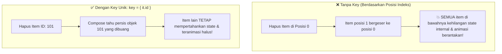

# 📱 Jetpack Compose - Modul 04: Lazy Layouts, Sticky Headers & Paging 3

Jika Anda memiliki 5.000 item data, menampilkannya di dalam `Column` biasa akan membuat aplikasi Android langsung mengalami **Out of Memory (OOM) Crash**, karena `Column` me-render seluruh 5.000 composable ke memori sekaligus. 

Solusinya adalah **Lazy Layouts** (`LazyColumn`, `LazyRow`, `LazyVerticalGrid`) yang hanya memproses item yang **sedang terlihat di layar kaca HP pengguna**.

---

## 1. Anatomi Pengganti RecyclerView: `LazyColumn`

Lupakan era kelam di mana Anda harus menulis ratusan baris XML, Adapter class, `onCreateViewHolder`, dan `onBindViewHolder`. Di Compose, menampilkan daftar jutaan baris data semudah ini:

```kotlin
import androidx.compose.foundation.lazy.LazyColumn
import androidx.compose.foundation.lazy.items

@Composable
fun DaftarKontakList(kontakList: List<KontakModel>) {
    LazyColumn(
        modifier = Modifier.fillMaxSize(),
        contentPadding = PaddingValues(16.dp),
        verticalArrangement = Arrangement.spacedBy(8.dp)
    ) {
        // 1. Header statis:
        item {
            Text("Daftar Teman", style = MaterialTheme.typography.headlineMedium)
        }

        // 2. Daftar berulang dinamis:
        items(
            items = kontakList,
            key = { kontak -> kontak.id } // ⚠️ SANGAT PENTING: Kunci Unik!
        ) { kontak ->
            ItemKontakCard(kontak = kontak)
        }
    }
}
```

---

## 2. Mengapa Parameter `key = { ... }` Wajib Hukumnya?

Secara default, jika Anda tidak menyediakan parameter `key`, Compose membedakan item berdasarkan **posisi indeks integer (0, 1, 2, ...)**.



### Animasi Pergeseran Otomatis (`animateItem`):
Mulai Compose 1.7+, cukup tambahkan modifier ini agar item yang berpindah posisi teranimasi secara otomatis:
```kotlin
items(kontakList, key = { it.id }) { kontak ->
    ItemKontakCard(
        kontak = kontak,
        modifier = Modifier.animateItem() // Animasi halus saat list di-reorder atau dihapus!
    )
}
```

---

## 3. Fitur Canggih: Sticky Headers

Menampilkan header yang menempel di bagian paling atas layar saat user melakukan scrolling (seperti pengelompokan tanggal transaksi atau abjad kontak telepon):

```kotlin
@OptIn(ExperimentalFoundationApi::class)
@Composable
fun TransaksiGroupedScreen(transaksiMap: Map<String, List<Transaksi>>) {
    LazyColumn {
        transaksiMap.forEach { (tanggal, daftarTransaksi) ->
            // Sticky Header menempel di atas saat di-scroll:
            stickyHeader {
                Text(
                    text = tanggal,
                    modifier = Modifier
                        .fillMaxWidth()
                        .background(MaterialTheme.colorScheme.surfaceVariant)
                        .padding(8.dp),
                    fontWeight = FontWeight.Bold
                )
            }

            items(daftarTransaksi, key = { it.id }) { trx ->
                ItemTransaksiRow(trx)
            }
        }
    }
}
```

---

## 4. Mengontrol & Memantau Posisi Scroll (`LazyListState`)

```kotlin
@Composable
fun LayarDenganScrollToTop() {
    val listState = rememberLazyListState()
    val scope = rememberCoroutineScope()

    // Tampilkan tombol "Kembali ke Atas" hanya jika user sudah scroll melewati item ke-5:
    val showButton by remember {
        derivedStateOf { listState.firstVisibleItemIndex > 5 }
    }

    Box(modifier = Modifier.fillMaxSize()) {
        LazyColumn(state = listState) {
            items(100) { Text("Baris Data ke-$it", modifier = Modifier.padding(16.dp)) }
        }

        if (showButton) {
            FloatingActionButton(
                onClick = {
                    scope.launch {
                        // Scroll halus kembali ke baris paling atas:
                        listState.animateScrollToItem(index = 0)
                    }
                },
                modifier = Modifier.align(Alignment.BottomEnd).padding(16.dp)
            ) {
                Icon(Icons.Default.KeyboardArrowUp, contentDescription = "Top")
            }
        }
    }
}
```

---

## 5. Infinite Scroll / Pagination dengan AndroidX Paging 3

Untuk memuat data dari REST API secara bertahap (misal 20 item per halaman saat user mencapai dasar layar):

```kotlin
// build.gradle.kts:
// implementation("androidx.paging:paging-compose:3.3.4")

@Composable
fun PagingProductScreen(viewModel: ProductPagingViewModel = hiltViewModel()) {
    // 1. Ubah Flow PagingData menjadi LazyPagingItems:
    val products = viewModel.productFlow.collectAsLazyPagingItems()

    LazyColumn {
        items(
            count = products.itemCount,
            key = { index -> products[index]?.id ?: index }
        ) { index ->
            val product = products[index]
            if (product != null) {
                ProductCard(product)
            }
        }

        // 2. Tangani Loading State saat halaman berikutnya sedang dimuat di bawah:
        when (products.loadState.append) {
            is LoadState.Loading -> {
                item {
                    CircularProgressIndicator(
                        modifier = Modifier.fillMaxWidth().padding(16.dp).wrapContentWidth()
                    )
                }
            }
            is LoadState.Error -> {
                item {
                    Button(onClick = { products.retry() }) {
                        Text("Gagal memuat halaman berikutnya. Coba Lagi")
                    }
                }
            }
            else -> {}
        }
    }
}
```
