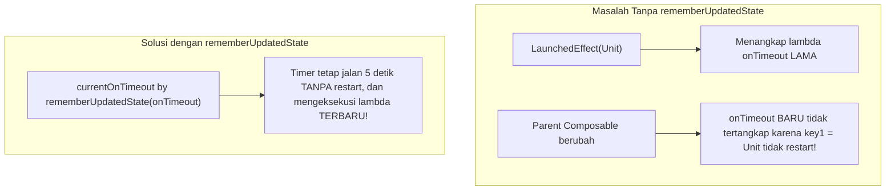

# 📱 Jetpack Compose - Modul 05: Side Effects & Lifecycle Awareness

Fungsi Composable idealnya adalah fungsi murni (*Pure Function*): hanya menerima state dan merender UI. Namun, aplikasi nyata membutuhkan **Efek Samping (*Side Effects*)**, seperti memicu panggilan REST API saat layar pertama kali dibuka, menampilkan Snackbar, atau mendengarkan sensor GPS.

---

## 1. Matriks 5 Effect Handlers Jetpack Compose

| Handler | Sifat Eksekusi | Kapan Dibatalkan / Restart? | Kasus Penggunaan Utama |
|---|---|---|---|
| **`LaunchedEffect`** | Coroutine Asinkron | Dibatalkan saat `key` berubah atau composable meninggalkan layar. | Memuat data API saat layar dibuka, animasi awal, timer. |
| **`rememberCoroutineScope`** | Coroutine Scope | Terikat pada siklus hidup Composition pemanggil. | Memulai coroutine dari event klik tombol (`onClick = { scope.launch { ... } }`). |
| **`DisposableEffect`** | Sinkron dengan Cleanup | Menjalankan blok **`onDispose`** saat `key` berubah / keluar. | Registrasi BroadcastReceiver, Sensor, Observer Lifecycle. |
| **`rememberUpdatedState`** | Helper State | Tidak pernah me-restart efek samping yang sedang berjalan. | Menangkap lambda callback terbaru di dalam `LaunchedEffect` berdurasi panjang. |
| **`SideEffect`** | Sinkron Setiap Recompose | Dijalankan setiap kali recomposition berhasil diselesaikan. | Sinkronisasi state Compose ke library eksternal non-Compose (Analytics, Firebase). |

---

## 2. Praktik Kasus Nyata

### A. `LaunchedEffect`: Memuat Data & Menampilkan Snackbar
`LaunchedEffect` akan berjalan saat composable pertama kali memasuki Composition Tree. Jika parameter `key1` berubah, coroutine lama **akan otomatis dibatalkan** dan coroutine baru dimulai!

```kotlin
@Composable
fun HalamanDetailUser(userId: String, viewModel: UserViewModel) {
    val snackbarHostState = remember { SnackbarHostState() }

    // 1. Panggil fetchUser saat userId berubah:
    LaunchedEffect(key1 = userId) {
        viewModel.fetchUserById(userId)
    }

    // 2. Dengarkan One-off Event Channel dari ViewModel:
    LaunchedEffect(key1 = Unit) { // Unit = Hanya dijalankan SEKALI seumur hidup layar
        viewModel.eventFlow.collect { pesan ->
            snackbarHostState.showSnackbar(pesan)
        }
    }
}
```

---

### B. `rememberCoroutineScope`: Menjalankan Asinkron dari Tombol
Anda **tidak boleh** memanggil fungsi suspend langsung di dalam lambda klik tombol biasa. Gunakan `rememberCoroutineScope`:

```kotlin
@Composable
fun TombolSimpanData(onSimpan: suspend () -> Unit) {
    // Ambil coroutine scope yang aman:
    val coroutineScope = rememberCoroutineScope()
    var isLoading by remember { mutableStateOf(false) }

    Button(
        onClick = {
            // Luncurkan coroutine dari lambda tombol:
            coroutineScope.launch {
                isLoading = true
                onSimpan()
                isLoading = false
            }
        }
    ) {
        if (isLoading) CircularProgressIndicator() else Text("Simpan")
    }
}
```

---

### C. `DisposableEffect`: Pembersihan Resource Terjamin
Jika efek samping Anda membutuhkan proses pembersihan (*Teardown / Unregister*), gunakan `DisposableEffect`:

```kotlin
@Composable
fun SensorMonitor(context: Context) {
    DisposableEffect(key1 = context) {
        val sensorManager = context.getSystemService(Context.SENSOR_SERVICE) as SensorManager
        val sensor = sensorManager.getDefaultSensor(Sensor.TYPE_ACCELEROMETER)
        
        val listener = object : SensorEventListener {
            override fun onSensorChanged(event: SensorEvent?) { /* Baca koordinat */ }
            override fun onAccuracyChanged(sensor: Sensor?, accuracy: Int) {}
        }

        // 1. Registrasi sensor:
        sensorManager.registerListener(listener, sensor, SensorManager.SENSOR_DELAY_UI)

        // 2. Blok Wajib: Bersihkan sensor saat composable dihancurkan!
        onDispose {
            sensorManager.unregisterListener(listener)
            println("Sensor listener berhasil dicabut (Aman dari memory leak)!")
        }
    }
}
```

---

### D. Penyelamat Callback: `rememberUpdatedState`

Bayangkan skenario ini: Anda memiliki `LaunchedEffect` dengan timer 5 detik, namun parameter callback `onTimeout` yang dioper dari parent berubah di detik ke-2:



```kotlin
@Composable
fun SplashTimerScreen(onTimeout: () -> Unit) {
    // Selalu referensikan lambda terbaru tanpa memicu restart timer!
    val currentOnTimeout by rememberUpdatedState(onTimeout)

    LaunchedEffect(key1 = Unit) {
        delay(5000)
        currentOnTimeout() // Memanggil versi paling mutakhir dari onTimeout!
    }
}
```

---

### E. Lifecycle Event Awareness (AndroidX Lifecycle 2.8+)
Mendengarkan event siklus hidup Activity/Fragment secara deklaratif:

```kotlin
import androidx.lifecycle.compose.LifecycleEventEffect
import androidx.lifecycle.Lifecycle

@Composable
fun VideoPlayerScreen(player: VideoPlayer) {
    // Otomatis resume video saat aplikasi aktif kembali:
    LifecycleEventEffect(Lifecycle.Event.ON_RESUME) {
        player.play()
    }

    // Otomatis pause video saat user beralih ke aplikasi lain:
    LifecycleEventEffect(Lifecycle.Event.ON_PAUSE) {
        player.pause()
    }
}
```
