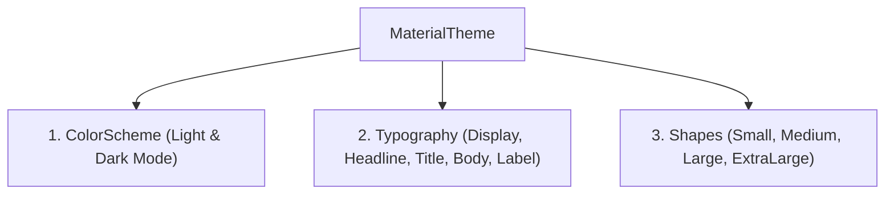
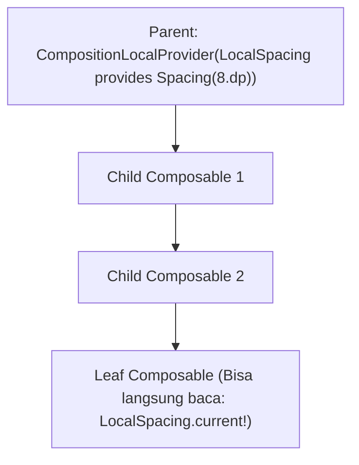

# 📱 Jetpack Compose - Modul 07: Theming Material 3 & CompositionLocal

Desain antarmuka modern di Android bertumpu pada **Material Design 3 (M3)**. Di Jetpack Compose, sistem tema tidak lagi diatur melalui XML styles yang membingungkan, melainkan menggunakan struktur kode Kotlin yang fleksibel dan mendukung warna dinamis (*Dynamic Theming*) yang menyesuaikan wallpaper pengguna.

---

## 1. Tiga Pilar Material Design 3 (M3)



### A. Mengatur ColorScheme & Dynamic Colors (Android 12+)
Mulai Android 12+, sistem dapat mengekstrak palet warna dari wallpaper pengguna (**Material You Dynamic Colors**):

```kotlin
import androidx.compose.material3.*
import androidx.compose.runtime.Composable
import androidx.compose.ui.platform.LocalContext
import android.os.Build

private val DarkColorScheme = darkColorScheme(
    primary = Color(0xFFD0BCFF),
    secondary = Color(0xFFCCC2DC),
    background = Color(0xFF1C1B1F)
)

private val LightColorScheme = lightColorScheme(
    primary = Color(0xFF6650A4),
    secondary = Color(0xFF625B71),
    background = Color(0xFFFFFBFE)
)

@Composable
fun AppTheme(
    darkTheme: Boolean = isSystemInDarkTheme(),
    dynamicColor: Boolean = true, // Fitur Material You
    content: @Composable () -> Unit
) {
    val colorScheme = when {
        // Jika HP mendukung Material You (Android 12+ / API 31+):
        dynamicColor && Build.VERSION.SDK_INT >= Build.VERSION_CODES.S -> {
            val context = LocalContext.current
            if (darkTheme) dynamicDarkColorScheme(context) else dynamicLightColorScheme(context)
        }
        darkTheme -> DarkColorScheme
        else -> LightColorScheme
    }

    MaterialTheme(
        colorScheme = colorScheme,
        typography = AppTypography,
        shapes = AppShapes,
        content = content
    )
}
```

---

## 2. Mengakses Token Tema di Layar

Gunakan objek singleton **`MaterialTheme`** untuk membaca nilai warna dan tipografi saat ini. Komponen Anda otomatis beradaptasi saat pengguna beralih antara Light dan Dark mode:

```kotlin
@Composable
fun KartuInfo() {
    Card(
        colors = CardDefaults.cardColors(
            containerColor = MaterialTheme.colorScheme.surfaceVariant
        ),
        shape = MaterialTheme.shapes.medium
    ) {
        Column(modifier = Modifier.padding(16.dp)) {
            Text(
                text = "Judul Berita",
                style = MaterialTheme.typography.titleLarge,
                color = MaterialTheme.colorScheme.onSurfaceVariant
            )
            Text(
                text = "Deskripsi singkat isi berita...",
                style = MaterialTheme.typography.bodyMedium
            )
        }
    }
}
```

---

## 3. Deep Dive: `CompositionLocal`

Bayangkan jika Anda memiliki objek `UserSession` atau konfigurasi `Spacing` kustom. Apakah Anda harus mengoper objek tersebut sebagai parameter melalui 10 tingkat fungsi Composable bersarang (*Prop Drilling*)? **TENTU TIDAK**.

**`CompositionLocal`** adalah mekanisme untuk mengalirkan data secara implisit ke seluruh cabang Composition Tree di bawahnya.



---

### A. Membuat `CompositionLocal` Kustom
Ada dua jenis pembuatan CompositionLocal:
1. **`compositionLocalOf`**: Jika nilai yang di-provide berubah, **hanya Composable yang membaca `.current` yang akan di-recompose**.
2. **`staticCompositionLocalOf`**: Jika nilai yang di-provide berubah, **SELURUH pohon Composable di bawahnya akan di-recompose**. Gunakan ini untuk data yang hampir tidak pernah berubah saat runtime (seperti Spacing atau Dimensi).

```kotlin
// 1. Definisikan Data Spacing:
data class AppSpacing(
    val default: Dp = 0.dp,
    val small: Dp = 8.dp,
    val medium: Dp = 16.dp,
    val large: Dp = 24.dp
)

// 2. Buat CompositionLocal menggunakan staticCompositionLocalOf:
val LocalAppSpacing = staticCompositionLocalOf { AppSpacing() }

// 3. Inject nilai di root tema:
@Composable
fun AppThemeWithSpacing(content: @Composable () -> Unit) {
    CompositionLocalProvider(LocalAppSpacing provides AppSpacing()) {
        content()
    }
}

// 4. Baca di Composable mana saja sedalam apa pun tanpa oper parameter:
@Composable
fun TombolKustom() {
    val spacing = LocalAppSpacing.current

    Box(modifier = Modifier.padding(spacing.medium)) {
        Text("Tombol dengan spacing standar!")
    }
}
```

### B. CompositionLocal Bawaan Android yang Sering Digunakan:
- **`LocalContext.current`**: Mengambil `Context` Android untuk memanggil Intent atau Toast.
- **`LocalConfiguration.current`**: Membaca orientasi layar (Portrait/Landscape) dan dimensi lebar layar dalam `dp`.
- **`LocalFocusManager.current`**: Menutup keyboard virtual Android (`focusManager.clearFocus()`).
