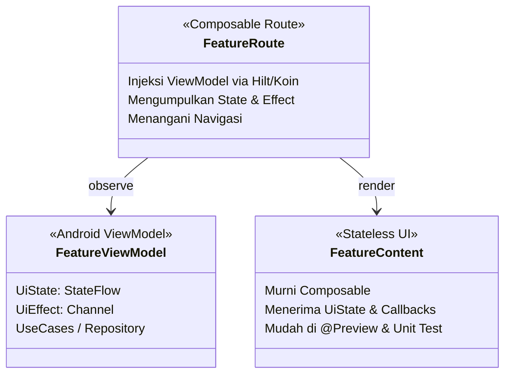

# 📱 Jetpack Compose - Modul 09: Navigation Type-Safe & Clean Architecture

Di era Navigation Compose versi awal, developer harus menulis rute navigasi menggunakan teks URL rentan typo (`"detail_user/{userId}?isVip={isVip}"`) dan melakukan parsing manual bundle argumen. 

Mulai **Navigation Compose 2.8+**, Google memperkenalkan **Type-Safe Navigation** penuh berbasis pustaka `kotlinx.serialization`.

---

## 1. Type-Safe Navigation 2.8+ (Bebas String Route Typo!)

```mermaid
flowchart LR
    Route["@Serializable data class DetailRoute(val id: Int, val title: String)"]
    
    Route -->|navController.navigate(DetailRoute(10, 'MacBook'))| NavHost
    NavHost -->|backStackEntry.toRoute[DetailRoute]()| Screen["DetailScreen (Menerima Objek Langsung Type-Safe!)"]
```

### A. Mendefinisikan Rute sebagai Objek `@Serializable`
```kotlin
// build.gradle.kts:
// implementation("androidx.navigation:navigation-compose:2.8.5")
// implementation("org.jetbrains.kotlinx:kotlinx-serialization-json:1.7.3")

import kotlinx.serialization.Serializable

// 1. Rute tanpa argumen (Gunakan Object):
@Serializable
object HomeRoute

// 2. Rute dengan parameter argumen (Gunakan Data Class):
@Serializable
data class DetailProductRoute(
    val idProduk: Long,
    val namaProduk: String,
    val harga: Double
)

@Serializable
data class ProfileRoute(val userId: String)
```

---

### B. Membangun NavHost Type-Safe
```kotlin
import androidx.compose.runtime.Composable
import androidx.navigation.compose.*
import androidx.navigation.toRoute

@Composable
fun AppNavigation() {
    val navController = rememberNavController()

    NavHost(
        navController = navController,
        startDestination = HomeRoute
    ) {
        // Layar 1: Home
        composable<HomeRoute> {
            HomeScreen(
                onProductClick = { produk ->
                    // Navigasi ke detail dengan passing objek utuh:
                    navController.navigate(
                        DetailProductRoute(
                            idProduk = produk.id,
                            namaProduk = produk.nama,
                            harga = produk.harga
                        )
                    )
                }
            )
        }

        // Layar 2: Detail Produk
        composable<DetailProductRoute> { backStackEntry ->
            // Ekstrak parameter otomatis dengan toRoute():
            val detail: DetailProductRoute = backStackEntry.toRoute()

            DetailProductScreen(
                id = detail.idProduk,
                nama = detail.namaProduk,
                harga = detail.harga,
                onBackClick = { navController.popBackStack() }
            )
        }
    }
}
```

---

## 2. Arsitektur Clean Code di Presentation Layer Compose

Struktur modular profesional membagi setiap fitur menjadi 3 lapisan:



### A. Komponen Stateless Content (Mudah Di-test & Preview)
```kotlin
@Composable
fun ProductDetailContent(
    uiState: ProductDetailUiState,
    onBeliClick: () -> Unit,
    modifier: Modifier = Modifier
) {
    Scaffold { padding ->
        Column(modifier = modifier.padding(padding).padding(16.dp)) {
            Text(text = uiState.nama, style = MaterialTheme.typography.headlineMedium)
            Text(text = "Rp ${uiState.harga}", color = MaterialTheme.colorScheme.primary)
            Spacer(modifier = Modifier.height(24.dp))
            Button(onClick = onBeliClick, modifier = Modifier.fillMaxWidth()) {
                Text("Beli Sekarang")
            }
        }
    }
}

// Preview Instan di Android Studio:
@Preview(showBackground = true)
@Composable
private fun ProductDetailPreview() {
    MaterialTheme {
        ProductDetailContent(
            uiState = ProductDetailUiState(nama = "MacBook Air M3", harga = 18500000.0),
            onBeliClick = { }
        )
    }
}
```

### B. Komponen Stateful Route (Konektor Navigasi & ViewModel)
```kotlin
@Composable
fun ProductDetailRoute(
    idProduk: Long,
    onNavigateBack: () -> Unit,
    viewModel: ProductDetailViewModel = hiltViewModel() // Injeksi Hilt
) {
    val uiState by viewModel.uiState.collectAsStateWithLifecycle()

    LaunchedEffect(key1 = idProduk) {
        viewModel.loadDetail(idProduk)
    }

    ProductDetailContent(
        uiState = uiState,
        onBeliClick = { viewModel.beliProduk() }
    )
}
```
Arsitektur ini memisahkan logika Android framework dari tampilan UI murni, menghasilkan kode yang rapi, modular, dan $100\%$ siap dites dalam pipeline CI/CD!
