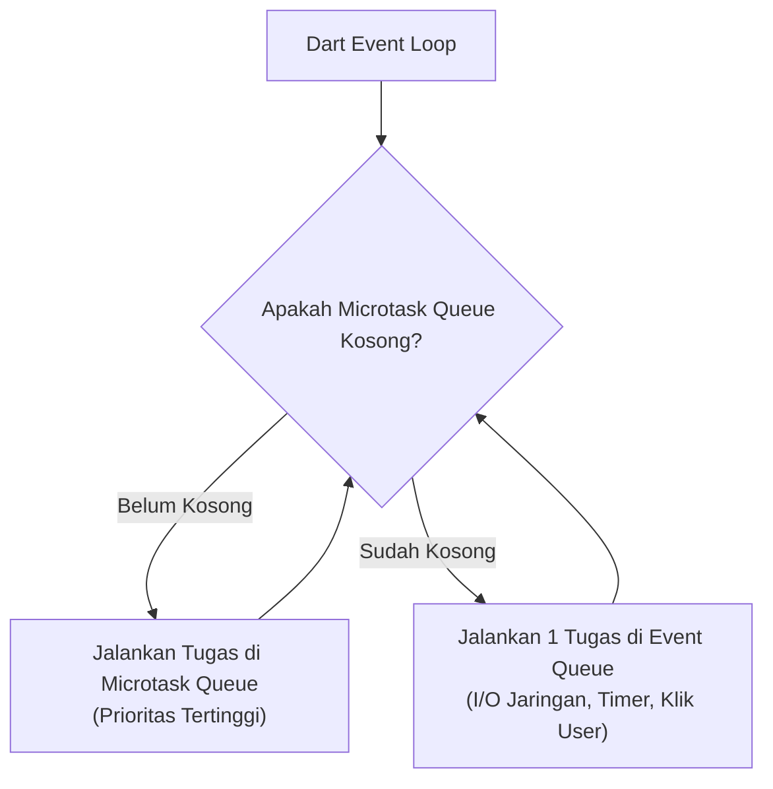

# 🎯 Dart - Modul 06: Asynchronous Event Loop, Streams & Error Zones

Dart berjalan dalam model **Single-Threaded Event Loop**. Namun berkat arsitektur antrean ganda (*Dual-Queue Architecture*) dan pemrograman reaktif **Streams**, Dart mampu menangani ribuan animasi 120 FPS dan request jaringan simultan tanpa lag.

---

## 1. Arsitektur Event Loop: Microtask Queue vs Event Queue

Event Loop di Dart memproses dua jenis antrean dengan aturan prioritas kaku:



1. **Microtask Queue (Prioritas #1)**: Tugas internal yang sangat mendesak dan harus diselesaikan sesegera mungkin sebelum merender UI (`scheduleMicrotask()`).
2. **Event Queue (Prioritas #2)**: Event eksternal seperti klik tombol pengguna, pesan soket jaringan, baca file disk, dan timer `Future.delayed`.

---

## 2. Futures & Konkurensi Paralel (`Future.wait`)

`Future` merepresentasikan nilai yang akan tersedia di masa depan:

```dart
Future<String> downloadFile(String url) async {
  await Future.delayed(const Duration(milliseconds: 200)); // Simulasi I/O
  return "Konten dari $url";
}

void main() async {
  // Mengeksekusi banyak panggilan jaringan secara paralel (Paralel Execution):
  final hasil = await Future.wait([
    downloadFile("https://api.com/user"),
    downloadFile("https://api.com/produk"),
    downloadFile("https://api.com/banner"),
  ]);

  print("Semua data selesai diambil serentak: ${hasil.length} items");
}
```

---

## 3. Reactive Programming dengan `Stream`

Jika `Future` mengembalikan **1 nilai tunggal**, maka `Stream` mengembalikan **aliran banyak nilai dari waktu ke waktu** (seperti detak sensor GPS, chat WebSocket, atau aliran audio):

### A. Generator Stream (`async*` dan `yield`)
```dart
Stream<int> generatorHitungMundur(int max) async* {
  for (int i = max; i >= 0; i--) {
    await Future.delayed(const Duration(seconds: 1));
    yield i; // Memancarkan nilai ke stream setiap 1 detik
  }
}

// Konsumsi stream dengan 'await for':
void jalankanTimer() async {
  await for (var sisaDetik in generatorHitungMundur(3)) {
    print("Sisa waktu: $sisaDetik detik");
  }
}
```

### B. `StreamController`: Membangun Event Bus Manual
```dart
import 'dart:async';

final controller = StreamController<String>.broadcast(); // Broadcast mengizinkan banyak listener

// Tambahkan data ke Sink:
controller.sink.add("Notifikasi Baru");

// Dengarkan data:
final subscription = controller.stream
    .where((pesan) => pesan.isNotEmpty)
    .listen((pesan) {
      print("Diterima: $pesan");
    });

// Wajib tutup controller saat widget di-dispose agar tidak memory leak!
// controller.close();
```

---

## 4. Global Crash Boundary: `runZonedGuarded`

Di Flutter, error asinkron yang tidak tertangkap oleh `try-catch` (misal: di dalam callback timer atau thread isolat) bisa membuat aplikasi tertutup mendadak.

Bungkus `runApp()` dengan **`runZonedGuarded`** untuk menangkap 100% crash dan mengirimkannya ke Sentry atau Firebase Crashlytics:

```dart
import 'dart:async';
import 'package:flutter/material.dart';

void main() {
  runZonedGuarded(() async {
    WidgetsFlutterBinding.ensureInitialized();
    runApp(const MyApp());
  }, (error, stackTrace) {
    // SEMUA UNHANDLED ASYNC CRASH DI APLIKASI AKAN TERTANGKAP DI SINI:
    print("🚨 TERDETEKSI GLOBAL CRASH: $error");
    kirimKeSentry(error, stackTrace);
  });
}
```
