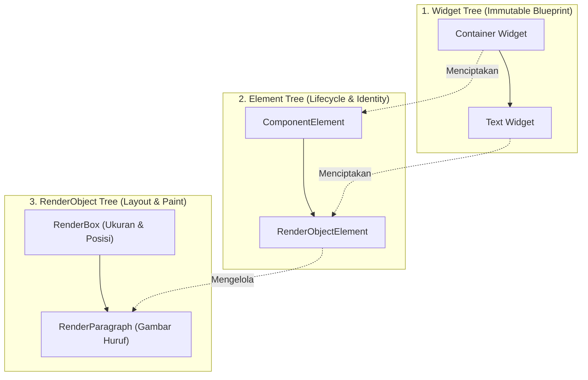
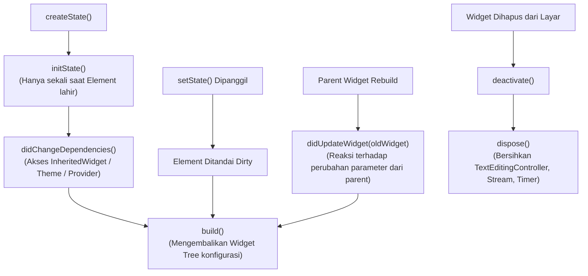

# 🎨 Flutter - Modul 01: Anatomi Tiga Pohon: Widget, Element & RenderObject

Slogan Flutter yang paling terkenal adalah *"Everything is a Widget"*. Namun untuk memahami bagaimana Flutter bisa merender 120 FPS tanpa lag, kamu harus membedah arsitektur internal di baliknya: **Flutter memiliki TIGA POHON yang bekerja bersamaan**.

---

## 1. Arsitektur Tiga Pohon (The Three Trees)



| Pohon | Sifat | Tanggung Jawab | Siklus Hidup |
|---|---|---|---|
| **Widget Tree** | **Immutable (Kekal)** & Sangat Ringan | Berisi konfigurasi dan parameter deklaratif UI. | Dibuat dan dihancurkan berulang kali di memori setiap frame (*cheap allocation*). |
| **Element Tree** | **Mutable** | Menghubungkan Widget dengan RenderObject, mengelola *State* (`StatefulElement`), dan menentukan apakah UI perlu di-rebuild. | **Hidup lama (*Persistent*)**, mempertahankan posisi di pohon memori. |
| **RenderObject Tree** | **Mutable & Berat** | Menghitung kalkulasi geometri fisik layout (*Sizing*, *Positioning*) dan menggambar piksel (*Painting*) ke layar GPU. | Hanya diperbarui jika ukuran atau tampilan benar-benar berubah (*expensive*). |

---

## 2. Mekanisme Rekonsiliasi: `Widget.canUpdate`

Saat kamu memanggil `setState()`, Flutter **tidak menghancurkan seluruh pohon rendering**. Flutter menjalankan method `Widget.canUpdate`:

```dart
// Di dalam source code framework Flutter (framework.dart):
static bool canUpdate(Widget oldWidget, Widget newWidget) {
  return oldWidget.runtimeType == newWidget.runtimeType
      && oldWidget.key == newWidget.key;
}
```

- Jika `runtimeType` dan `key` sama: Element **TETAP HIDUP**, dan hanya memperbarui referensi konfigurasi ke Widget baru.
- RenderObject yang mendasarinya **hanya diperbarui nilainya (*update slot*) tanpa perlu alokasi ulang**. Inilah rahasia performa super Flutter!

---

## 3. Siklus Hidup Lengkap `StatefulWidget`



> [!CAUTION]
> **Aturan Wajib `dispose()`**:
> Selalu batalkan semua `StreamSubscription`, matikan `AnimationController`, dan panggil `.dispose()` pada `TextEditingController` serta `ScrollController` di dalam method `dispose()`. Mengabaikan langkah ini akan memicu kebocoran memori parah (*Memory Leak*) di HP pengguna!
