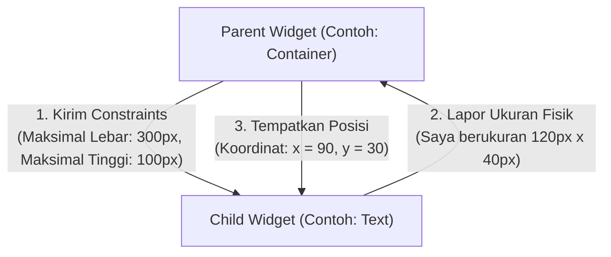
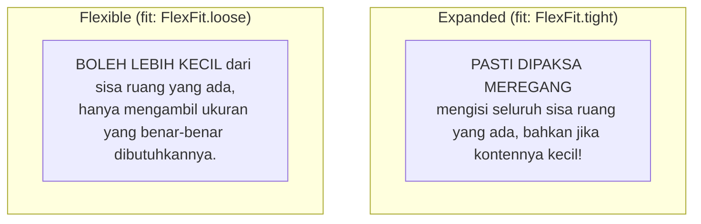

# 🎨 Flutter - Modul 02: Layout Constraints & Solusi RenderFlex Overflowed

Kesalahan paling umum yang dihadapi developer Flutter adalah munculnya **garis kuning-hitam garis zebra (*Yellow-Black Hazard Tape*)** di layar yang bertuliskan:
```text
A RenderFlex overflowed by 48 pixels on the right.
```
Memahami model tata letak (*Layout Engine*) Flutter adalah kunci menghapus error ini selamanya.

---

## 1. Aturan Emas Tata Letak Flutter (The Golden Rule)

Hafalkan 3 kalimat sakti ini:
> 1. **Constraints go down** (Parent mengirimkan batasan ukuran ke Anak).
> 2. **Sizes go up** (Anak memutuskan ukurannya sendiri berdasarkan batasan tersebut dan melapor ke Parent).
> 3. **Parent sets position** (Parent menentukan koordinat posisi X dan Y anak di layar).



---

## 2. Tight vs Loose Constraints

- **Tight Constraints**: Nilai minimum sama persis dengan nilai maksimum (`minWidth == maxWidth` dan `minHeight == maxHeight`). Anak dipaksa memiliki ukuran yang kaku (misal: layar penuh HP).
- **Loose Constraints**: Nilai minimum adalah 0 (`minWidth == 0`). Anak bebas memiliki ukuran sekecil apa pun asalkan tidak melebihi batas maksimum.
- **Unbounded Constraints**: Nilai maksimum adalah **`double.infinity`** (Tidak terbatas). Ini adalah kondisi default di dalam arah gulir `ListView` atau `SingleChildScrollView`.

> [!CAUTION]
> **Penyebab Error: "Vertical viewport was given unbounded height"**:
> Terjadi saat kamu memasukkan `ListView` di dalam `Column`. `Column` tidak membatasi tinggi anaknya (unbounded), sementara `ListView` ingin meregang setinggi mungkin hingga tak hingga. Keduanya bertabrakan!
> 
> **Solusi**: Bungkus `ListView` anak dengan widget **`Expanded`** atau berikan tinggi kaku dengan **`SizedBox(height: 300, child: ...)`**.

---

## 3. Bedah Solusi: `RenderFlex overflowed on the right`

Penyebab: Kamu menaruh teks panjang di dalam `Row`. `Row` tidak membatasi lebar anaknya secara default, sehingga saat teks melebihi lebar layar HP, teks meluber keluar layar:

```dart
// KODE YANG CRASH OVERFLOW:
Row(
  children: [
    Icon(Icons.person),
    Text("Nama yang sangat panjang sekali hingga melewati batas layar handphone"), // CRASH!
  ],
)

// SOLUSI BENAR: Bungkus dengan EXPANDED
Row(
  children: [
    Icon(Icons.person),
    Expanded( // Membatasi teks hanya boleh menggunakan sisa ruang layar yang tersedia!
      child: Text(
        "Nama yang sangat panjang sekali hingga melewati batas layar handphone",
        overflow: TextOverflow.ellipsis, // Tambahkan titik-titik (...) jika kepotong
        maxLines: 1,
      ),
    ),
  ],
)
```

---

## 4. `Expanded` vs `Flexible`: Apa Bedanya?

Keduanya digunakan di dalam `Row`, `Column`, atau `Flex`, namun memiliki perilaku `FlexFit` yang berbeda:



### Mengontrol Rasio Lebar dengan Argumen `flex`:
```dart
Row(
  children: [
    Expanded(
      flex: 2, // Mengambil 2/3 (66.6%) lebar layar
      child: Container(color: Colors.red),
    ),
    Expanded(
      flex: 1, // Mengambil 1/3 (33.3%) lebar layar
      child: Container(color: Colors.blue),
    ),
  ],
)
```

---

## 5. Mengatasi Overflow Dinamis Banyak Elemen: `Wrap`

Jika kamu memiliki kumpulan tombol filter (Chips) yang jumlah dan panjangnya dinamis, jangan gunakan `Row`! Gunakan widget **`Wrap`** yang otomatis memindahkan elemen ke baris baru saat horizontal penuh:

```dart
Wrap(
  spacing: 8.0, // Jarak horizontal antar chip
  runSpacing: 4.0, // Jarak vertikal antar baris baru
  children: [
    Chip(label: Text("Flutter")),
    Chip(label: Text("Golang")),
    Chip(label: Text("PostgreSQL")),
    Chip(label: Text("Terraform")),
    Chip(label: Text("Kubernetes")),
  ],
)
```
