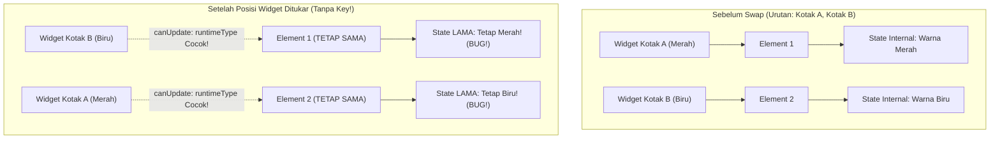
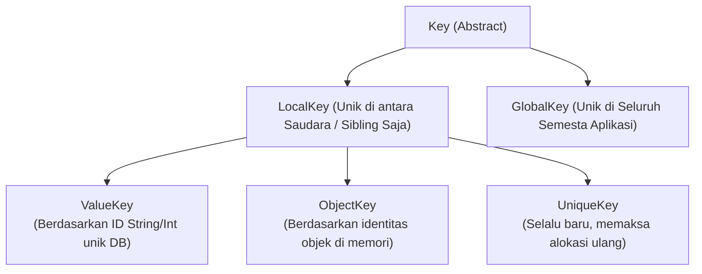

# 🎨 Flutter - Modul 04: Keys, State Preservation & GlobalKey Mechanics

Sebagian besar waktu, kamu tidak perlu menulis parameter `key` di Flutter. Namun saat kamu mulai memanipulasi koleksi widget yang memiliki status (*StatefulWidget*)—seperti menghapus item dari list, mengurutkan ulang (*reordering*), atau memindahkan video player ke layar penuh tanpa memutus playback—**Keys adalah satu-satunya penyelamat agar state tidak tertukar atau hilang**.

---

## 1. Eksperimen Klasik: Mengapa Kita Butuh Keys?

Bayangkan kamu memiliki daftar dua kotak warna yang memiliki state internal:



### Penjelasan Bug:
Ingat kembali aturan `Widget.canUpdate`:
```dart
oldWidget.runtimeType == newWidget.runtimeType && oldWidget.key == newWidget.key
```
Jika kedua widget sama-sama bertipe `KotakWarna` dan **keduanya tidak memiliki `key` (`null == null`)**, Flutter menganggap widget tersebut tidak berubah identitas! Flutter **mempertahankan Element Tree lama beserta State lamanya**. Hasilnya: posisi widget tertukar di kode, namun warna di layar HP **TIDAK BERUBAH SAMA SEKALI**!

### Solusinya: Berikan `ValueKey`:
```dart
KotakWarna(key: ValueKey("kotak_merah")),
KotakWarna(key: ValueKey("kotak_biru")),
```
Sekarang, saat posisi ditukar, Flutter melihat `key` tidak cocok, memutus hubungan Element, dan menukar State secara benar!

---

## 2. Hirarki & Ragam Jenis Keys di Flutter



| Tipe Key | Kapan Harus Digunakan? | Contoh Nyata |
|---|---|---|
| **`ValueKey(id)`** | **Paling Sering Digunakan**. Saat item memiliki ID unik dari database atau API. | `ListTile(key: ValueKey(user.id))` di dalam list yang bisa dihapus/di-reorder. |
| **`ObjectKey(obj)`** | Saat objek tidak memiliki ID string primitif, namun kombinasi field-nya unik. | `ObjectKey(pesananItem)`. |
| **`UniqueKey()`** | Saat kamu **sengaja ingin memaksa Element dan State dihancurkan lalu dibuat baru dari nol** setiap kali parent me-rebuild. | Menyetel ulang formulir atau mereset player animasi. |
| **`GlobalKey`** | Saat parent butuh mengakses State milik anak, atau memindahkan widget melintasi pohon (*Reparenting*). | Validasi Form (`GlobalKey<FormState>`). |

---

## 3. Kekuatan Super `GlobalKey`: Validasi Form & Reparenting

### A. Validasi Formulir Tanpa Controller Terpisah:
```dart
class FormPendaftaranState extends State<FormPendaftaran> {
  // GlobalKey yang memegang referensi ke State milik Form widget:
  final _formKey = GlobalKey<FormState>();

  void _kirimForm() {
    // Akses method validate() langsung ke State anak:
    if (_formKey.currentState!.validate()) {
      _formKey.currentState!.save();
      print("Formulir valid dan siap dikirim ke backend!");
    }
  }

  @override
  Widget build(BuildContext context) {
    return Form(
      key: _formKey, // Pasang GlobalKey di sini
      child: Column(
        children: [
          TextFormField(
            validator: (val) => val!.isEmpty ? "Nama wajib diisi" : null,
          ),
          ElevatedButton(onPressed: _kirimForm, child: const Text("Submit")),
        ],
      ),
    );
  }
}
```

### B. Reparenting (Memindahkan Widget Tanpa Kehilangan State)
Bayangkan aplikasi streaming video seperti YouTube: video sedang diputar di posisi bawah daftar (*Mini Player*). Saat user menekan tombol expand, video berpindah ke bagian paling atas layar (*Full Player*).

Dengan **`GlobalKey`**, Flutter **tidak menghancurkan objek video player dan tidak memutus koneksi streaming jaringan**. Flutter secara fisik mencabut Element tersebut dari pohon lama dan mencolokkannya ke cabang pohon baru secara instan dengan state utuh!
