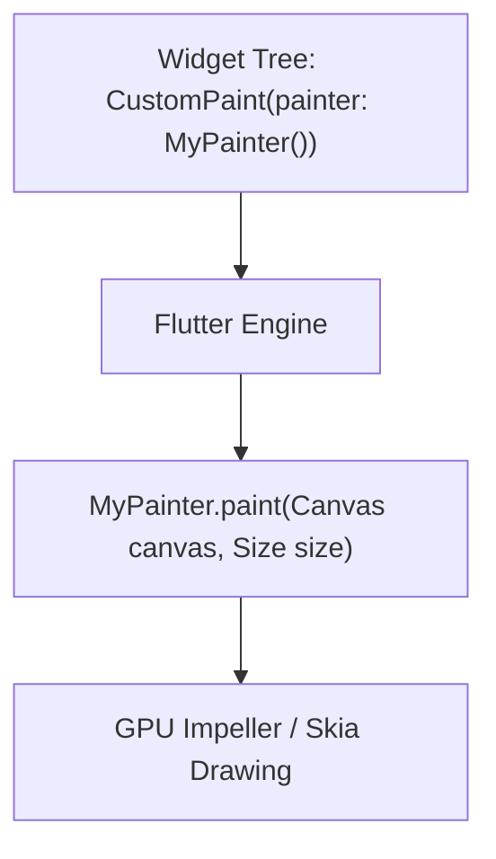

# 🎨 Flutter - Modul 06: CustomPainter, Canvas Drawing & Vektor 2D

Ketika kombinasi widget bawaan (seperti `Container`, `Row`, `Stack`) tidak sanggup menghasilkan bentuk visual yang kamu inginkan—seperti **grafik lingkaran progres dinamis, gelombang air (*wave animation*), papan tanda tangan digital, atau chart saham**—kamu bisa mengambil kuas dan menggambar langsung ke GPU via **`CustomPainter`**.

---

## 1. Arsitektur `CustomPaint` & `CustomPainter`



### Dua Method Wajib `CustomPainter`:
1. **`paint(Canvas canvas, Size size)`**: Tempat kamu menulis instruksi menggambar (garis, lingkaran, teks, kurva).
2. **`shouldRepaint(covariant CustomPainter oldDelegate)`**: Mengembalikan boolean (`true` / `false`) yang menentukan apakah kanvas perlu digambar ulang saat widget me-rebuild. Jika parameter gambar tidak berubah, return `false` untuk menghemat baterai HP!

---

## 2. Contoh Nyata: Menggambar Radial Progress Ring

Berikut contoh menggambar lingkaran progres persentase dengan gradien warna:

```dart
import 'dart:math' as math;
import 'package:flutter/material.dart';

class LingkaranProgresPainter extends CustomPainter {
  final double persentase; // Nilai 0.0 sampai 1.0

  LingkaranProgresPainter({required this.persentase});

  @override
  void paint(Canvas canvas, Size size) {
    final center = Offset(size.width / 2, size.height / 2);
    final radius = math.min(size.width / 2, size.height / 2) - 10;

    // 1. Cat Latar Belakang (Lingkaran Abu-Abu Tipis):
    final catBackground = Paint()
      ..color = Colors.grey.shade300
      ..strokeWidth = 8
      ..style = PaintingStyle.stroke; // Murni garis lingkaran tanpa isi

    canvas.drawCircle(center, radius, catBackground);

    // 2. Cat Progres Aktif (Warna Biru dengan Ujung Membulat):
    final catProgres = Paint()
      ..color = Colors.blueAccent
      ..strokeWidth = 10
      ..strokeCap = StrokeCap.round // Ujung garis melengkung cantik
      ..style = PaintingStyle.stroke;

    // Sudut sapuan dalam radian:
    final sweepAngle = 2 * math.pi * persentase;

    // Gambar busur lingkaran (Arc):
    canvas.drawArc(
      Rect.fromCircle(center: center, radius: radius),
      -math.pi / 2, // Mulai dari arah jam 12 (-90 derajat)
      sweepAngle,
      false,
      catProgres,
    );
  }

  @override
  bool shouldRepaint(covariant LingkaranProgresPainter oldDelegate) {
    // Hanya gambar ulang JIKA persentase berubah!
    return oldDelegate.persentase != persentase;
  }
}
```

### Menggunakan Painter di UI:
```dart
SizedBox(
  width: 150,
  height: 150,
  child: CustomPaint(
    painter: LingkaranProgresPainter(persentase: 0.75), // 75% selesai
    child: const Center(
      child: Text("75%", style: TextStyle(fontSize: 24, fontWeight: FontWeight.bold)),
    ),
  ),
)
```

---

## 3. Bentuk Kompleks dengan `Path` (Kurva Bézier)

Untuk menggambar kurva organik (seperti header bergelombang):

```dart
class GelombangPainter extends CustomPainter {
  @override
  void paint(Canvas canvas, Size size) {
    final paint = Paint()..color = Colors.indigo;
    final path = Path();

    path.lineTo(0, size.height - 40); // Garis lurus ke bawah kiri

    // Kurva Bézier Kuadratik (quadraticBezierTo(controlX, controlY, endX, endY)):
    path.quadraticBezierTo(
      size.width / 2, size.height + 20, // Titik tarik lengkungan
      size.width, size.height - 40       // Titik akhir di kanan
    );

    path.lineTo(size.width, 0); // Garis ke atas kanan
    path.close();               // Sambungkan kembali ke titik awal (0,0)

    canvas.drawPath(path, paint);
  }

  @override
  bool shouldRepaint(covariant CustomPainter oldDelegate) => false;
}
```
Karena digambar langsung di level GPU Impeller, animasi berbasis `CustomPainter` berjalan sangat ringan dan stabil pada refresh rate **120 Hz**!
