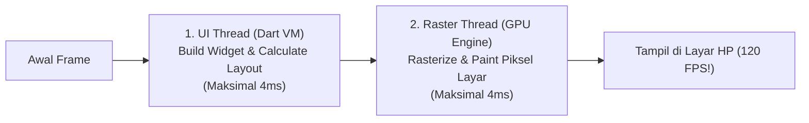
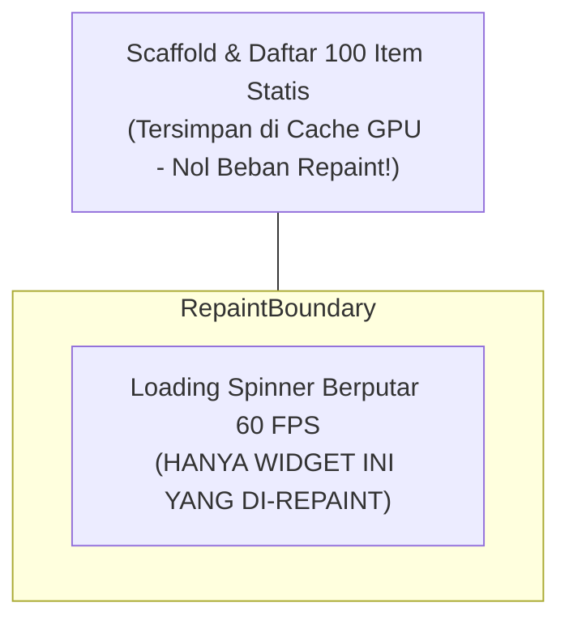

# 🎨 Flutter - Modul 08: Performance Profiling, DevTools & RepaintBoundary

Di modul penutup Flutter ini, kita akan membahas teknik mencapai **performa mentah 120 FPS**: membedah batas anggaran waktu frame (*Frame Budgeting*), mengisolasi rendering dengan **`RepaintBoundary`**, dan menggunakan **Flutter DevTools** untuk mengeliminasi lag (*Jank*).

---

## 1. Frame Budgeting: 16ms (60 FPS) vs 8ms (120 FPS)

Agar animasi terasa sehalus sutra di layar HP modern:
- **Layar 60 Hz**: Setiap frame harus selesai dihitung dan digambar dalam waktu maksimal **$16.6\text{ milidetik}$**.
- **Layar ProMotion / 120 Hz**: Waktu pengerjaan terpangkas menjadi hanya **$8.3\text{ milidetik}$**!



> [!CAUTION]
> Jika salah satu thread melebihi kuota waktu tersebut, **frame tersebut akan dibuang (*Dropped Frame / Jank*)**, dan animasi akan tampak tersendat-sendat bagi pengguna.

---

## 2. Senjata Rahasia GPU: `RepaintBoundary`

Secara default di Flutter, ketika satu widget kecil me-repaint dirinya sendiri (misal: jarum jam berputar atau icon spinner animasi), **seluruh widget parent di sekitarnya ikut digambar ulang ke GPU**, membuang banyak daya baterai!

**`RepaintBoundary`** menginstruksikan engine untuk **membuat layer grafis terpisah di memori GPU**:



### Kapan Harus Memasang `RepaintBoundary`?
1. Pada widget animasi berulang yang berada di tengah-tengah tampilan yang kompleks.
2. Di dalam setiap item `ListView.builder` yang memiliki gambar atau grafis berat:

```dart
ListView.builder(
  itemCount: 1000,
  itemBuilder: (context, index) {
    // Isolasi setiap kartu agar scrolling cepat tidak memicu repaint beruntun:
    return RepaintBoundary(
      child: KartuProfilBerat(user: daftarUser[index]),
    );
  },
)
```

---

## 3. Empat Anti-Pattern Performa yang Wajib Dihindari

### 1. Inisialisasi Objek Berat di Dalam Method `build()`
Method `build()` bisa dipanggil **60 kali per detik** saat animasi berjalan! Jangan pernah melakukan ini:
```dart
// ANTI-PATTERN SANGAT BURUK:
Widget build(BuildContext context) {
  final formatUang = NumberFormat.currency(locale: 'id_ID'); // BOROS ALOKASI RAM!
  return Text(formatUang.format(100000));
}

// SOLUSI: Simpan sebagai konstanta atau atribut static/state:
static final formatUang = NumberFormat.currency(locale: 'id_ID');
```

### 2. Penggunaan Widget `Opacity` yang Ceroboh
Widget `Opacity(opacity: 0.5, child: ...)` memaksa GPU membuat *Offscreen Framebuffer* sementara yang sangat boros memori:
```dart
// HINDARI:
Opacity(opacity: 0.5, child: Container(color: Colors.blue))

// LEBIH CEPAT (Nol Overhead GPU):
Container(color: Colors.blue.withOpacity(0.5))
```

### 3. Melupakan Kata Kunci `const`
Menambahkan `const` pada widget statis (`const SizedBox(height: 16)`, `const Text("Halo")`) memberi tahu Flutter untuk **meng-cache widget tersebut secara permanen**. Flutter akan **melewati (*skip*) proses rebuild** untuk widget tersebut selamanya!

### 4. Memanggil `setState()` di Pucuk Pohon (*Root Widget*)
Jangan memanggil `setState()` di tingkat halaman penuh jika yang berubah hanya satu icon bintang favorit. Pisahkan widget bintang tersebut menjadi komponen kecil mandiri, atau gunakan **GetX (`Obx`) / ValueListenableBuilder** agar rebuild hanya terjadi pada daun pohon widget (*Leaf Node*).

---

## 4. Profiling dengan Flutter DevTools

Jalankan aplikasi di **Device Fisik Nyata** dalam mode **Profile** (Bukan Debug mode, karena Debug mode memiliki overhead verifikasi assertion yang lambat!):

```bash
flutter run --profile
```
Buka URL **Flutter DevTools** di browser untuk:
- Memeriksa **Timeline Flame Chart** (Melihat fungsi Dart mana yang memakan waktu $> 8\text{ ms}$).
- Mengaktifkan **Highlight Repaints** (Kotak warna-warni akan menyala di layar HP menunjukkan bagian mana yang sedang digambar ulang oleh GPU).
