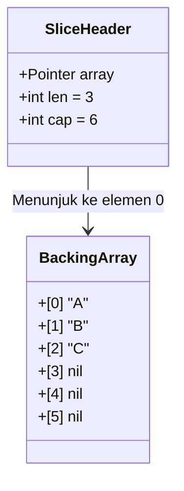
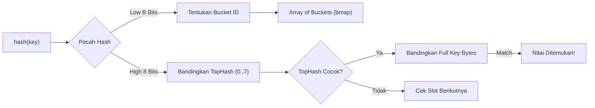

# 🐹 Golang - Modul 03: Slice & Map Internals: Backing Array, Hmap & Memory Leaks

Di Go, **Slice dan Map bukan pointer langsung**, melainkan *fat pointers* atau struktur data header kecil yang mereferensikan memori di heap atau stack. Memahami struktur internal keduanya adalah syarat wajib agar terhindar dari bug alokasi dan race condition fatal.

---

## 1. Anatomi Internal Slice (3-Word Header)

Di dalam runtime Go (`runtime/slice.go`), sebuah slice direpresentasikan oleh struktur 3-word (24 byte pada arsitektur 64-bit):

```go
type slice struct {
    array unsafe.Pointer // Pointer ke elemen pertama di Backing Array
    len   int            // Panjang elemen aktif yang bisa diakses
    cap   int            // Kapasitas maksimum sebelum perlu relokasi memori
}
```



### Array vs Slice di Go:
- **Array (`[5]int`)**: Ukuran bersifat fixed dan menjadi bagian dari tipe data (`[3]int` beda tipe dengan `[5]int`). Array adalah **Value Type**; mengirim array ke fungsi akan menyalin (*copy*) seluruh elemennya.
- **Slice (`[]int`)**: Ukuran dinamis. Mengirim slice ke fungsi hanya menyalin 24-byte header-nya, namun tetap memodifikasi backing array yang sama!

---

## 2. Mekanisme `append()` & Growth Factor

Saat kita memanggil `append()`, runtime Go memeriksa apakah `len + 1 <= cap`:
1. **Jika kapasitas masih cukup**: Runtime langsung menulis elemen ke index berikutnya di backing array dan menaikkan nilai `len`.
2. **Jika kapasitas penuh**: Runtime mengalokasikan backing array baru yang lebih besar, menyalin elemen lama, lalu melepaskan array lama ke Garbage Collector.

```go
package main

import "fmt"

func main() {
	s := make([]int, 0, 2) // len: 0, cap: 2
	fmt.Printf("len: %d, cap: %d, ptr: %p\n", len(s), cap(s), s)

	s = append(s, 10, 20)
	fmt.Printf("len: %d, cap: %d, ptr: %p\n", len(s), cap(s), s) // Pointer masih sama

	// Triggers Reallocation: Kapasitas penuh terlampaui!
	s = append(s, 30)
	fmt.Printf("len: %d, cap: %d, ptr: %p (BARU!)\n", len(s), cap(s), s)
}
```

> [!NOTE]
> **Aturan Ekspansi Kapasitas Go**:
> - Di bawah 256 elemen: Kapasitas berlipat ganda ($2\times$).
> - Di atas 256 elemen (Go 1.18+): Rumus pertumbuhan melambat secara halus: `cap += (cap + 3*256) / 4` (sekitar $1.25\times$ pertumbuhan) untuk menghemat pemborosan memori.

---

## 3. Bahaya Pitfall: Sub-Slicing Memory Leak Trap

Jika kamu mengambil irisan kecil dari slice raksasa, slice kecil tersebut **tetap mengunci seluruh backing array raksasa di memori RAM** karena pointer-nya masih terhubung!

```go
// BAHAYA: Mengunci 100 Megabyte hanya untuk 3 byte pertama!
func dapatkanTigaKarakterHeader(filePath string) []byte {
	fileData := bacaFileRaksasa100MB(filePath) // []byte sebesar 100MB
	return fileData[:3] // Garbage Collector TIDAK BISA membebaskan 100MB!
}

// SOLUSI: Selalu gunakan copy() untuk data yang disimpan jangka panjang
func dapatkanTigaKarakterAman(filePath string) []byte {
	fileData := bacaFileRaksasa100MB(filePath)
	hasil := make([]byte, 3)
	copy(hasil, fileData[:3]) // Mengalokasikan 3 byte baru independen
	return hasil              // 100MB fileData aman dibersihkan oleh GC!
}
```

---

## 4. Anatomi Internal Map (`hmap` & `bmap`)

Map di Go adalah implementasi **Hash Table** terbuka dengan sistem bucket (`runtime/map.go`):

- **`hmap`**: Header map utama yang mencatat `count` (jumlah entri), `B` ($\log_2$ dari jumlah bucket), dan pointer ke array `buckets`.
- **`bmap` (Bucket)**: Masing-masing bucket menampung tepat **8 pasang key-value**.
- **Top Hash (tophash)**: 8-bit hash atas disimpan dalam array terpisah di dalam bucket untuk mempercepat pencarian string tanpa perlu membandingkan byte teks penuh.



### Operasi Aman Map & Comma-ok Idiom:
```go
m := map[string]int{"kopi": 15000}

// Jika key tidak ada, Go mengembalikan ZERO VALUE tipe datanya:
hargaTeh := m["teh"] // 0 (Apakah harganya memang gratis 0 atau key tidak ada?)

// Solusi: Selalu gunakan Comma-ok idiom
if harga, ada := m["teh"]; ada {
	fmt.Println("Harga teh:", harga)
} else {
	fmt.Println("Menu teh belum terdaftar!")
}

// Menghapus elemen
delete(m, "kopi")

// Mengosongkan seluruh isi map tanpa alokasi baru (Go 1.21+)
clear(m)
```

---

## 5. ⚠️ Bahaya Fatal: Concurrent Map Writes Crash

Map bawaan Go **TIDAK THREAD-SAFE**. Jika satu goroutine menulis ke map sementara goroutine lain membaca atau menulis secara simultan, Go runtime akan melempar **Panic Unrecoverable** yang mematikan aplikasi seketika:

```text
fatal error: concurrent map writes
```

Error ini **tidak bisa di-tangkap dengan `recover()`**!

### Solusi Concurrency Aman:
1. Bungkus akses map dengan `sync.RWMutex` (Direkomendasikan untuk 95% kasus).
2. Gunakan `sync.Map` jika key jarang berubah namun jutaan kali dibaca dari ratusan goroutine konkuren.

```go
type SafeCache struct {
	mu   sync.RWMutex
	data map[string]string
}

func (c *SafeCache) Set(key, val string) {
	c.mu.Lock()
	defer c.mu.Unlock()
	c.data[key] = val
}

func (c *SafeCache) Get(key string) (string, bool) {
	c.mu.RLock()
	defer c.mu.RUnlock()
	val, ok := c.data[key]
	return val, ok
}
```
