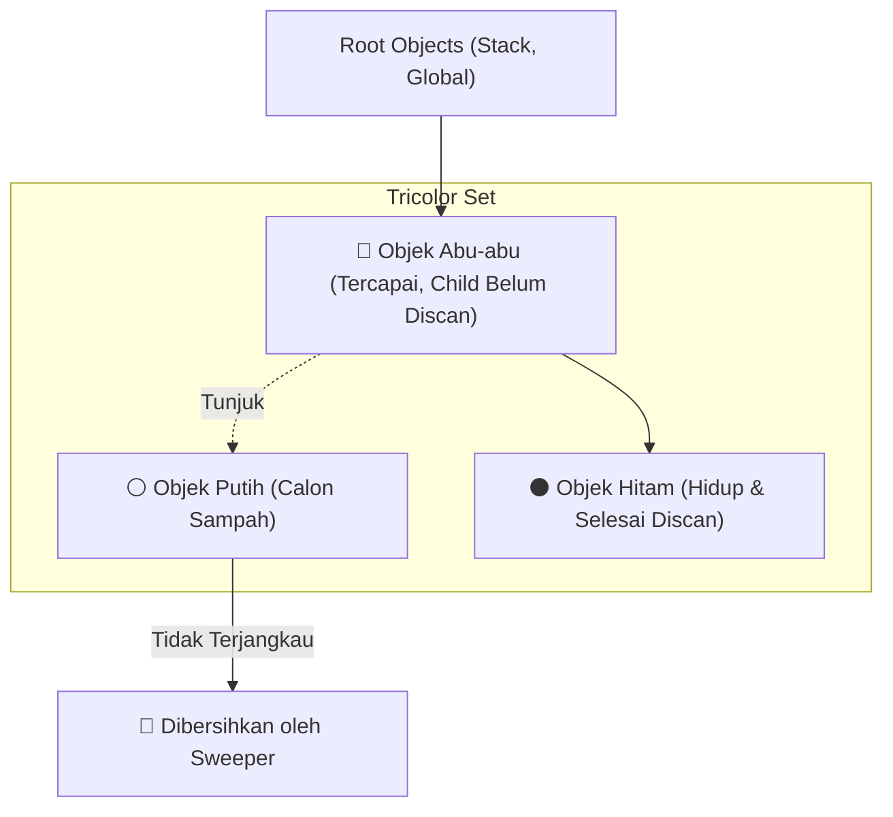

# 🐹 Golang - Modul 04: Pointer Semantics, Escape Analysis & Garbage Collection

Berbeda dengan C/C++ di mana programmer mengalokasikan (`malloc`) dan membebaskan (`free`) memori secara manual, Go memiliki **Escape Analysis** cerdas di tingkat kompilator yang otomatis menentukan apakah variabel cukup hidup di Stack (super cepat, nol overhead GC) atau harus dialokasikan ke Heap (memerlukan Garbage Collection).

---

## 1. Stack vs Heap di Runtime Go

| Karakteristik | Stack Memory | Heap Memory |
|---|---|---|
| **Alokasi** | Otomatis dialokasikan saat fungsi dipanggil, langsung dibersihkan saat fungsi return. | Dialokasikan secara dinamis di area global memori program. |
| **Kecepatan** | Mendekati kecepatan register CPU ($\sim$ nanodetik). Nol overhead. | Memerlukan alokator runtime (mcache, mcentral, mheap), jauh lebih lambat. |
| **Dibersihkan Oleh** | Penyesuaian pointer register CPU (Stack Frame Pop). | **Garbage Collector (GC)** secara periodik. |
| **Ukuran** | Per goroutine mulai dari 2 KB dan bisa tumbuh dinamis hingga 1 GB (64-bit). | Dibatasi oleh kapasitas total RAM mesin host. |

---

## 2. Pointer Semantics vs Value Semantics

```go
package main

import "fmt"

type AkunBank struct {
	Pemilik string
	Saldo   int
}

// 1. Value Semantics: Menerima salinan struct (Isolasi data aman, cocok untuk tipe kecil)
func tambahBonusValue(a AkunBank) {
	a.Saldo += 50000 // Hanya mengubah salinan lokal di stack!
}

// 2. Pointer Semantics: Berbagi akses ke lokasi memori yang sama
func tambahBonusPointer(a *AkunBank) {
	if a == nil {
		return // Selalu guard nil pointer sebelum dereference!
	}
	a.Saldo += 50000 // Mengubah data asli di alamat memori terkait
}

func main() {
	user := AkunBank{Pemilik: "Eka", Saldo: 100000}

	tambahBonusValue(user)
	fmt.Println("Setelah value semantics:", user.Saldo) // Tetap 100000

	tambahBonusPointer(&user)
	fmt.Println("Setelah pointer semantics:", user.Saldo) // Menjadi 150000
}
```

> [!NOTE]
> Go **melarang pointer arithmetic** murni (seperti `p++` di C) demi keamanan memori. Jika kamu benar-benar butuh manipulasi raw memory tingkat rendah, Go menyediakan package khusus `unsafe`.

---

## 3. Apa itu Escape Analysis?

Escape analysis adalah algoritma kompilator Go yang menganalisis siklus hidup variabel:
> *"Jika sebuah variabel masih bisa direferensikan setelah fungsi pembuatnya selesai dieksekusi, maka variabel tersebut HARUS **Escape to Heap**."*

### Cara Menginspeksi Keputusan Kompilator:
Jalankan perintah build dengan flag compiler `-gcflags="-m"`:

```bash
go build -gcflags="-m" main.go
```

Contoh output compiler:
```text
./main.go:8:6: can inline buatUser
./main.go:9:9: &User{...} escapes to heap   <-- Variabel dipindahkan ke HEAP!
./main.go:14:13: ... argument does not escape
./main.go:15:13: u.Nama escapes to heap
```

---

## 4. Empat Pemicu Utama Alokasi Heap (Heap Escapes)

### Kasus 1: Mengembalikan Pointer Variabel Lokal
```go
type User struct {
	Nama string
}

func buatUser(nama string) *User {
	u := User{Nama: nama} // Di C ini adalah bug dangling stack memory!
	return &u             // Di Go, compiler otomatis memindahkan u ke HEAP!
}
```

### Kasus 2: Mengirim Variabel ke Parameter Interface (Boxing)
Setiap kali variabel dimasukkan ke `interface{}` atau `any` (misalnya `fmt.Println()`), compiler harus membungkus nilai tersebut ke struktur `eface`, yang memicu escape ke heap:

```go
angka := 42
fmt.Println(angka) // 'angka' escape to heap karena fmt.Println menerima interface{}!
```

### Kasus 3: Ukuran Slice Dinamis atau Terlalu Besar
```go
// Stack: Compiler tahu persis ukurannya kecil
kecil := make([]int, 64) // Tetap di stack

// Heap: Ukuran ditentukan oleh variabel runtime dinamis
n := 100
dinamis := make([]int, n) // Escapes to heap!

// Heap: Terlalu besar untuk stack frame
raksasa := make([]int, 100000) // Escapes to heap!
```

### Kasus 4: Pointer Ditugaskan ke Field Pointer Lain
Jika pointer disimpan ke dalam map, slice pointer, atau channel, data yang ditunjuk otomatis kabur ke heap.

---

## 5. Siklus Garbage Collector Go: Tricolor Concurrent GC

Go menggunakan algoritma **Concurrent Tricolor Mark-and-Sweep** non-generational yang dioptimalkan untuk latensi ultra rendah (*Stop-The-World pause < 1 milidetik*):



1. **Mark Setup (STW singkat)**: Mengaktifkan Write Barrier untuk mencatat mutasi pointer saat GC berjalan paralel dengan goroutine aplikasi.
2. **Concurrent Marking (Paralel)**: Goroutine aplikasi tetap berjalan normal sementara worker GC menandai objek hidup dari warna Putih $\to$ Abu-abu $\to$ Hitam.
3. **Mark Termination (STW singkat)**: Menyelesaikan sisa objek abu-abu dan mematikan Write Barrier.
4. **Concurrent Sweeping (Paralel)**: Membebaskan memori objek Putih yang tidak tersentuh kembali ke alokator memory pool.

> [!TIP]
> **Tuning GC**: Variabel environment `GOGC` (default `100`) menentukan target pertumbuhan heap sebelum GC dipicu. Nilai `GOGC=200` akan menunda siklus GC hingga heap tumbuh 200%, menghemat CPU namun memakai lebih banyak RAM. Go 1.19+ juga memperkenalkan `GOMEMLIMIT` untuk mencegah OOM (Out-of-Memory) di dalam Kubernetes container!
