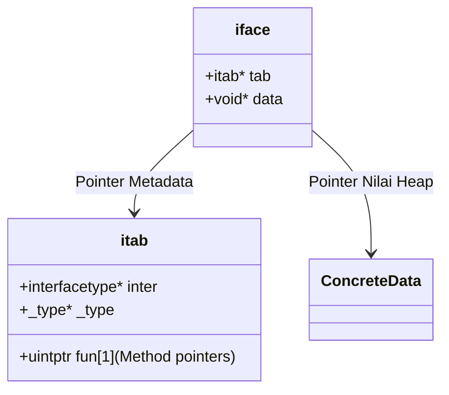

# 🐹 Golang - Modul 05: Struct, Method Sets & Interface Internals (iface/eface)

Go menolak warisan hierarki (*class inheritance*) dan sepenuhnya mengadopsi **komposisi (*composition over inheritance*)** serta **antarmuka struktural (*structural typing / duck typing*)**.

---

## 1. Struct Composition & Promoted Fields

Go tidak memiliki keyword `extends`. Penggabungan struktur dilakukan dengan menyematkan (*embedding*) struct lain tanpa nama field (*anonymous field*):

```go
package main

import "fmt"

type EntitasBase struct {
	ID        int64
	CreatedAt string
}

func (e EntitasBase) FormatLog() string {
	return fmt.Sprintf("[ID: %d dibuat pada: %s]", e.ID, e.CreatedAt)
}

type User struct {
	EntitasBase        // Embedded struct (Promoted)
	Nama        string // Field milik User sendiri
	Role        string
}

func main() {
	u := User{
		EntitasBase: EntitasBase{ID: 101, CreatedAt: "2026-11-20"},
		Nama:        "Eka",
		Role:        "Admin",
	}

	// Promoted fields & methods bisa diakses langsung seolah milik User:
	fmt.Println("ID User:", u.ID)
	fmt.Println("Log:", u.FormatLog())

	// Akses eksplisit via namespace embedded juga tetap valid:
	fmt.Println("ID via path panjang:", u.EntitasBase.ID)
}
```

---

## 2. Aturan Emas Method Sets: Pointer vs Value Receiver

| Tipe Receiver | Modifikasi State Struct? | Bisa Dipanggil oleh Variabel Value? | Bisa Dipanggil oleh Variabel Pointer? |
|---|:---:|:---:|:---:|
| `(s MyStruct)` | ❌ Tidak (Bekerja pada copy) | ✅ Ya | ✅ Ya (Otomatis didereference) |
| `(s *MyStruct)` | ✅ Ya (Bekerja pada memori asli) | ✅ Ya (Otomatis diambil alamatnya `&`) | ✅ Ya |

### Mengapa Method Sets Sangat Krusial untuk Interface?
Perhatikan aturan ketat compiler Go:
- Jika sebuah method memiliki **Pointer Receiver `(s *User)`**, maka interface hanya diimplementasikan oleh tipe pointer `*User`, **BUKAN oleh `User` biasa**.

```go
type Pelari interface {
	Lari()
}

type Atlet struct{}

func (a *Atlet) Lari() {}

func main() {
	var p Pelari
	// var a Atlet
	// p = a // COMPILE ERROR: Atlet does not implement Pelari (Lari method has pointer receiver)

	p = &Atlet{} // VALID: Tipe *Atlet yang memenuhi interface!
	p.Lari()
}
```

---

## 3. Trik Sakti: Compile-Time Interface Implementation Check

Untuk memastikan struct kita mematuhi interface tertentu saat masa kompilasi (*compile time*), gunakan idiom penugasan pointer nil:

```go
type PaymentGateway interface {
	Bayar(nominal int) error
	Refund(id string) error
}

type MidtransGateway struct{}

func (m *MidtransGateway) Bayar(nominal int) error { return nil }
func (m *MidtransGateway) Refund(id string) error  { return nil }

// TRIK SAKTI: Jika ada method yang belum diimplementasikan,
// baris ini akan langsung gagal kompilasi seketika!
var _ PaymentGateway = (*MidtransGateway)(nil)
```

---

## 4. Anatomi Internal Interface: `eface` vs `iface`

Di balik layar (`runtime/runtime2.go`), sebuah interface di Go selalu berukuran **16 byte (2 word)**:

### A. Empty Interface (`interface{}` atau `any`) $\to$ `eface`
```go
type eface struct {
    _type *_type         // Menunjuk ke metadata tipe data konkret
    data  unsafe.Pointer // Menunjuk ke nilai data sebenarnya di memori
}
```

### B. Non-Empty Interface $\to$ `iface`
```go
type iface struct {
    tab  *itab          // Berisi metadata interface + daftar pointer fungsi konkret
    data unsafe.Pointer // Menunjuk ke nilai data konkret di heap
}
```



---

## 5. ⚠️ Jebakan Fatal: Nil Interface Error Trap

Salah satu bug paling terkenal dan sering lolos ke produksi di Go adalah: **"Mengembalikan pointer nil concrete ke dalam variabel interface"**:

```go
package main

import "fmt"

type CustomError struct {
	Pesan string
}

func (e *CustomError) Error() string {
	return e.Pesan
}

// FUNGSI INI BERBAHAYA: Mengembalikan pointer concrete *CustomError
func validasiData(val int) *CustomError {
	if val < 0 {
		return &CustomError{Pesan: "Angka negatif"}
	}
	return nil // Mengembalikan pointer nil ke concrete type
}

func main() {
	// 'err' bertipe interface standar 'error'
	var err error = validasiData(10)

	// APA HASILNYA?
	if err != nil {
		fmt.Println("FATAL: Terdeteksi error!", err) // KODE INI AKAN DIEKSEKUSI!
	} else {
		fmt.Println("Data valid!")
	}
}
```

### Mengapa `err != nil` bernilai TRUE padahal pointer-nya nil?
Ingat kembali struktur `iface`:
- `iface.tab` = terisi pointer itab tipe `*CustomError` (BUKAN NIL!).
- `iface.data` = `nil`.
- Di Go, sebuah interface bernilai `nil` **HANYA JIKA kedua field (`tab` DAN `data`) sama-sama nil!**

> [!CAUTION]
> **Aturan Wajib**: Jika sebuah fungsi dimaksudkan untuk mengembalikan interface `error`, **selalu deklarasikan tipe return-nya sebagai `error`**, dan selalu return `nil` secara eksplisit, jangan pernah return variabel pointer lokal concrete!
```go
func validasiDataAman(val int) error {
	if val < 0 {
		return &CustomError{Pesan: "Angka negatif"}
	}
	return nil // Interface murni nil (tab=nil, data=nil)
}
```
