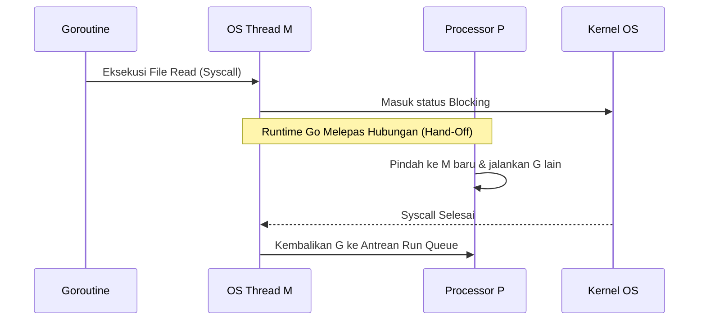

# 🐹 Golang - Modul 06: GMP Scheduler Internals & Runtime Goroutine

Kekuatan super Go dalam menangani jutaan koneksi konkuren dengan konsumsi RAM minimal berasal dari **Go Runtime Scheduler** yang mengimplementasikan **M:N Scheduler (GMP Model)** sepenuhnya di tingkat user space tanpa bergantung pada overhead kernel OS.

---

## 1. Goroutine vs Thread Sistem Operasi (OS Thread)

| Parameter | OS Thread (Kernel Space) | Goroutine (Go User Space) |
|---|---|---|
| **Ukuran Memori Awal** | Fixed $1 - 8\text{ MB}$ per thread | Dinamis mulai dari **$2\text{ KB}$** (bisa tumbuh/menyusut otomatis) |
| **Kapasitas Skalabilitas** | Ribuan thread sudah membuat OS kehabisan RAM | **Jutaan goroutine** bisa hidup bersamaan di satu mesin |
| **Biaya Context Switch** | $\sim 1000 - 2000\text{ ns}$ (Harus masuk Kernel ring-0 CPU) | $\sim 10 - 20\text{ ns}$ (Murni operasi register di user space) |
| **Manajemen Penjadwalan** | OS Kernel Scheduler | **Go Runtime Scheduler** bawaan binary |

---

## 2. Arsitektur Model GMP (Goroutine - Machine - Processor)

Scheduler Go menggunakan 3 entitas utama untuk mengelola konkurensi:

```mermaid
flowchart TD
    subgraph GlobalQueue["Global Run Queue (GRQ)"]
        G_Global["[ G ] [ G ] [ G ]"]
    end

    subgraph P1["Processor P (GOMAXPROCS)"]
        LRQ1["Local Run Queue (LRQ - max 256)"]
        M1["OS Thread M1"]
        G_Active1["G (Aktif Berjalan)"]
    end

    subgraph P2["Processor P2"]
        LRQ2["Local Run Queue (LRQ)"]
        M2["OS Thread M2"]
        G_Active2["G (Aktif Berjalan)"]
    end

    GlobalQueue -.->|1/61 Cek Berkala| LRQ1
    LRQ1 --> G_Active1
    G_Active1 --> M1
    LRQ2 --> G_Active2
    G_Active2 --> M2
    LRQ2 -.->|Work Stealing (Curi 50%)| LRQ1
```

### Penjelasan Komponen:
1. **G (Goroutine)**:
   - Merepresentasikan unit kerja eksekusi. Berisi stack, program counter (PC), dan status (`_Grunnable`, `_Grunning`, `_Gwaiting`, `_Gsyscall`).
2. **M (Machine / OS Thread)**:
   - Thread fisik OS yang dibuat oleh kernel. M bertanggung jawab mengeksekusi instruksi assembly mesin nyata.
3. **P (Processor / Logical Context)**:
   - Resource logis yang dibutuhkan untuk mengeksekusi kode Go. Jumlah `P` dikontrol oleh `runtime.GOMAXPROCS(0)` (secara default sama dengan jumlah core CPU).
   - Setiap `P` memiliki **Local Run Queue (LRQ)** sendiri yang menampung hingga 256 goroutine secara lock-free.

---

## 3. Algoritma Work Stealing

Bagaimana jika satu core CPU (satu `P`) menyelesaikan semua tugas di antrean lokalnya sementara core lain masih sibuk? Scheduler Go tidak membiarkan CPU menganggur dengan urutan pencarian kerja:

1. **Cek Local Run Queue (LRQ)**: Jalankan G berikutnya di antrean lokal milik `P`.
2. **Cek Global Run Queue (GRQ)**: Setiap $61$ iterasi scheduler, `P` wajib memeriksa GRQ agar goroutine di antrean global tidak mengalami kelaparan (*starvation*).
3. **Cek Network Poller**: Memeriksa apakah ada I/O jaringan yang sudah siap dieksekusi.
4. **Work Stealing**: Jika masih kosong, `P` akan memilih `P` lain secara acak dan **mencuri setengah (50%) goroutine** dari LRQ milik `P` tersebut!

---

## 4. Penanganan System Call & Network Poller

### A. Blocking System Call (Pola Hand-Off)
Saat sebuah goroutine memanggil operasi file disk atau syscall sinkron yang memblokir:
1. Thread `M` akan diblokir oleh OS kernel.
2. Scheduler Go segera melepaskan relasi antara `P` dan `M` (*hand-off*).
3. `P` akan mencari atau membuat thread `M` baru yang menganggur untuk melanjutkan sisa goroutine di LRQ tanpa terganggu.
4. Saat syscall selesai, `G` yang tadi diblokir akan dimasukkan kembali ke LRQ atau GRQ.



### B. Asynchronous Network I/O (Netpoller)
Untuk koneksi jaringan (HTTP, TCP, UDP), Go **tidak memblokir thread OS**. Go mengintegrasikan **Netpoller** yang menggunakan abstraksi OS event loop tercepat:
- **Linux**: `epoll`
- **macOS / BSD**: `kqueue`
- **Windows**: `IOCP`

Goroutine yang menunggu data soket akan diparkir di netpoller (`_Gwaiting`). Saat data tiba di socket buffer jaringan, netpoller membangunkan goroutine tersebut kembali ke status runnable.

---

## 5. Preemption: Menghentikan Goroutine Nakal

Sebelum Go 1.14, jika ada goroutine yang menjalankan loop tak hingga tanpa pemanggilan fungsi (`for {}`), thread tersebut akan terkunci selamanya (*starvation*).

Sejak **Go 1.14+**, Go memperkenalkan **Asynchronous Non-Cooperative Preemption**:
- Thread monitor khusus runtime (`sysmon`) memantau eksekusi goroutine.
- Jika sebuah goroutine berjalan terus-menerus selama lebih dari **10 milidetik**, `sysmon` mengirimkan sinyal sistem operasi (`SIGURG` di Unix/macOS) ke thread `M` terkait.
- Handler sinyal menyimpan state register CPU, menjeda goroutine tersebut, dan memindahkannya ke antrean belakang agar goroutine lain mendapatkan giliran giliran eksekusi.
