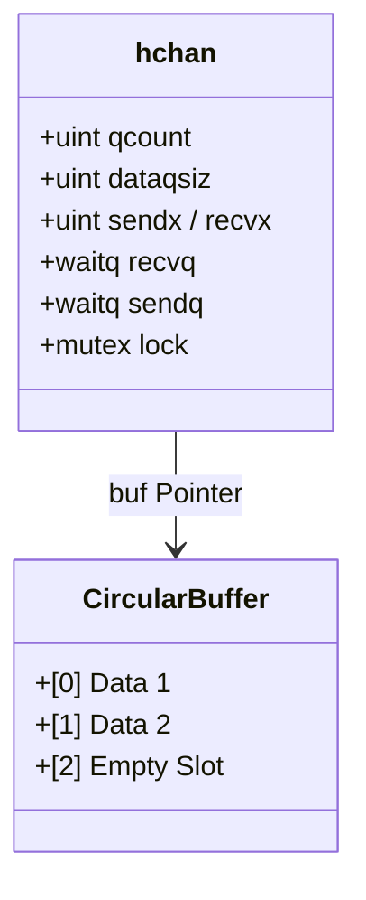
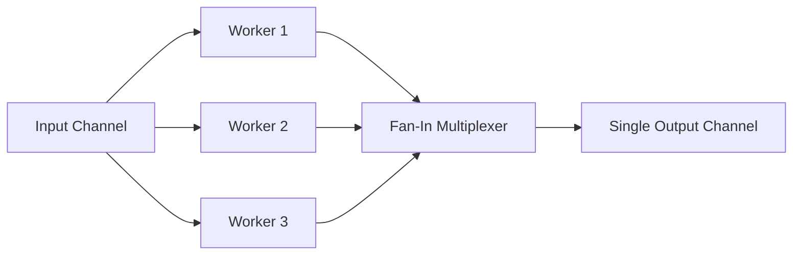

# 🐹 Golang - Modul 07: Channel Internals, Select & Production Concurrency Patterns

Slogan paling terkenal di komunitas Go dirumuskan oleh Rob Pike:
> *"Do not communicate by sharing memory; instead, share memory by communicating."*
> (Jangan berkomunikasi dengan berbagi memori; melainkan, bagikan memori dengan berkomunikasi via Channel.)

---

## 1. Anatomi Internal Channel (`hchan`)

Banyak yang mengira Channel adalah fitur hardware atau lock-free ajaib. Faktanya di dalam runtime Go (`runtime/chan.go`), channel adalah struct biasa bernama `hchan`:

```go
type hchan struct {
    qcount   uint           // Total elemen yang ada di buffer saat ini
    dataqsiz uint           // Kapasitas buffer (panjang make(chan T, size))
    buf      unsafe.Pointer // Pointer ke Circular Ring Buffer di heap
    elemsize uint16
    closed   uint32         // 0 = open, 1 = closed
    sendx    uint           // Index buffer untuk pengiriman berikutnya
    recvx    uint           // Index buffer untuk penerimaan berikutnya
    recvq    waitq          // Antrean Goroutine yang sedang tidur menunggu data
    sendq    waitq          // Antrean Goroutine yang sedang tidur menunggu slot kosong
    lock     mutex          // Spinlock internal untuk melindungi operasi hchan
}
```



> [!NOTE]
> **Fakta Menarik**: Channel menggunakan mutex internal (`lock mutex`) untuk mengamankan modifikasi buffer dan antrean goroutine (`sudog`). Kecepatan channel berasal dari minimnya contention dan optimasi direct copy antar stack memori goroutine tanpa perantara heap jika ada goroutine yang sudah menunggu di `recvq`.

---

## 2. Tabel Sakti 3 Status Channel (Wajib Dihafal!)

Perilaku channel di Go sangat kaku dan deterministik. Kesalahan memahami tabel ini adalah sumber utama bug panic dan deadlock di sistem backend:

| Operasi | Channel `nil` (Belum di-make) | Channel `Open` (Aktif) | Channel `Closed` (Sudah Ditutup) |
|---|---|---|---|
| **Kirim (`ch <- x`)** | 🔴 **Blokir Selamanya** (Deadlock) | ✅ Sukses (atau blokir jika buffer penuh) | 💥 **PANIC!** (`send on closed channel`) |
| **Terima (`<-ch`)** | 🔴 **Blokir Selamanya** (Deadlock) | ✅ Sukses (atau blokir jika buffer kosong) | ✅ **Segera Return Zero Value** (`ok = false`) |
| **Tutup (`close(ch)`)** | 💥 **PANIC!** (`close of nil channel`) | ✅ Sukses menutup | 💥 **PANIC!** (`close of closed channel`) |

### Idiom Membaca Channel yang Ditutup:
```go
val, ok := <-ch
if !ok {
	fmt.Println("Channel sudah ditutup dan buffer sudah habis dikonsumsi!")
}
```

---

## 3. Multiplexing dengan `select`

Kata kunci `select` memungkinkan goroutine mendengarkan banyak channel sekaligus secara non-blocking atau dengan batas waktu:

```go
select {
case pesan := <-chPesan:
	fmt.Println("Diterima pesan:", pesan)

case chKirim <- "data baru":
	fmt.Println("Data berhasil terkirim ke buffer")

case <-time.After(2 * time.Second):
	fmt.Println("Timeout! Operasi dibatalkan karena lebih dari 2 detik")

default:
	// Jika semua case di atas sedang terblokir, blok default langsung dieksekusi seketika!
	fmt.Println("Tidak ada channel yang siap (Non-blocking polling)")
}
```

---

## 4. Pola Konkurensi Produksi 1: Worker Pool

Pola worker pool membatasi jumlah goroutine aktif agar tidak membanjiri CPU dan koneksi database:

```go
package main

import (
	"fmt"
	"sync"
	"time"
)

func worker(id int, jobs <-chan int, results chan<- int, wg *sync.WaitGroup) {
	defer wg.Done()
	for j := range jobs { // Loop otomatis berhenti saat jobs di-close
		fmt.Printf("Worker %d memproses job %d\n", id, j)
		time.Sleep(50 * time.Millisecond) // Simulasi kerja I/O
		results <- j * 2
	}
}

func main() {
	const totalJobs = 10
	const totalWorkers = 3

	jobs := make(chan int, totalJobs)
	results := make(chan int, totalJobs)
	var wg sync.WaitGroup

	// 1. Nyalakan worker pool
	for w := 1; w <= totalWorkers; w++ {
		wg.Add(1)
		go worker(w, jobs, results, &wg)
	}

	// 2. Kirim tugas ke antrean
	for j := 1; j <= totalJobs; j++ {
		jobs <- j
	}
	close(jobs) // Tutup channel jobs agar worker tahu tidak ada kerjaan lagi

	// 3. Tunggu semua worker selesai di background goroutine
	go func() {
		wg.Wait()
		close(results) // Tutup results setelah semua worker selesai
	}()

	// 4. Konsumsi hasil
	for res := range results {
		fmt.Println("Hasil didapat:", res)
	}
}
```

---

## 5. Pola Konkurensi Produksi 2: Fan-Out & Fan-In

- **Fan-Out**: Memecah satu aliran data masukan menjadi banyak goroutine pekerja paralel.
- **Fan-In**: Menggabungkan hasil dari banyak channel pekerja paralel ke dalam satu channel terpadu untuk dikonsumsi downstream.



```go
func fanIn(channels ...<-chan string) <-chan string {
	out := make(chan string)
	var wg sync.WaitGroup

	multiplex := func(c <-chan string) {
		defer wg.Done()
		for val := range c {
			out <- val
		}
	}

	wg.Add(len(channels))
	for _, c := range channels {
		go multiplex(c)
	}

	go func() {
		wg.Wait()
		close(out)
	}()

	return out
}
```

---

## 6. Bahaya Fatal: Goroutine Leaks & Pencegahannya

Goroutine leak terjadi ketika sebuah goroutine dialokasikan namun terblokir selamanya menunggu kirim/terima channel yang tidak pernah terjadi. Memori stack goroutine tersebut **tidak akan pernah bisa dibersihkan oleh Garbage Collector**!

```go
// CONTOH BUG GOROUTINE LEAK:
func prosesRequestTimeout() error {
	ch := make(chan error) // Unbuffered channel!

	go func() {
		err := panggilAPILambat()
		ch <- err // LEAK: Jika fungsi luar timeout duluan, receiver sudah pergi!
		          // Goroutine ini akan tertidur di sendq SELAMANYA!
	}()

	select {
	case err := <-ch:
		return err
	case <-time.After(100 * time.Millisecond):
		return errors.New("timeout!")
	}
}

// SOLUSI: Gunakan buffered channel berukuran 1 agar goroutine pengirim tidak terblokir!
ch := make(chan error, 1)
```
