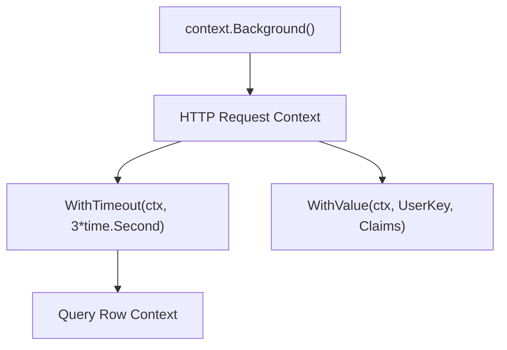

# 🐹 Golang - Modul 09: Context Architecture, Graceful Shutdown & Modern Error Handling

Dalam arsitektur backend mikroservis, sebuah HTTP request yang dibatalkan oleh pengguna (misal: menutup browser) **harus segera membatalkan query database dan panggilan API hilir**. Di Go, standar orkestrasi pembatalan dan batas waktu (*timeout*) ini dikelola secara terpusat melalui package `context`.

---

## 1. Anatomi Pohon `context.Context`

Semua context di Go membentuk struktur pohon hierarkis:



Jika node parent dibatalkan (*cancelled*) atau mengalami *timeout*, **semua node child yang diturunkan darinya otomatis ikut dibatalkan**!

### 4 Method Inti Interface `context.Context`:
```go
type Context interface {
    Deadline() (deadline time.Time, ok bool) // Mengetahui kapan timeout terjadi
    Done() <-chan struct{}                   // Channel yang ditutup saat context dibatalkan
    Err() error                              // Mengembalikan Canceled atau DeadlineExceeded
    Value(key any) any                       // Mengambil data request-scoped
}
```

---

## 2. Pola Pembatalan: `WithTimeout` & Propagasi

```go
package main

import (
	"context"
	"fmt"
	"time"
)

func panggilDatabase(ctx context.Context) error {
	select {
	case <-time.After(500 * time.Millisecond): // Simulasi query 500ms
		fmt.Println("Query DB selesai!")
		return nil

	case <-ctx.Done(): // Context dibatalkan duluan!
		fmt.Println("Query DB dibatalkan:", ctx.Err())
		return ctx.Err()
	}
}

func main() {
	// Batasi operasi maksimal 200 milidetik
	ctx, cancel := context.WithTimeout(context.Background(), 200*time.Millisecond)
	defer cancel() // Selalu panggil cancel() untuk mencegah context resource leak!

	err := panggilDatabase(ctx)
	if err != nil {
		fmt.Println("Operasi gagal:", err) // context deadline exceeded
	}
}
```

---

## 3. Best Practice `context.WithValue`

Jangan pernah menggunakan string biasa sebagai context key karena rawan tabrakan (*collision*) antar library pihak ketiga. Selalu buat tipe custom private:

```go
type contextKey string

const (
	UserIDKey    contextKey = "ctx_user_id"
	RequestIDKey contextKey = "ctx_req_id"
)

// Menyimpan nilai
ctx = context.WithValue(ctx, UserIDKey, "USR-8821")

// Mengambil nilai secara type-safe
if userID, ok := ctx.Value(UserIDKey).(string); ok {
	fmt.Println("User yang login:", userID)
}
```

> [!CAUTION]
> **Anti-Pattern**: Jangan gunakan `context.WithValue` untuk mengirimkan parameter opsional fungsi. Context value murni hanya untuk data transitif yang melintasi batas proses (seperti Request ID, JWT Claims, Trace ID OpenTelemetry).

---

## 4. Pola Produksi: Graceful Shutdown HTTP Server

Saat aplikasi di-restart di Kubernetes (`kubectl rollout`), server tidak boleh mematikan koneksi secara kasar. Server harus berhenti menerima request baru, namun memberi waktu bagi request yang sedang berjalan untuk selesai:

```go
package main

import (
	"context"
	"log"
	"net/http"
	"os"
	"os/signal"
	"syscall"
	"time"
)

func main() {
	server := &http.Server{
		Addr: ":8080",
	}

	// 1. Channel mendengarkan sinyal terminasi OS (SIGINT, SIGTERM)
	stop := make(chan os.Signal, 1)
	signal.Notify(stop, os.Interrupt, syscall.SIGTERM)

	go func() {
		log.Println("Server aktif di port :8080...")
		if err := server.ListenAndServe(); err != nil && err != http.ErrServerClosed {
			log.Fatalf("Gagal menjalankan server: %v", err)
		}
	}()

	<-stop // Blokir thread utama hingga sinyal kill tiba
	log.Println("Menerima sinyal shutdown, membersihkan resource...")

	// 2. Beri batas waktu toleransi 10 detik untuk menyelesaikan request aktif
	ctx, cancel := context.WithTimeout(context.Background(), 10*time.Second)
	defer cancel()

	if err := server.Shutdown(ctx); err != nil {
		log.Fatalf("Server shutdown terpaksa karena timeout: %v", err)
	}

	log.Println("Server berhasil dimatikan secara bersih (Graceful)!")
}
```

---

## 5. Modern Error Handling: Wrapping, `errors.Is` & `errors.As`

Sejak Go 1.13, Go menyediakan error wrapping standar menggunakan verb format `%w`:

```go
package main

import (
	"errors"
	"fmt"
)

// Sentinel Error standar
var ErrNotFound = errors.New("data tidak ditemukan")

type DatabaseError struct {
	Query string
	Err   error
}

func (e *DatabaseError) Error() string {
	return fmt.Sprintf("database error pada query '%s': %v", e.Query, e.Err)
}

func cariUser(id int) error {
	// Membungkus (Wrap) error asli dengan konteks tambahan menggunakan %w
	return fmt.Errorf("service layer gagal: %w", &DatabaseError{
		Query: "SELECT * FROM users",
		Err:   ErrNotFound,
	})
}

func main() {
	err := cariUser(99)

	// 1. errors.Is: Mengecek apakah target error ada di dalam rantai wrapping
	if errors.Is(err, ErrNotFound) {
		fmt.Println("Validasi: Record memang tidak ada di database!")
	}

	// 2. errors.As: Mengekstrak struct custom error dari rantai wrapping
	var dbErr *DatabaseError
	if errors.As(err, &dbErr) {
		fmt.Printf("Query yang gagal dieksekusi: %s\n", dbErr.Query)
	}
}
```

---

## 6. Panic, Defer & Safe Recovery Middleware

Di Go, `panic` hanya digunakan untuk kesalahan fatal programmer yang tidak bisa dipulihkan saat startup (seperti konfigurasi mandatory hilang). Di tingkat web server, **satu panic di satu goroutine tidak boleh mematikan seluruh server**.

Gunakan Middleware Recovery:

```go
func SafeRecoveryMiddleware(next http.Handler) http.Handler {
	return http.HandlerFunc(func(w http.ResponseWriter, r *http.Request) {
		defer func() {
			if r := recover(); r != nil {
				// Tangkap panic dan cegah crash aplikasi!
				log.Printf("💥 RECOVERED FROM PANIC: %v", r)
				http.Error(w, "Internal Server Error", http.StatusInternalServerError)
			}
		}()

		next.ServeHTTP(w, r)
	})
}
```
