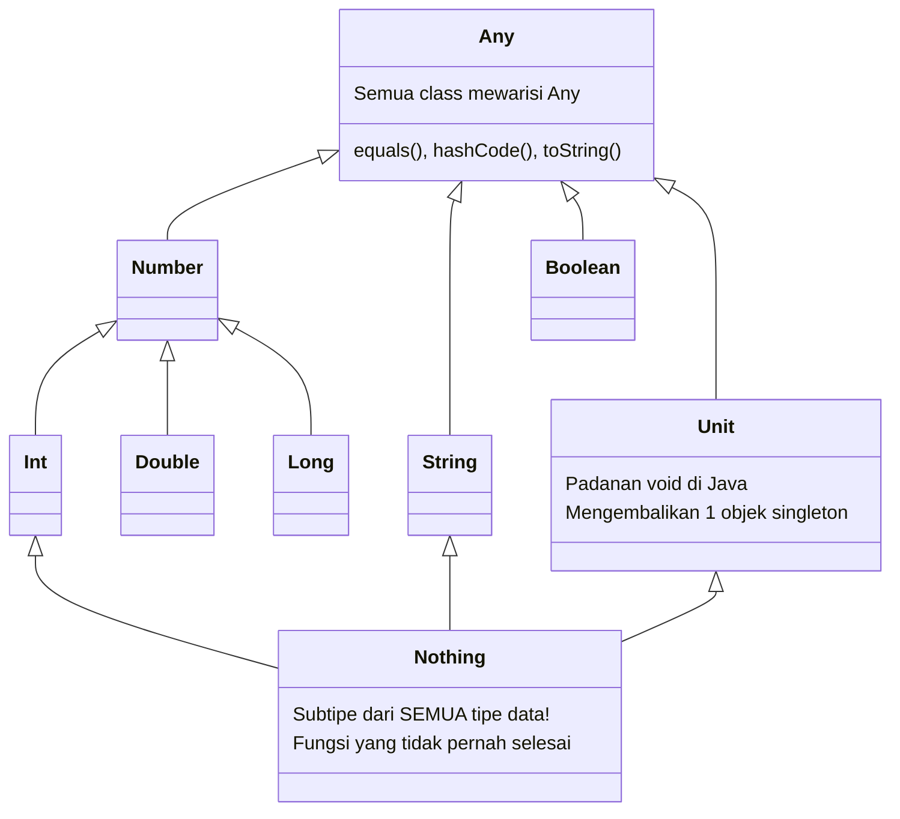

# 🟣 Kotlin - Modul 01: Sintaks Dasar, Variabel & Tipe Data

Kotlin adalah bahasa pemrograman modern berorientasi objek dan fungsional yang berjalan di atas Java Virtual Machine (JVM), Native (iOS/Desktop), dan JavaScript. Kotlin dirancang oleh JetBrains untuk mengatasi kelemahan verbositas dan *NullPointerException* warisan Java.

---

## 1. Deklarasi Variabel: `val` vs `var`

Di Kotlin, *immutability* (data tidak dapat diubah) sangat diprioritaskan:

```kotlin
// 1. val (Value / Immutable): Nilai tidak bisa di-reassign setelah diinisialisasi
val nama: String = "Eka"
// nama = "Budi" // ❌ ERROR: Val cannot be reassigned!

// 2. var (Variable / Mutable): Nilai bisa diubah sewaktu-waktu
var saldo: Double = 150000.0
saldo += 50000.0 // ✅ OK

// 3. Type Inference: Tipe data ditebak otomatis oleh compiler
val umur = 28        // Otomatis bertipe Int
val phi = 3.14159    // Otomatis bertipe Double
val isAktif = true   // Otomatis bertipe Boolean
```

> [!TIP]
> **Aturan Emas Kotlin**: Selalu gunakan **`val`** secara default. Hanya ubah menjadi `var` jika variabel tersebut benar-benar membutuhkan mutasi nilai berulang kali di dalam loop atau kalkulasi dinamis.

---

## 2. Hirarki Tipe Data: Primitive as Object, `Unit` & `Nothing`

Di Kotlin, **tidak ada tipe primitif mentah** seperti `int` atau `boolean` kecil di Java. Semua tipe data direpresentasikan sebagai objek kelas, namun compiler Kotlin otomatis mengompilasinya menjadi primitif JVM berkecepatan tinggi di balik layar.



### A. Perbedaan `Unit` vs `Nothing`
- **`Unit`**: Padanan dari `void` di Java/C, tetapi `Unit` adalah objek singleton nyata. Jika fungsi tidak mengembalikan nilai apa pun, fungsi tersebut secara implisit mengembalikan `Unit`:
  ```kotlin
  fun printPesan(pesan: String): Unit {
      println(pesan)
  }
  ```
- **`Nothing`**: Tipe data spesial yang **tidak memiliki instance**. Digunakan untuk menandai fungsi yang **tidak akan pernah kembali secara normal** (misalnya selalu melempar exception atau berada dalam infinite loop tak berujung):
  ```kotlin
  fun lemparErrorFatal(pesan: String): Nothing {
      throw IllegalStateException("Bencana: $pesan")
  }

  // Compiler memanfaatkan Nothing untuk type inference:
  val data: String = database.find(id) ?: lemparErrorFatal("Data tidak ada")
  // Di baris setelah ini, compiler TAHU PASTI variabel 'data' bertipe String murni (Bukan String?)!
  ```

---

## 3. String Template & Multiline Strings

```kotlin
val harga = 50000
val qty = 3

// 1. String Interpolasi sederhana dengan tanda $
println("Harga satuan: $harga")

// 2. Evaluasi ekspresi kompleks dengan kurung kurawal ${...}
println("Total tagihan: Rp ${harga * qty}")

// 3. Multiline Raw String dengan trimIndent()
val formatJson = """
    {
      "nama": "Eka Dev",
      "total_item": ${qty * 2},
      "status": "PAID"
    }
""".trimIndent()
```

---

## 4. Type Checking & Smart Casts

Di Java, setelah memeriksa `if (obj instanceof String)`, developer harus melakukan casting manual `(String) obj`. Di Kotlin, compiler secara cerdas melakukan **Smart Cast** otomatis!

```kotlin
fun prosesData(obj: Any) {
    // 1. Smart Cast dengan operator 'is'
    if (obj is String) {
        // Compiler otomatis menganggap obj sebagai String!
        println("Panjang teks: ${obj.length}") // Langsung bisa panggil .length
    }

    // 2. Inverted Check
    if (obj !is Int) return
    // Setelah return, compiler tahu pasti obj adalah Int!
    println("Nilai kuadrat: ${obj * obj}")

    // 3. Unsafe Cast 'as' vs Safe Cast 'as?'
    // val teks = obj as String // ❌ Lempar ClassCastException jika obj bukan String!
    val teksAman: String? = obj as? String // ✅ Jika gagal, menghasilkan null tanpa crash!
}
```

---

## 5. Control Flow Modern: Range Looping & `when`

### A. Looping Range (`..`, `until`, `downTo`, `step`)
```kotlin
// 1. Rentang Inklusif 1 s/d 5 (1, 2, 3, 4, 5)
for (i in 1..5) print("$i ")

// 2. Rentang Eksklusif dengan 'until' (1, 2, 3, 4) - Sangat cocok untuk index array!
for (i in 1 until 5) print("$i ")

// 3. Menghitung Mundur dengan 'downTo' dan lompatan 'step'
for (i in 10 downTo 0 step 2) {
    print("$i ") // 10, 8, 6, 4, 2, 0
}
```

### B. Ekspresi Sakti `when` (Pengganti `switch-case`)
Di Kotlin, `when` bukan sekadar statement pemilih, melainkan **sebuah ekspresi yang mengembalikan nilai** (*Expression*) dan mendukung evaluasi kondisi bebas:

```kotlin
val statusCode = 404

val pesanRespons = when (statusCode) {
    200, 201 -> "Sukses: Data berhasil diproses"
    in 400..499 -> "Error Client: Permintaan tidak valid ($statusCode)"
    in 500..599 -> "Error Server: Internal failure"
    else -> "Kode status tidak dikenal"
}

// when tanpa argumen (Pengganti if-else ladder yang rapi):
val skor = 85
val predikat = when {
    skor >= 90 -> "A - Luar Biasa"
    skor >= 80 -> "B - Baik"
    skor >= 70 -> "C - Cukup"
    else -> "D - Ulangi"
}
```
