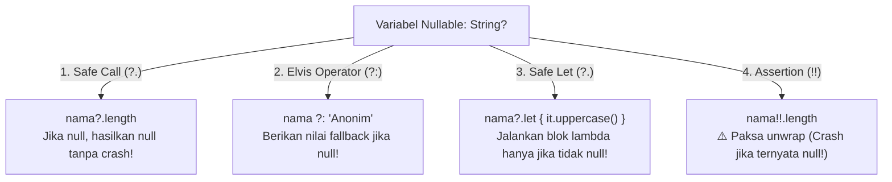

# 🟣 Kotlin - Modul 02: Null Safety & Operator Spesial

Tony Hoare menyebut penemuan pointer `null` pada tahun 1965 sebagai *"The Billion Dollar Mistake"*, karena telah menyebabkan miliaran crash sistem di dunia. Kotlin memecahkan masalah ini di tingkat sistem tipe data compiler melalui **Sound Null Safety**.

---

## 1. Tipe Nullable vs Non-Nullable

Di Kotlin, tipe data secara default **TIDAK BISA bernilai null**. Anda harus secara eksplisit membubuhkan tanda tanya (`?`) untuk mengizinkan nilai null.

```kotlin
// 1. Non-Nullable: Dijamin 100% tidak pernah null
var nama: String = "Eka"
// nama = null // ❌ COMPILE ERROR: Null can not be a value of a non-null type String!

// 2. Nullable Type: Ditandai dengan tanda tanya ?
var kota: String? = "Jakarta"
kota = null // ✅ Diizinkan compiler!
```

---

## 2. 4 Senjata Sakti Penanganan Null



### A. Operator Safe Call (`?.`)
Jika variabel bernilai `null`, compiler tidak akan melempar `NullPointerException`, melainkan mengembalikan nilai `null`:
```kotlin
val email: String? = null
val panjang: Int? = email?.length // panjang bernilai null (Aman, aplikasi tidak crash!)
```

### B. Operator Elvis (`?:`)
Menyediakan nilai default (*fallback*) jika sisi sebelah kiri bernilai null:
```kotlin
val username: String? = null
val displayName: String = username ?: "Guest" // displayName bernilai "Guest"
```

#### Elvis untuk Guard Clause & Early Return:
Pola paling populer di clean code Kotlin:
```kotlin
fun prosesPesanan(orderId: String?) {
    // Jika orderId null, hentikan eksekusi fungsi seketika:
    val id = orderId ?: return 

    // Jika order tidak ditemukan di database, lempar exception:
    val order = orderRepo.find(id) ?: throw NoSuchElementException("Pesanan $id raib!")

    println("Memproses pesanan untuk: ${order.customerName}")
}
```

### C. Safe Unwrapping dengan `?.let`
Menjalankan blok kode hanya jika objek tidak bernilai null:
```kotlin
val token: String? = dapatkanTokenDariStorage()

token?.let { nonNullToken ->
    // Di dalam blok ini, nonNullToken dijamin 100% BUKAN null!
    apiService.setAuthorizationHeader("Bearer $nonNullToken")
    println("Token valid sepanjang: ${nonNullToken.length} karakter")
}
```

### D. Operator Not-Null Assertion (`!!`)
Memberitahu compiler: *"Saya bersumpah nilai ini pasti ada, jika saya salah, silakan crash aplikasi saya!"*:
```kotlin
val biodata: String? = "Ada data"
val panjangPasti: Int = biodata!!.length // Jika biodata null -> 💥 NullPointerException dilempar!
```
> [!CAUTION]
> Hindari penggunaan operator `!!` di kode produksi! Penggunaan `!!` mematikan fitur keselamatan Kotlin dan mengembalikan aplikasi Anda ke kerapuhan era Java. Gunakan `?.let` atau `?:` sebagai gantinya.

---

## 3. Koleksi Nullable: `filterNotNull()`

Kotlin membedakan antara **List of Nullable Items** dengan **Nullable List**:
```kotlin
// 1. List-nya ada, tapi item di dalamnya bisa null:
val daftarNilai: List<Int?> = listOf(80, null, 95, null, 100)

// Bersihkan semua item null secara instan:
val nilaiBersih: List<Int> = daftarNilai.filterNotNull()
println(nilaiBersih) // [80, 95, 100] (Tipe data otomatis menjadi List<Int> non-nullable!)

// 2. Variabel list-nya sendiri yang bisa null:
val listMungkinNull: List<String>? = null
val jumlahElemen: Int = listMungkinNull?.size ?: 0
```

---

## 4. Inisialisasi Tunda: `lateinit var` vs `by lazy`

Seringkali kita tidak bisa menginisialisasi variabel saat deklarasi (misal di Android Activity saat view binding baru tersedia di `onCreate`):

| Fitur | `lateinit var` | `val ... by lazy` |
|---|---|---|
| **Tipe Variabel** | Wajib `var` (Mutable). | Wajib `val` (Immutable / Read-only). |
| **Tipe Data** | Hanya untuk tipe Objek (Bukan primitif `Int`, `Double`, `Boolean`). | Mendukung semua tipe data. |
| **Inisialisasi** | Diinisialisasi secara manual di kemudian hari oleh developer. | Diinisialisasi otomatis saat variabel **pertama kali diakses** (*Thread-safe*). |
| **Pengecekan** | Bisa dicek dengan `this::variabel.isInitialized`. | Otomatis diatur engine delegasi. |

```kotlin
class DetailActivity {
    // 1. lateinit var: Diisi manual nanti di onCreate
    lateinit var presenter: DetailPresenter

    // 2. by lazy: Baru dieksekusi saat databaseHelper pertama kali dipanggil!
    val databaseHelper: DatabaseHelper by lazy {
        println("Membuat koneksi database...")
        DatabaseHelper(context = this)
    }

    fun onCreate() {
        presenter = DetailPresenter()
    }
}
```

---

## 5. Platform Types Java (`T!`)

Saat Anda memanggil kode Java dari Kotlin:
```java
// Kode Java
public class UserJava {
    public String getNama() { return "Eka"; }
}
```
Karena Java tidak memiliki sistem null safety bawaan, Kotlin menandai kembalian method Java sebagai **Platform Type** bertanda seru: `String!`.
- Compiler Kotlin tidak tahu apakah kembalian method tersebut bisa null atau tidak.
- **Praktik Terbaik**: Selalu tangani platform types secara defensif sebagai tipe nullable (`val nama: String? = userJava.nama`) untuk mencegah crash tak terduga!
