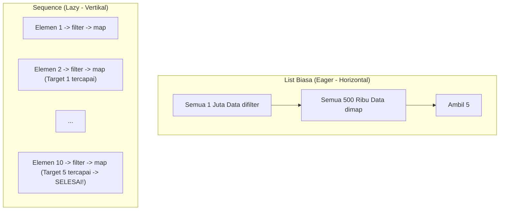

# 🟣 Kotlin - Modul 04: Koleksi, Transformasi & Lazy Sequences

Manipulasi data adalah denyut nadi aplikasi modern. Kotlin menyediakan arsitektur koleksi yang memisahkan antarmuka hanya-baca (*Read-Only*) dengan antarmuka yang dapat dimutasi (*Mutable*), serta menghadirkan **`Sequence`** untuk pemrosesan dataset besar tanpa membanjiri memori RAM.

---

## 1. Arsitektur: Read-Only vs Mutable Collections

Di Java, method `List.add()` selalu ada di interface, dan jika list tidak boleh diubah, Java melempar `UnsupportedOperationException` saat runtime. Kotlin menyelesaikan inkonsistensi ini di tingkat kompilasi:

```mermaid
classDiagram
    class Iterable
    class Collection
    class List {
        <<interface>>
        get(), size, contains()
        (Hanya-Baca / Read-Only)
    }
    class MutableList {
        <<interface>>
        add(), remove(), clear()
        (Bisa Diubah / Mutable)
    }

    Iterable <|-- Collection
    Collection <|-- List
    List <|-- MutableList
```

```kotlin
// 1. Read-Only List (listOf): Tidak ada method .add() atau .remove()!
val daftarBahasa: List<String> = listOf("Kotlin", "Swift", "Go")
// daftarBahasa.add("Rust") // ❌ COMPILE ERROR: Unresolved reference 'add'

// 2. Mutable List (mutableListOf): Mendukung penambahan & penghapusan
val daftarTugas: MutableList<String> = mutableListOf("Makan", "Tidur")
daftarTugas.add("Coding") // ✅ OK
```

> [!TIP]
> **Prinsip Enkapsulasi State**: Di arsitektur Clean Code atau ViewModel, ekspos koleksi internal sebagai Read-Only:
> ```kotlin
> private val _items = mutableListOf<String>() // Private mutable
> val items: List<String> get() = _items        // Public read-only
> ```

---

## 2. Operator Transformasi Canggih

Lupakan perulangan `for` manual dan `if` bertingkat. Kotlin menyediakan deretan fungsi deklaratif:

### A. `partition` (Membelah List Menjadi 2 Sekaligus)
Membagi koleksi menjadi sepasang (*Pair*) list: list pertama yang memenuhi kondisi, dan list kedua yang tidak:
```kotlin
val angka = listOf(1, 2, 3, 4, 5, 6, 7, 8)
val (genap, ganjil) = angka.partition { it % 2 == 0 }

println("Genap: $genap")   // [2, 4, 6, 8]
println("Ganjil: $ganjil") // [1, 3, 5, 7]
```

### B. `groupBy` vs `associateBy`
- **`groupBy`**: Mengelompokkan banyak item dengan key yang sama menjadi `Map<Key, List<Item>>`:
  ```kotlin
  data class User(val nama: String, val role: String)
  val users = listOf(User("Eka", "ADMIN"), User("Budi", "USER"), User("Siti", "USER"))

  val grupRole: Map<String, List<User>> = users.groupBy { it.role }
  // grupRole["USER"] menghasilkan list berisi 2 orang (Budi & Siti)
  ```
- **`associateBy`**: Mengubah list menjadi `Map<Key, Item>` tunggal (jika ada key sama, item terakhir menimpa item sebelumnya):
  ```kotlin
  val userMapById = users.associateBy { it.nama }
  // userMapById["Eka"] langsung mengembalikan objek User("Eka", "ADMIN")
  ```

### C. `flatMap` vs `flatten`
Membongkar list bersarang (*Nested Lists*) menjadi satu list datar:
```kotlin
val orders = listOf(
    listOf("Keyboard", "Mouse"),
    listOf("Monitor"),
    listOf("Headset", "Mic")
)

val semuaItem: List<String> = orders.flatten()
// ["Keyboard", "Mouse", "Monitor", "Headset", "Mic"]
```

### D. Akumulasi: `fold` & `sumOf`
```kotlin
data class Keranjang(val nama: String, val harga: Int, val qty: Int)
val cart = listOf(
    Keranjang("Mouse", 200000, 2),
    Keranjang("Keyboard", 800000, 1)
)

// 1. sumOf (Sangat ringkas untuk menghitung total angka):
val totalBayar = cart.sumOf { it.harga * it.qty } // 1.200.000

// 2. fold (Akumulator umum dengan nilai awal):
val invoiceText = cart.fold("Daftar Belanja:\n") { acc, item ->
    acc + "- ${item.nama} x${item.qty}\n"
}
```

---

## 3. Perangkap Memori Eager vs Lazy Sequences

### Jebakan Koleksi Biasa (`Iterable` Eager Evaluation)
Ketika Anda melakukan *chaining* operator pada `List` biasa:
```kotlin
val hasil = (1..1000000)
    .filter { it % 2 == 0 } // ⚠️ Alokasi List intermediate 1: Berisi 500.000 angka di Heap!
    .map { it * 2 }         // ⚠️ Alokasi List intermediate 2: Berisi 500.000 angka di Heap!
    .take(5)                // Mengambil 5 angka pertama
    .toList()
```
Dua buah koleksi sementara berukuran raksasa dibuat di RAM hanya untuk mengambil 5 data pertama!

---

### Solusi Sakti: `Sequence` (Lazy Evaluation)
`Sequence` memproses data **secara vertikal (elemen-per-elemen)**, bukan horizontal (tahap-per-tahap). Setiap elemen dialirkan dari awal hingga akhir satu per satu:



```kotlin
val hasilCepat = (1..1000000).asSequence()
    .filter { it % 2 == 0 }
    .map { it * 2 }
    .take(5) // Setelah menemukan 5 elemen yang lolos, perulangan langsung BERHENTI!
    .toList() // Terminal operator yang memicu eksekusi
```
Query selesai dalam hitungan mikrodetik dengan konsumsi memori mendekati **0 MB**!

### Membuat Infinite Sequence:
```kotlin
// Membangun deret bilangan Fibonacci tanpa batas:
val fibonacci = generateSequence(Pair(0, 1)) { Pair(it.second, it.first + it.second) }
    .map { it.first }

println(fibonacci.take(10).toList()) // [0, 1, 1, 2, 3, 5, 8, 13, 21, 34]
```
