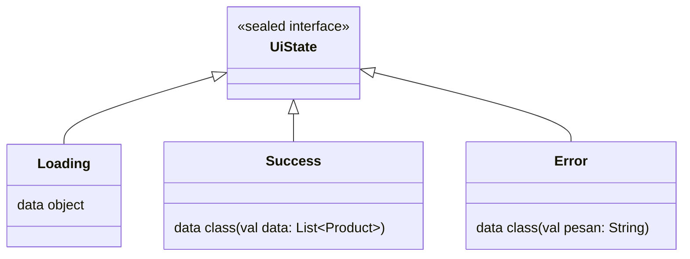

# 🟣 Kotlin - Modul 05: OOP, Sealed Hierarchy & Properti Delegasi

Kotlin memangkas ratusan baris kode *boilerplate* berulang yang biasa kita jumpai dalam Object-Oriented Programming (OOP) Java: tidak ada lagi kebutuhan membuat method Getter/Setter, `equals()`, `hashCode()`, atau builder pattern manual.

---

## 1. Konstruktor Ringkas & Data Classes

Di Java, membuat class POJO sederhana dengan 3 field membutuhkan sekitar 50 baris kode. Di Kotlin, cukup **1 baris**:

```kotlin
data class User(val id: Int, val nama: String, val email: String)
```

### Apa yang Otomatis Dibuat oleh `data class`?
1. **`toString()`**: Menghasilkan teks deskriptif otomatis: `User(id=1, nama=Eka, email=eka@dev.local)`.
2. **`equals()` & `hashCode()`**: Perbandingan struktural berdasarkan isi data properti, bukan alamat memori pointer.
3. **`copy()`**: Mengkloning objek secara aman sambil memodifikasi field tertentu:
   ```kotlin
   val userLama = User(1, "Eka", "lama@dev.local")
   val userBaru = userLama.copy(email = "baru@dev.local") // id dan nama tetap disalin!
   ```
4. **`componentN()` Functions**: Mendukung **Destructuring Declarations**:
   ```kotlin
   val (idUser, namaUser) = userBaru
   println("ID: $idUser, Nama: $namaUser")
   ```

---

## 2. Sealed Hierarchy: State Machine Kebal Bug

Jika Anda membangun aplikasi mobile atau web, pola terbaik untuk memodelkan status UI (*UI State*) adalah menggunakan **`sealed interface`** atau **`sealed class`**.



### Mengapa Sealed Hierarchy Sangat Hebat?
Semua turunan dari *sealed interface* **wajib diketahui saat waktu kompilasi**. Compiler mengetahui secara pasti semua kemungkinan status yang ada!

```kotlin
sealed interface UiState {
    data object Loading : UiState
    data class Success(val produk: List<String>) : UiState
    data class Error(val pesan: String, val kode: Int) : UiState
}

// Evaluasi Exhaustive When:
fun renderLayar(state: UiState) = when (state) {
    is UiState.Loading -> tampilkanLoadingSpinner()
    is UiState.Success -> tampilkanDaftarProduk(state.produk) // Smart Cast otomatis!
    is UiState.Error -> tampilkanBannerError(state.pesan)
    // 💡 TIDAK PERLU branch 'else'! 
    // Jika kelak Anda menambah 'is UiState.Empty', compiler akan melempar ERROR
    // dan memaksa Anda menangani state baru tersebut di seluruh file proyek!
}
```

---

## 3. Singleton `object` & `companion object`

### A. Singleton Murni (`object`)
Membangun pola Singleton di Kotlin tidak membutuhkan `getInstance()` atau *double-checked locking*:
```kotlin
object DatabaseConfig {
    const val URL = "jdbc:postgresql://localhost:5432/db"
    fun getKoneksi() = "Connected to $URL"
}

// Pemanggilan langsung via nama objek:
val status = DatabaseConfig.getKoneksi()
```

### B. `companion object` (Pengganti Keyword `static`)
Kotlin tidak memiliki kata kunci `static`. Fungsi dan konstanta yang menempel pada sebuah kelas diletakkan di dalam **`companion object`**:
```kotlin
class ApiService private constructor(val url: String) {
    companion object {
        const val BASE_URL = "https://api.eka-dev.cloud"

        // Factory Method:
        fun create(): ApiService {
            return ApiService(BASE_URL)
        }
    }
}

// Pemanggilan:
val service = ApiService.create()
```

---

## 4. Properti Delegasi (Delegated Properties)

Pola delegasi memungkinkan kita menyerahkan logika getter/setter suatu properti ke objek pembantu terpisah menggunakan sintaks **`by`**.

### A. Delegasi Bawaan: `lazy`, `observable`, `vetoable`
```kotlin
import kotlin.properties.Delegates

class AkunPengguna {
    // 1. by lazy: Inisialisasi lambat hanya saat pertama kali dibaca
    val tokenRahasia: String by lazy {
        println("Menghitung hash token...")
        "JWT-ABC-123"
    }

    // 2. Delegates.observable: Pasang observer/listener perubahan nilai
    var levelPengguna: Int by Delegates.observable(1) { prop, oldVal, newVal ->
        println("Properti ${prop.name} naik dari level $oldVal ke level $newVal!")
    }

    // 3. Delegates.vetoable: Validasi nilai baru (bisa menolak assignment jika false!)
    var usia: Int by Delegates.vetoable(18) { _, _, newAge ->
        newAge >= 17 // Tolak jika nilai baru < 17 tahun!
    }
}
```

### B. Membuat Delegated Property Kustom
Misal: Kita ingin membuat properti string yang otomatis menghapus spasi di awal dan akhir (*auto-trim*):

```kotlin
import kotlin.properties.ReadWriteProperty
import kotlin.reflect.KProperty

class TrimmedString(private var nilai: String) : ReadWriteProperty<Any?, String> {
    override fun getValue(thisRef: Any?, property: KProperty<*>): String = nilai

    override fun setValue(thisRef: Any?, property: KProperty<*>, value: String) {
        nilai = value.trim() // Otomatis hapus spasi liar!
    }
}

// Penggunaan di Class:
class ProfilKaryawan {
    var nama: String by TrimmedString("")
}

val k = ProfilKaryawan()
k.nama = "   Eka Dev Santoso   "
println(k.nama) // "Eka Dev Santoso" (Spasi langsung bersih!)
```
