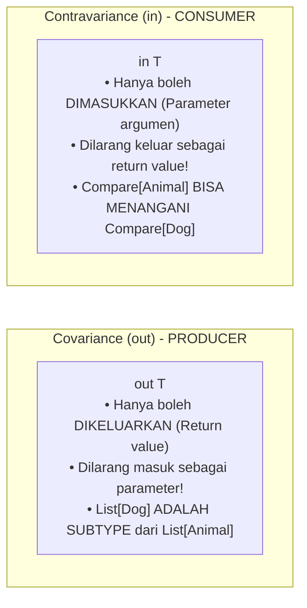

# 🟣 Kotlin - Modul 07: Generics, Variance (in/out) & Reified Types

Generics memungkinkan kita menulis kode yang fleksibel, dapat digunakan kembali (*reusable*), dan aman dari kesalahan tipe data saat kompilasi (*Type-Safe*). Salah satu keunggulan terbesar Kotlin atas Java adalah sistem **Declaration-Site Variance** yang elegan dan **Reified Type Parameters**.

---

## 1. Konsep Dasar Generics & Type Constraints

```kotlin
// 1. Generic Class dengan Type Parameter T
class KotakPenyimpanan<T>(val item: T) {
    fun ambilItem(): T = item
}

// 2. Type Constraint (Membatasi T hanya untuk turunan Number)
fun <T : Number> hitungRataRata(a: T, b: T): Double {
    return (a.toDouble() + b.toDouble()) / 2.0
}
```

---

## 2. Masalah Invariance: Mengapa `ArrayList<String>` Bukan `ArrayList<Any>`?

Di Java atau Kotlin, tipe generic secara default bersifat **Invariant** (Kaku):
Walaupun `String` adalah turunan (*subtype*) dari `Any`, objek `MutableList<String>` **BUKAN** turunan dari `MutableList<Any>`.

```kotlin
// Mengapa dilarang? Bayangkan jika ini diizinkan:
val daftarString: MutableList<String> = mutableListOf("A", "B")
// val daftarAny: MutableList<Any> = daftarString // ❌ KOTLIN MELARANG INI!
// daftarAny.add(100) // 💥 Bencana! Angka integer masuk ke list yang isinya String!
```

Namun, bagaimana dengan list yang **hanya bisa dibaca (*Read-Only*)**? Jika kita hanya membaca data, mengambil `String` sebagai `Any` dijamin $100\%$ aman! Inilah yang disebut **Variance**.

---

## 3. Declaration-Site Variance: Covariance (`out`) vs Contravariance (`in`)

Kotlin menggantikan sintaks *Wildcards* Java yang rumit (`? extends T` dan `? super T`) dengan dua kata kunci intuitif: **`out`** dan **`in`**.



### Rumus Sakti: PECS (Producer Out, Consumer In)

### A. Covariance (`out` - Menghasilkan / Producer)
Gunakan kata kunci `out` jika generic class Anda **hanya memproduksi/mengeluarkan nilai bertipe `T`**:
```kotlin
// Karena hanya ada fungsi get(), pasang 'out':
interface SumberData<out T> {
    fun ambil(): T // T hanya keluar (return)
}

fun prosesHewan(sumber: SumberData<Any>) { ... }

val sumberString: SumberData<String> = ...
prosesHewan(sumberString) // ✅ Diizinkan 100%! Subtyping bekerja secara alami.
```
Inilah alasan mengapa `List<String>` di Kotlin bisa di-passing ke fungsi yang meminta `List<Any>`, karena interface `List` didefinisikan sebagai:
`public interface List<out E> : Collection<E>`!

---

### B. Contravariance (`in` - Menerima / Consumer)
Gunakan kata kunci `in` jika generic class Anda **hanya menerima/mengkonsumsi nilai bertipe `T`**:
```kotlin
interface Pembanding<in T> {
    fun bandingkan(item1: T, item2: T): Int // T hanya masuk sebagai parameter
}

val pembandingSemuaObjek: Pembanding<Number> = ...
val pembandingKhususInt: Pembanding<Int> = pembandingSemuaObjek // ✅ Subtyping terbalik!
```

---

## 4. Reified Type Parameters: Menghancurkan Type Erasure JVM

### Apa itu Type Erasure?
Di JVM, informasi tipe data generic **dihapus saat runtime** (*Type Erasure*). Saat aplikasi berjalan, JVM hanya melihat `List` mentah tanpa tahu apakah itu `List<String>` atau `List<Int>`. 

Akibatnya, kode berikut **DILARANG** di Java dan Kotlin biasa:
```kotlin
fun <T> cekTipe(obj: Any) {
    // if (obj is T) { } // ❌ ERROR: Cannot check for instance of erased type: T!
}
```

---

### Solusi Sakti Kotlin: `inline fun <reified T>`
Dengan menggabungkan fungsi **`inline`** dan kata kunci **`reified`**, compiler Kotlin menyalin tipe kelas aktual langsung ke bytecode pemanggil, membuat tipe generic **dapat diakses saat runtime**!

```kotlin
// 1. Pengecekan Tipe Dinamis yang Sebelumnya Mustahil:
inline fun <reified T> cekDanCasting(obj: Any): T? {
    return if (obj is T) obj else null // ✅ Berhasil! Tipe T tidak dihapus!
}

// 2. Navigasi Activity Android Super Ringkas:
inline fun <reified T : Any> Context.bukaLayar() {
    val intent = Intent(this, T::class.java) // Langsung dapat java.lang.Class tanpa parameter manual!
    startActivity(intent)
}

// Pemanggilan di UI:
// context.bukaLayar<DetailUserActivity>()

// 3. Deserialisasi JSON Tanpa Menulis Class Token:
inline fun <reified T> parseJson(jsonString: String): T {
    return Gson().fromJson(jsonString, T::class.java)
}
```
