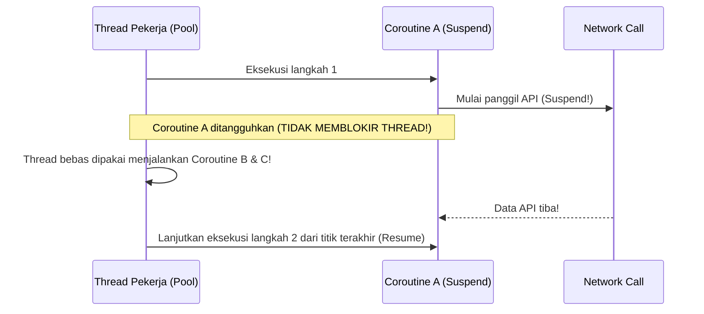
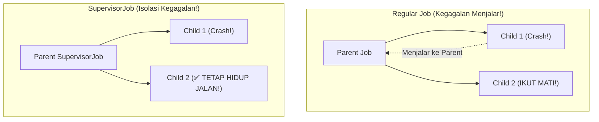

# 🟣 Kotlin - Modul 08: Coroutines Deep Dive & Structured Concurrency

Thread pada tingkat sistem operasi sangat boros memori (1 thread OS memakan sekitar 1MB memori stack). Menjalankan 5.000 thread sekaligus bisa membuat server kehabisan memori. Kotlin menghadirkan **Coroutines (Lightweight Threads)**: Anda bisa menjalankan **100.000 coroutines sekaligus** di atas segelintir thread CPU tanpa membebani memori!

---

## 1. Bagaimana Coroutine Bekerja di Balik Layar?

Ketika sebuah fungsi ditandai dengan kata kunci **`suspend`**, compiler Kotlin mengubah fungsi tersebut menjadi mesin status (*State Machine*) menggunakan teknik **Continuation-Passing Style (CPS)**.



Fungsi suspend **tidak pernah memblokir thread pekerja**. Thread tersebut bebas melayani tugas lain selama operasi I/O menunggu respon jaringan.

---

## 2. Dispatchers: Memilih Thread yang Tepat

| Dispatcher | Thread Pool yang Digunakan | Kasus Penggunaan Wajib |
|---|---|---|
| **`Dispatchers.Main`** | Main Thread / UI Thread tunggal | Mengupdate tampilan UI, animasi, interaksi tombol di Android/Desktop. |
| **`Dispatchers.IO`** | Elastic Thread Pool (Maks 64 thread atau jumlah core) | Membaca database, REST API, query disk file, operasi jaringan blocking. |
| **`Dispatchers.Default`** | Fixed Thread Pool (Sesuai jumlah CPU cores) | Komputasi berat CPU: parsing JSON 50MB, enkripsi, pengolahan gambar, sorting. |
| **`Dispatchers.Unconfined`** | Dimulai di thread saat ini hingga titik suspension pertama | Kasus khusus testing / event pipeline. |

### Berpindah Thread dengan `withContext`
```kotlin
suspend fun ambilDataDanUpdateUI() {
    // 1. Berpindah ke IO Thread untuk menarik data jaringan:
    val dataUser = withContext(Dispatchers.IO) {
        apiService.fetchUserProfile() // Blocking network call aman di sini!
    }

    // 2. Kembali otomatis ke Main Thread untuk update tampilan:
    withContext(Dispatchers.Main) {
        labelNama.text = dataUser.nama
    }
}
```

---

## 3. Structured Concurrency: `launch` vs `async`

Kotlin melarang coroutine liar yang tidak bertuan (*No Unstructured Concurrency*). Semua coroutine harus dimulai di dalam sebuah **`CoroutineScope`**.

### A. `launch` (Fire-and-Forget)
Mengembalikan objek **`Job`**. Digunakan saat Anda tidak membutuhkan nilai kembalian:
```kotlin
val job: Job = viewModelScope.launch {
    repo.kirimLogAktivitas()
}
// Batalkan kapan saja jika user meninggalkan halaman:
// job.cancel()
```

### B. `async` / `await` (Dekomposisi Paralel)
Mengembalikan objek **`Deferred<T>`**. Digunakan saat Anda ingin menjalankan beberapa pekerjaan secara bersamaan dan menggabungkan hasilnya:

```kotlin
suspend fun ambilDataDashboard() = coroutineScope {
    // Jalankan kedua request API secara paralel di saat yang sama!
    val deferredProfil = async(Dispatchers.IO) { api.getProfil() }
    val deferredSaldo = async(Dispatchers.IO) { api.getSaldo() }

    // Tunggu kedua hasil selesai:
    val profil = deferredProfil.await()
    val saldo = deferredSaldo.await()

    DashboardModel(profil, saldo)
}
```

---

## 4. Pembatalan Kooperatif (Cooperative Cancellation)

Memanggil `job.cancel()` **TIDAK serta-merta mematikan loop CPU seketika**. Coroutine di Kotlin bersifat kooperatif: kode Anda harus secara aktif mengecek status pembatalan!

```kotlin
val jobHitung = CoroutineScope(Dispatchers.Default).launch {
    var i = 0
    while (i < 1000000) {
        // ⚠️ CARA BENAR: Cek apakah coroutine sudah dibatalkan
        ensureActive() // atau cek: if (!isActive) break

        // Lakukan kalkulasi...
        i++
    }
}

jobHitung.cancel() // Sekarang loop akan langsung berhenti!
```

### Membersihkan Resource di Blok `finally`:
```kotlin
val job = launch {
    try {
        delay(10000)
    } finally {
        // Jika butuh memanggil fungsi suspend saat membersihkan resource yang dicancel:
        withContext(NonCancellable) {
            database.tutupKoneksi()
        }
    }
}
```

---

## 5. Menangani Exception: `Job` vs `SupervisorJob`



### Mengapa Menggunakan `SupervisorJob` / `supervisorScope`?
Pada `Job` biasa, jika 1 child coroutine mengalami crash, **seluruh sibling (saudara coroutine lain) dan parent akan ikut dibatalkan**.

Di aplikasi nyata, jika download foto profil gagal, download feed artikel tidak boleh ikut mati! Gunakan **`supervisorScope`**:

```kotlin
suspend fun sinkronisasiData() = supervisorScope {
    launch {
        // Jika task ini melempar exception...
        throw RuntimeException("Download Banner Gagal")
    }

    launch {
        // ...task ini TETAP BERJALAN DENGAN AMAN!
        println("Download Feed Artikel Sukses!")
    }
}
```

---

## 6. Thread Safety dengan Coroutine `Mutex`

Jangan gunakan `synchronized(lock)` di dalam coroutine karena akan memblokir seluruh thread OS! Gunakan **`Mutex`** yang ramah penangguhan (*Suspension-Friendly*):

```kotlin
import kotlinx.coroutines.sync.Mutex
import kotlinx.coroutines.sync.withLock

val mutex = Mutex()
var counter = 0

suspend fun tambahCounterAman() {
    // withLock menangguhkan coroutine (tanpa memblokir thread) hingga kunci tersedia:
    mutex.withLock {
        counter++
    }
}
```
