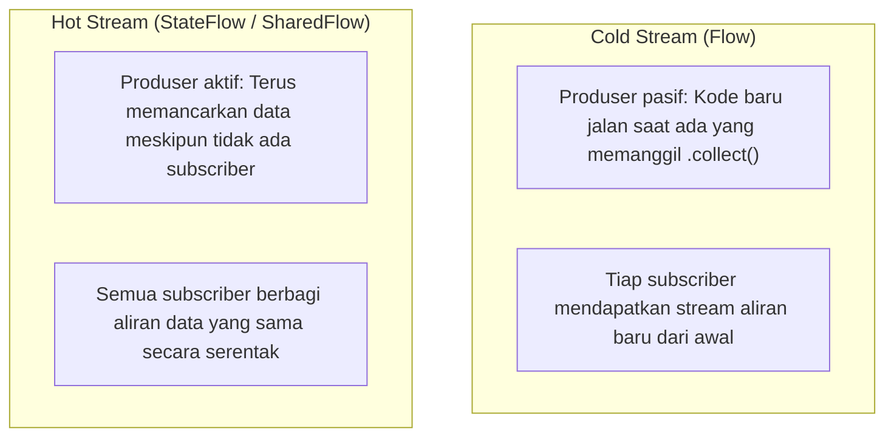
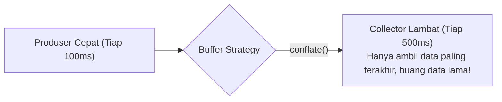

# 🟣 Kotlin - Modul 09: Reactive Flow, StateFlow & SharedFlow

Jika fungsi `suspend` hanya mampu mengembalikan satu nilai asinkron tunggal, bagaimana jika kita perlu mengalirkan **banyak nilai secara terus-menerus seiring berjalannya waktu** (seperti pembaruan lokasi GPS, websocket harga kripto, atau pencarian real-time)? 

Jawabannya adalah **Kotlin Flow**: pustaka aliran data reaktif (*Reactive Streams*) bawaan Kotlin.

---

## 1. Konsep Aliran: Cold Stream vs Hot Stream



| Karakteristik | ❄️ **Cold Stream (`Flow`)** | 🔥 **Hot Stream (`StateFlow` / `SharedFlow`)** |
|---|---|---|
| **Eksekusi Produser** | Pasif (Baru berjalan saat ada `collect`). | Aktif (Bisa memancarkan nilai kapan saja). |
| **Penyimpanan Nilai** | Tidak menyimpan nilai terakhir di memori. | `StateFlow` selalu menyimpan 1 nilai terakhir (`.value`). |
| **Jumlah Subscriber** | 1 produser per 1 collector. | Multi-cast (Banyak subscriber sekaligus). |
| **Kasus Penggunaan** | Request network berkala, pembacaan database Room. | State layar UI di ViewModel, notifikasi event satu kali. |

---

## 2. Membuat Cold Flow Dasar

```kotlin
import kotlinx.coroutines.delay
import kotlinx.coroutines.flow.*

// Produser Cold Flow: Mengalirkan data harga saham setiap 1 detik
fun streamHargaSaham(): Flow<Double> = flow {
    var harga = 100.0
    while (true) {
        emit(harga) // Pancarkan nilai ke collector
        delay(1000)
        harga += (-2..2).random()
    }
}

// Konsumsi Data (Collector):
suspend fun monitorPasar() {
    streamHargaSaham()
        .filter { it > 100.0 }
        .map { "Harga Naik: $$it" }
        .collect { pesan ->
            println(pesan) // Menerima data secara reaktif
        }
}
```

---

## 3. Operator Penting & Threading (`flowOn`)

### A. Memindahkan Thread Upstream dengan `flowOn`
Patuhi aturan: **Flow Context Preservation**. Jangan ganti context di dalam `flow { withContext(...) }`. Gunakan operator **`flowOn`**:
```kotlin
fun ambilDataSensor(): Flow<Int> = flow {
    // 1. Bagian ini berjalan di DISPATCHERS.IO
    emit(bacaSensorHardDisk()) 
}.flowOn(Dispatchers.IO) // Mengatur thread untuk blok flow di atasnya!

// Collector berjalan di thread pemanggil (misal Main UI Thread):
ambilDataSensor().collect { nilai ->
    textView.text = "$nilai"
}
```

### B. Fitur Pencarian Realtime: `debounce` & `distinctUntilChanged`
Cegah spam request API saat user mengetik di search bar:
```kotlin
searchQueryFlow
    .debounce(300) // Tunggu user berhenti mengetik selama 300ms
    .distinctUntilChanged() // Abaikan jika teks sama dengan input sebelumnya
    .flatMapLatest { query ->
        apiService.searchProducts(query) // Batalkan pencarian lama jika ada query baru!
    }
    .collect { listProduk ->
        updateTampilanAdapter(listProduk)
    }
```

---

## 4. Mengatasi Backpressure: `buffer`, `conflate`, `collectLatest`

**Backpressure** terjadi ketika produser memancarkan data lebih cepat daripada kemampuan collector memprosesnya.



1. **`buffer()`**: Menjalankan produser dan collector di dua coroutine terpisah dengan antrean memori, sehingga produser tidak tertahan menunggu collector.
2. **`conflate()`**: Jika collector sedang sibuk, **buang nilai-nilai perantara** dan langsung berikan nilai paling mutakhir saat collector senggang!
3. **`collectLatest`**: Membatalkan blok pemrosesan data lama seketika ketika nilai baru dipancarkan oleh produser.

---

## 5. Hot Streams: `StateFlow` vs `SharedFlow`

### A. `StateFlow` (Penyimpan State UI Layar)
- Wajib memiliki nilai awal (*Initial Value*).
- Selalu menyimpan nilai paling terakhir dan bisa dibaca langsung secara sinkron melalui `stateFlow.value`.
- Otomatis melakukan *conflation* (tidak memancarkan data jika nilainya sama persis).

```kotlin
class UserViewModel : ViewModel() {
    // 1. Private MutableStateFlow (Hanya ViewModel yang boleh mengubah isi)
    private val _uiState = MutableStateFlow<UiState>(UiState.Loading)

    // 2. Public Read-Only StateFlow (Diekspos ke View / Compose)
    val uiState: StateFlow<UiState> = _uiState.asStateFlow()

    fun loadData() {
        viewModelScope.launch {
            _uiState.value = UiState.Success(data = listOf("Item 1", "Item 2"))
        }
    }
}
```

### B. `SharedFlow` (Event Bus Satu-Kali / One-Off Events)
Gunakan `SharedFlow` untuk peristiwa yang tidak boleh dipancarkan ulang saat layar diputar (*Recreated*), seperti menampilkan **Toast, Snackbar, atau Perintah Navigasi**:

```kotlin
class CheckoutViewModel : ViewModel() {
    // Tidak butuh nilai awal!
    private val _eventFlow = MutableSharedFlow<String>()
    val eventFlow = _eventFlow.asSharedFlow()

    fun bayarPesanan() {
        viewModelScope.launch {
            // ...proses transaksi...
            _eventFlow.emit("Pembayaran Berhasil! Mengalihkan ke Home...")
        }
    }
}
```
