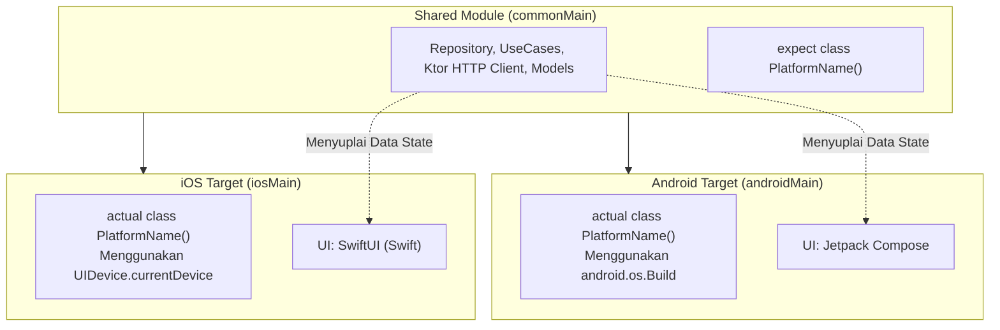

# 🟣 Kotlin - Modul 10: kotlinx.serialization & Fondasi KMP

Di era modern, Kotlin tidak lagi terikat hanya pada ekosistem Android atau JVM. Melalui **Kotlin Multiplatform (KMP)** dan pustaka **`kotlinx.serialization`**, kita dapat membagikan $80\%$ kode logika bisnis, validasi, networking, dan pemodelan data yang sama persis antara aplikasi Android, iOS, Desktop, dan Backend.

---

## 1. Mengapa `kotlinx.serialization` Menggantikan Gson?

Pustaka lama seperti Gson atau Jackson menggunakan teknik **Java Reflection** saat runtime untuk membaca nama field kelas. 

Kelemahan fatal Gson:
1. ❌ **Melanggar Null Safety**: Gson bisa secara diam-diam memasukkan nilai `null` ke dalam properti non-nullable Kotlin (`val nama: String`) tanpa memicu error saat parsing, mengakibatkan crash aneh di kemudian hari!
2. ❌ **Tidak Bisa Dijalankan di iOS/Native**: Kotlin/Native (iOS) tidak memiliki JVM reflection.
3. ❌ **Lambat**: Membaca refleksi kelas membebani CPU perangkat mobile.

**`kotlinx.serialization`** bekerja sebagai **Compiler Plugin** yang menghasilkan kode serialisasi murni secara otomatis saat waktu kompilasi (*Compile-time code generation*). Bebas refleksi, super cepat, dan $100\%$ menghormati aturan null safety Kotlin!

---

## 2. Praktik Parsing JSON Modern

```kotlin
import kotlinx.serialization.*
import kotlinx.serialization.json.*

// 1. Tambahkan anotasi @Serializable
@Serializable
data class UserDto(
    val id: Long,
    val nama: String,
    
    // 2. Pemetaan nama key JSON yang berbeda:
    @SerialName("user_email")
    val email: String,

    // 3. Properti opsional dengan nilai default:
    val role: String = "USER",

    // 4. Abaikan field ini agar tidak ikut diserialisasi:
    @Transient
    val tokenLokal: String = ""
)

fun main() {
    val json = Json {
        ignoreUnknownKeys = true // Jangan crash jika server mengirim field tambahan!
        prettyPrint = true
        isLenient = true
    }

    // A. Mengubah String JSON menjadi Objek Kotlin:
    val jsonString = """{"id": 101, "nama": "Eka", "user_email": "eka@dev.local"}"""
    val user: UserDto = json.decodeFromString(jsonString)
    println("User: ${user.nama}, Email: ${user.email}")

    // B. Mengubah Objek Kotlin menjadi String JSON:
    val outputJson: String = json.encodeToString(user)
    println(outputJson)
}
```

---

## 3. Polymorphic Serialization (Sealed Classes JSON)

Bagaimana jika sebuah endpoint API mengirimkan tipe pesan yang berbeda-beda dalam satu array? `kotlinx.serialization` mendukung serialisasi polimorfik secara otomatis menggunakan field discriminator `"type"`:

```kotlin
@Serializable
sealed interface EventPayload {
    @Serializable
    @SerialName("CHAT_TEXT") // Nilai properti "type" di JSON
    data class Teks(val pesan: String) : EventPayload

    @Serializable
    @SerialName("IMAGE_UPLOAD")
    data class Gambar(val url: String, val ukuranByte: Long) : EventPayload
}

val dataJson = """{"type": "CHAT_TEXT", "pesan": "Halo dunia!"}"""
val event: EventPayload = Json.decodeFromString(dataJson)

when (event) {
    is EventPayload.Teks -> println("Pesan teks: ${event.pesan}")
    is EventPayload.Gambar -> println("URL gambar: ${event.url}")
}
```

---

## 4. Konsep Inti Kotlin Multiplatform (KMP)

Filosofi arsitektur KMP adalah: **"Share logic, keep UI native"**. Anda menulis business logic, database lokal (SQLDelight/Room), dan network client (Ktor) satu kali di `commonMain`, lalu UI dibangun menggunakan **Jetpack Compose** di Android dan **SwiftUI** di iOS.



### Mekanisme `expect` dan `actual`
Jika kode di `commonMain` perlu mengakses API khusus platform (misal nama model HP):

#### 1. Deklarasi Janji di `commonMain` (`expect`):
```kotlin
// commonMain/Platform.kt
expect class Platform() {
    val namaOS: String
}
```

#### 2. Implementasi di `androidMain` (`actual`):
```kotlin
// androidMain/Platform.kt
import android.os.Build

actual class Platform actual constructor() {
    actual val namaOS: String = "Android ${Build.VERSION.SDK_INT}"
}
```

#### 3. Implementasi di `iosMain` (`actual`):
```kotlin
// iosMain/Platform.kt
import platform.UIKit.UIDevice

actual class Platform actual constructor() {
    actual val namaOS: String = "${UIDevice.currentDevice.systemName()} ${UIDevice.currentDevice.systemVersion}"
}
```

Dengan KMP, tim tidak perlu menduplikasi validasi kartu kredit, kalkulasi diskon, atau parsing JSON berulang kali di dua bahasa berbeda!
