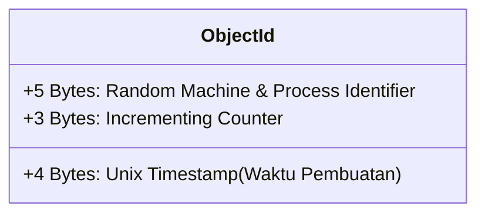

# 🍃 MongoDB - Modul 01: Dokumen, BSON & Operasi CRUD Lanjutan

MongoDB adalah basis data dokumen NoSQL terpopuler di dunia yang dirancang untuk skalabilitas horizontal tinggi, fleksibilitas skema dinamis, dan kecepatan pengolahan data semi-terstruktur.

---

## 1. Anatomi BSON vs JSON Standar

Banyak yang mengira MongoDB menyimpan teks JSON biasa. Di balik layar, MongoDB menggunakan format biner bernama **BSON (Binary JSON)**:

| Fitur | JSON Biasa | BSON (MongoDB) |
|---|---|---|
| **Representasi** | Teks ASCII / UTF-8 | Format Biner Terdekomposisi |
| **Parsing Overhead** | Berat (Harus di-parse dari string berulang kali) | **Sangat Ringan** (Disimpan dengan prefix panjang byte dan tipe data) |
| **Tipe Data Ekstra**| Hanya string, number, boolean, array, object, null | Mendukung **`Date` asli, `Binary` data, `Decimal128` presisi tinggi, `Regex`, dan `ObjectId`** |

### Anatomi 12-Byte `ObjectId` ("_id"):
Setiap dokumen memiliki primary key `_id` berukuran 12 byte yang terdistribusi dan unik secara global tanpa koordinasi pusat:


> [!TIP]
> **Trik Sakti**: Kamu bisa mengekstrak waktu pembuatan dokumen langsung dari `_id`-nya tanpa perlu membuat kolom `created_at` terpisah:
> `doc._id.getTimestamp()` mengembalikan tanggal dan jam pembuatan presisi detik!

---

## 2. Operasi Query Filter Canggih

```javascript
// Mengambil dokumen dengan kriteria majemuk:
db.pengguna.find({
    umur: { $gte: 18, $lte: 65 },          // Operator perbandingan: 18 <= umur <= 65
    status: { $in: ["AKTIF", "PENDING"] },  // Berada di salah satu himpunan
    "alamat.kota": "Jakarta",               // Query field bersarang (Dot Notation)
    hobi: { $all: ["koding", "kopi"] },     // Array wajib mengandung KEDUA elemen ini
    tags: { $size: 3 }                      // Panjang array tepat 3 elemen
})
.sort({ umur: -1, nama: 1 })               // Urutkan umur DESC, nama ASC
.skip(20)                                  // Paginasi offset
.limit(10);                                // Ambil 10 baris
```

---

## 3. Operator Mutasi Update Atomik

Hindari menimpa seluruh dokumen! Selalu gunakan operator pembaruan atomik:

```javascript
db.produk.updateOne(
    { _id: ObjectId("665123456789abcdef012345") },
    {
        // 1. $set: Mengubah atau menambah field spesifik tanpa merusak field lain
        $set: { harga: 150000, "spesifikasi.garansi": "2 Tahun", updated_at: new Date() },

        // 2. $inc: Menambah angka secara atomik (Anti Race Condition!)
        $inc: { stok: -1, terjual: 1 },

        // 3. $push: Menambahkan elemen baru ke dalam array
        $push: { riwayat_harga: { tanggal: new Date(), harga: 150000 } },

        // 4. $addToSet: Menambahkan ke array HANYA JIKA elemen belum pernah ada (Otomatis Unik)
        $addToSet: { tags: "diskon_kilat" }
    },
    { upsert: true } // Jika dokumen tidak ditemukan, BUAT BARU seketika!
);
```
