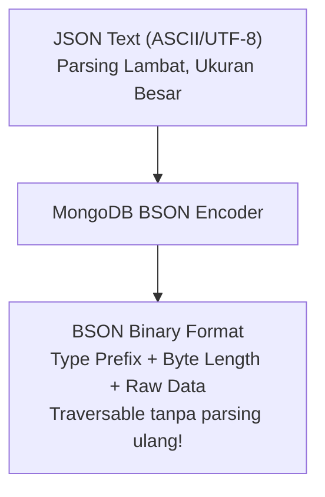
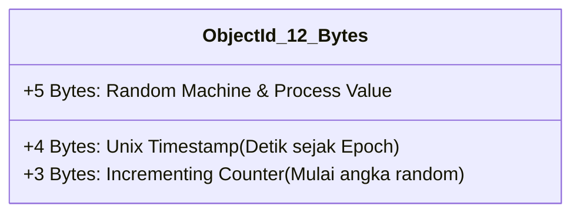
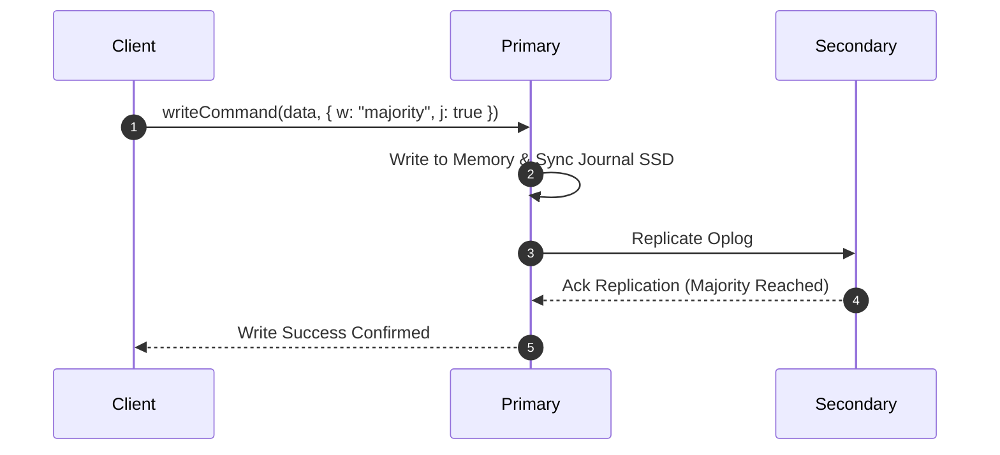

# 🍃 MongoDB - Modul 01: Dokumen, BSON & Operasi CRUD Lanjutan

MongoDB adalah basis data dokumen NoSQL terpopuler di dunia yang dirancang untuk skalabilitas horizontal tinggi, fleksibilitas skema dinamis, dan kecepatan pengolahan data semi-terstruktur berbasis dokumen terdistribusi.

---

## 1. Anatomi Format BSON vs JSON Standar

Banyak developer mengira MongoDB menyimpan teks JSON mentah. Di balik layar, engine MongoDB mengonversi dokumen ke format biner terdekomposisi bernama **BSON (Binary JSON)**.



| Karakteristik | JSON Biasa | BSON (MongoDB) |
|---|---|---|
| **Format Representasi** | String teks ASCII/UTF-8 | Serialisasi Biner Terstruktur |
| **Parsing Overhead** | Berat (seluruh string harus di-parse karakter per karakter) | **Sangat Cepat** (memiliki prefix panjang byte dan tipe data, engine bisa langsung loncat ke offset field) |
| **Tipe Data Ekstra** | String, Number, Boolean, Array, Object, Null | **`Date` (epoch ms), `Binary` (UUID/gambar), `Decimal128` (finansial), `Regex`, `Int32`, `Int64`, `Timestamp`, `ObjectId`** |
| **Ukuran Maksimum Dokumen**| Tidak dibatasi standar | **Tepat 16 MB per dokumen** |

> [!WARNING]
> **Aturan 16 MB Dokumen BSON**: Batas 16MB diterapkan oleh arsitektur MongoDB agar dokumen tidak menghabiskan terlalu banyak RAM cache WiredTiger saat di-fetch, dan mencegah lonjakan bandwidth jaringan. Jika kamu butuh menyimpan data biner > 16MB, gunakan spesifikasi **GridFS** (yang memecah file menjadi chunks 255KB di koleksi `fs.chunks`).

---

## 2. Anatomi 12-Byte `ObjectId` (`_id`)

Primary key bawaan MongoDB adalah `ObjectId`, nilai heksadesimal 24-karakter (12 byte) yang digenerate oleh client driver secara terdesentralisasi tanpa perlu koordinasi locking terpusat:



```javascript
// Memeriksa dan mengekstrak metadata dari ObjectId:
const id = new ObjectId();

// 1. Ekstrak waktu pembuatan dokumen (akurasi 1 detik):
console.log(id.getTimestamp()); 
// Output: 2026-11-20T04:15:22.000Z

// 2. Leksikografis terurut:
// ObjectId otomatis terurut secara kronologis berdasarkan 4 byte pertamanya!
db.orders.find({
    _id: { $gte: ObjectId.createFromTime(new Date("2026-01-01").getTime() / 1000) }
});
```

---

## 3. Operasi Create: `insertOne` vs `insertMany` (`ordered` Gotcha)

Saat memasukkan dokumen massal, opsi `ordered` menentukan perilaku error handling database:

```javascript
// 1. Single Insert
db.pelanggan.insertOne({
    nama: "Budi Santoso",
    email: "budi@eka-dev.cloud",
    saldo: NumberDecimal("1500000.50"), // Wajib Decimal128 untuk uang!
    status: "AKTIF",
    created_at: new Date()
});

// 2. Batch Insert dengan 'ordered: false' (UNORDERED)
db.produk.insertMany([
    { _id: 1, nama: "Laptop", sku: "SKU-001" },
    { _id: 2, nama: "Mouse", sku: "SKU-001" },  // Misal error duplicate key SKU
    { _id: 3, nama: "Keyboard", sku: "SKU-003" }
], {
    ordered: false // PENTING: Jika dokumen ke-2 gagal, dokumen ke-3 TETAP DIPROSES!
    // Jika ordered: true (default), kegagalan dokumen ke-2 akan menghentikan seluruh batch.
});
```

---

## 4. Query Filter Tingkat Lanjut

### A. Element & Evaluation Operators (`$exists`, `$type`, `$expr`)

```javascript
// 1. Memeriksa keberadaan field dan validasi tipe data:
db.pengguna.find({
    nomor_telepon: { $exists: true, $ne: null },
    skor_kredit: { $type: ["int", "double", "decimal"] }
});

// 2. $expr: Membandingkan 2 field di dalam SATU dokumen yang sama:
// Mencari transaksi di mana biaya kirim lebih besar dari keuntungan:
db.transaksi.find({
    $expr: {
        $gt: ["$ongkos_kirim", "$margin_keuntungan"]
    }
});
```

### B. Array Matching: `$all`, `$size`, dan `$elemMatch`

Gotcha terbesar di MongoDB adalah membedakan filter array biasa dengan `$elemMatch`:

```javascript
// Data: { item: "Jaket", varian: [{ warna: "Hitam", size: "XL" }, { warna: "Merah", size: "M" }] }

// ❌ SALAH: Filter biasa memeriksa elemen secara terpisah (OR kombinatorik):
// Dokumen di atas akan lolos query ini, padahal tidak ada varian "Hitam ukuran M"!
db.produk.find({
    "varian.warna": "Hitam",
    "varian.size": "M"
});

// ✅ BENAR: $elemMatch memastikan kedua kondisi terpenuhi pada SATU ELEMEN ARRAY yang sama:
db.produk.find({
    varian: {
        $elemMatch: { warna: "Hitam", size: "XL" }
    }
});
```

---

## 5. Mutasi Dokumen Atomik (Field & Array Modifiers)

Hindari membaca dokumen ke memori aplikasi lalu menimpanya dengan `save()`! Gunakan operator mutasi in-place:

```javascript
db.pengguna.updateOne(
    { _id: ObjectId("665123456789abcdef012345") },
    {
        // 1. Manipulasi Field Skalar:
        $set: { "alamat.kota": "Bandung", updated_at: new Date() },
        $inc: { login_count: 1, saldo: -50000 }, // Atomic counter (Anti Race Condition)
        $min: { low_score: 45 },                // Ubah hanya jika nilai baru lebih kecil
        $max: { high_score: 98 },               // Ubah hanya jika nilai baru lebih besar
        $unset: { token_sementara: "" },        // Hapus field dari dokumen

        // 2. Manipulasi Array Lanjutan:
        $addToSet: { roles: "EDITOR" },         // Masukkan hanya jika belum ada (set unik)
        $push: {
            riwayat_login: {
                $each: [{ ip: "192.168.1.10", waktu: new Date() }],
                $sort: { waktu: -1 },           // Urutkan array
                $slice: 10                      // Capped: Pertahankan HANYA 10 entri terbaru!
            }
        }
    },
    { upsert: true } // Jika tidak ditemukan, insert sebagai dokumen baru
);
```

### Positional Operators: `$`, `$[]`, dan `$[<identifier>]`

```javascript
// Kasus: Naikkan gaji semua staf departemen IT di dalam array 'karyawan':
db.perusahaan.updateOne(
    { _id: 101 },
    {
        $inc: { "karyawan.$[elem].gaji": 1000000 }
    },
    {
        arrayFilters: [
            { "elem.departemen": "IT", "elem.status": "AKTIF" } // Filter spesifik elemen array
        ]
    }
);
```

---

## 6. Operasi Find-and-Modify & `bulkWrite()`

### A. Atomic `findOneAndUpdate`

Sangat krusial untuk implementasi antrian job queue atau distributed sequence generator:

```javascript
const tiket = db.antrian.findOneAndUpdate(
    { status: "PENDING" },
    { 
        $set: { status: "PROCESSING", worker_id: "worker-01", locked_at: new Date() } 
    },
    {
        sort: { prioritas: -1, created_at: 1 }, // Ambil prioritas tertinggi
        returnDocument: "after"                  // Kembalikan versi dokumen SETELAH diupdate
    }
);
```

### B. High-Performance `bulkWrite` (1 Round-Trip Jaringan)

```javascript
db.inventaris.bulkWrite([
    {
        insertOne: {
            document: { sku: "BRG-01", stok: 100, harga: 25000 }
        }
    },
    {
        updateOne: {
            filter: { sku: "BRG-02" },
            update: { $inc: { stok: -5 } }
        }
    },
    {
        deleteOne: {
            filter: { stok: { $lte: 0 }, arsip: true }
        }
    }
], { ordered: false });
```

---

## 7. Write Concern & Read Concern (Jaminan Konsistensi)

MongoDB memungkinkan fine-tuning tingkat durabilitas dan konsistensi per operasi:



### Write Concern: `{ w: <value>, wtimeout: <ms>, j: <boolean> }`
- **`w: 1`** (Default): Ack diterima saat data sudah ditulis di RAM memori Primary node.
- **`w: "majority"`**: Ack baru dikembalikan setelah data tereplikasi ke mayoritas node di Replica Set. **Wajib untuk transaksi finansial!**
- **`j: true`**: Memaksa disk flush ke Journal file di storage SSD sebelum memberi ack (jaminan 100% anti data-loss saat listrik padam tiba-tiba).

### Read Concern: Menentukan Isolasi Pembacaan Data
- **`"local"`** (Default): Mengembalikan data lokal node tanpa menjamin data sudah durable di mayoritas node (berisiko rollback jika node primary crash).
- **`"majority"`**: Hanya mengembalikan data yang sudah confirmed ditulis di mayoritas node Replica Set (anti-dirty-read dan anti-rollback).
- **`"linearizable"`**: Menunggu konfirmasi real-time bahwa node primary masih memegang status leader saat query dieksekusi (mencegah split-brain stale read).
- **`"snapshot"`**: Digunakan di dalam multi-document ACID transactions; membaca data berdasarkan snapshot waktu konsisten.
