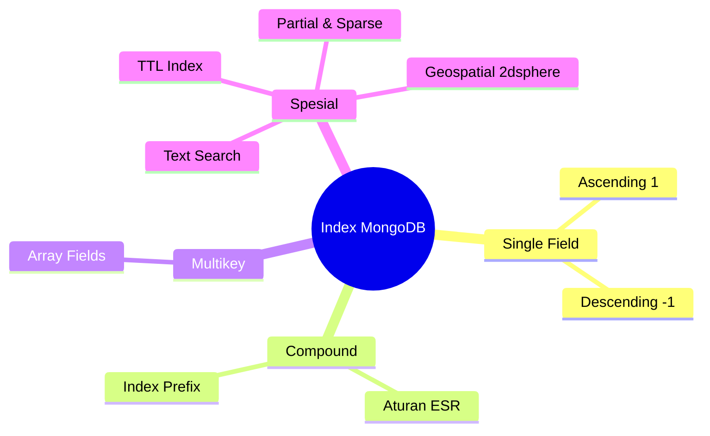

# 🍃 MongoDB - Modul 02: Indexing & Analisis Performa

Tanpa index, MongoDB harus memindai setiap dokumen dalam sebuah koleksi dari awal hingga akhir (*Collection Scan* / `COLLSCAN`). Dengan indeks berbasis **B-Tree**, MongoDB melompat langsung ke lokasi dokumen (*Index Scan* / `IXSCAN`), memangkas waktu query dari detik menjadi pecahan milidetik.

---

## 1. Jenis-Jenis Index di MongoDB



### A. Single Field & Compound Index
```javascript
// 1. Single field index pada email (Unique constraint)
db.users.createIndex({ email: 1 }, { unique: true });

// 2. Compound Index (Multi-kolom)
db.orders.createIndex({ status: 1, created_at: -1 });
```

### B. Aturan Sakti ESR (Equality, Sort, Range)
Saat merancang Compound Index untuk query yang kompleks, urutan field dalam index menentukan apakah MongoDB bisa menghindari in-memory sorting:

$$\text{Urutan Index:} \quad \mathbf{E} \text{quality} \longrightarrow \mathbf{S} \text{ort} \longrightarrow \mathbf{R} \text{ange}$$

1. **Equality ($=$)**: Kolom yang dicocokkan dengan nilai persis (misal `status: "PAID"`). Letakkan paling kiri!
2. **Sort**: Kolom urutan tampilan (misal `.sort({ created_at: -1 })`). Letakkan di tengah!
3. **Range ($>, <, \text{between}$)**: Kolom filter rentang nilai (misal `total: { $gte: 100000 }`). Letakkan paling kanan!

```javascript
// Query yang kita inginkan:
db.orders.find({
  status: "COMPLETED",           // Equality
  total: { $gte: 500000 }        // Range
}).sort({ order_date: -1 });     // Sort

// Index OPTIMAL mengikuti rumus ESR:
db.orders.createIndex({
  status: 1,       // 1. Equality
  order_date: -1,  // 2. Sort
  total: 1         // 3. Range
});
```

---

## 2. Index Khusus: Multikey, TTL & Partial

### A. Multikey Index (Indexing Array)
Jika sebuah field bernilai array, MongoDB otomatis membuat **Multikey Index** di mana setiap elemen array memiliki pointer sendiri:
```javascript
db.articles.createIndex({ tags: 1 });
// Query cepat: db.articles.find({ tags: "mongodb" })
```

### B. TTL Index (Auto-Delete Dokumen Kedaluwarsa)
Sangat berguna untuk tabel log, session user, OTP, atau token sementara:
```javascript
// Hapus dokumen secara otomatis 3600 detik (1 jam) setelah waktu 'created_at':
db.user_sessions.createIndex(
  { created_at: 1 },
  { expireAfterSeconds: 3600 }
);
```

### C. Partial Index (Hemat Ukuran Index)
Hanya mengindeks subset dokumen yang sering dicari, menghemat RAM server:
```javascript
// Hanya indeks user yang aktif:
db.users.createIndex(
  { username: 1 },
  { partialFilterExpression: { status: "ACTIVE" } }
);
```

---

## 3. Bedah Performa dengan `explain("executionStats")`

Untuk melihat bagaimana database mengeksekusi query Anda, gunakan `.explain("executionStats")`:

```javascript
db.orders.find({ status: "COMPLETED" }).sort({ order_date: -1 }).explain("executionStats");
```

### Metrik Kritis yang Wajib Diperiksa:
1. **`stage`**:
   - ❌ `COLLSCAN`: Memindai seluruh koleksi (Buruk! Belum ada index yang cocok).
   - ✅ `IXSCAN`: Memindai B-Tree index (Sangat cepat).
   - ⚠️ `SORT`: MongoDB melakukan in-memory sort karena index tidak meng-cover order. Jika hasil sorting melebihi 100MB RAM, MongoDB akan melempar error!
2. **Rasio `totalDocsExamined` vs `nReturned`**:
   - Jika `totalDocsExamined: 50000` tapi `nReturned: 10`, berarti database memeriksa 50.000 dokumen hanya untuk mengambil 10 baris. Targetkan rasio mendekati $1:1$!
3. **`totalKeysExamined`**: Jumlah entri index yang dilewati.

```bash
# Contoh Output executionStats Ideal:
"executionStats": {
  "executionSuccess": true,
  "nReturned": 15,
  "executionTimeMillis": 1,
  "totalKeysExamined": 15,
  "totalDocsExamined": 15,
  "executionStages": {
    "stage": "FETCH",
    "inputStage": {
      "stage": "IXSCAN",
      "indexName": "status_1_order_date_-1"
    }
  }
}
```
