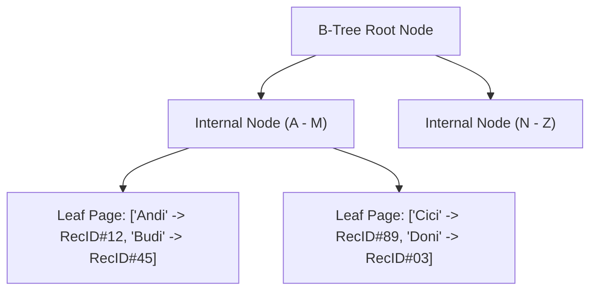
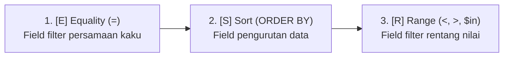
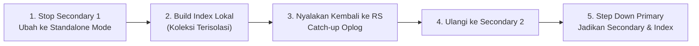

# 🍃 MongoDB - Modul 02: Indexing Mendalam, Aturan Sakti ESR & Explain Stats

Tanpa index yang tepat, MongoDB terpaksa melakukan **Collection Scan (`COLLSCAN`)** yang membaca setiap byte data dari disk. Dengan index B-Tree yang dirancang presisi, query pada koleksi 50 juta dokumen dapat dikembalikan dalam waktu kurang dari $2\text{ milidetik}$.

---

## 1. Arsitektur B-Tree Index WiredTiger

Index MongoDB disimpan dalam struktur data **B-Tree** di storage engine WiredTiger. Setiap entri index memetakan nilai field yang terurut leksikografis ke **RecordID** (pointer lokasi fisik dokumen di disk).



### Karakteristik Single Field & Compound Index:
```javascript
// 1. Single Field Index:
db.pengguna.createIndex({ email: 1 }); // 1 = ASC, -1 = DESC

// 2. Compound Index (Banyak Field):
db.transaksi.createIndex({ pelanggan_id: 1, tanggal: -1 });
```

> [!IMPORTANT]
> **Leftmost Prefix Rule**: Compound index `{ a: 1, b: 1, c: 1 }` HANYA bisa digunakan untuk query yang memfilter:
> 1. `a`
> 2. `a` DAN `b`
> 3. `a` DAN `b` DAN `c`
> Query yang HANYA memfilter `b` atau `c` **TIDAK BISA** menggunakan index ini!

### Aturan Arah Pengurutan (Sort Directionality):
Pada compound index, arah `1` (ASC) dan `-1` (DESC) sangat krusial:
- Index `{ a: 1, b: -1 }` mendukung sort `{ a: 1, b: -1 }` dan inversinya `{ a: -1, b: 1 }`.
- Index `{ a: 1, b: -1 }` **TIDAK MENDUKUNG** sort `{ a: 1, b: 1 }` atau `{ a: -1, b: -1 }` (akan memicu in-memory sort).

---

## 2. Aturan Sakti Desain Index: The ESR Rule

Saat merancang compound index yang menangani filter persamaan, pengurutan, dan rentang nilai, **urutan field menentukan apakah query bisa dieksekusi secara instan atau meledak di memori RAM**.

Ikuti urutan **ESR (Equality, Sort, Range)**:



### Bedah Kasus Nyata:
Diberikan query backend e-commerce berikut:
```javascript
db.pesanan.find({
    status: "SELESAI",                 // [E] Equality
    total_belanja: { $gte: 500000 }     // [R] Range
}).sort({ tanggal_transaksi: -1 });    // [S] Sort
```

| Desain Index | Urutan Index | Perilaku Eksekusi Query | Efisiensi |
|---|---|---|---|
| **❌ Salah (E-R-S)** | `{ status: 1, total_belanja: 1, tanggal_transaksi: -1 }` | Range scan memecah urutan B-Tree. MongoDB terpaksa melakukan **In-Memory Sort (`SORT_KEY_GENERATOR`)** | Lambat & boros RAM (Limit 100MB) |
| **❌ Salah (R-E-S)** | `{ total_belanja: 1, status: 1, tanggal_transaksi: -1 }` | Range di depan membuat Equality tidak selektif | Sangat Lambat |
| **✅ BENAR (E-S-R)** | `{ status: 1, tanggal_transaksi: -1, total_belanja: 1 }` | Filter `status` langsung membatasi cabang B-Tree; data dibaca **sudah terurut alami** oleh `tanggal_transaksi`; lalu dipangkas oleh rentang `total_belanja` | **Instan (< 2ms) & 0 In-Memory Sort** |

---

## 3. Jenis-Jenis Index Spesial Produksi

### A. Multikey Index (Array Gotchas)
Ketika field berupa array di-index, MongoDB otomatis menjadikannya Multikey Index:
```javascript
db.produk.createIndex({ kategori: 1, tags: 1 });
```
> [!WARNING]
> **Larangan Multikey Paralel**: MongoDB **MELARANG** pembuatan compound index di mana **lebih dari satu field berupa array**! Misal dokumen `{ tags: ["a", "b"], sizes: ["S", "M"] }`. Pembuatan index `{ tags: 1, sizes: 1 }` akan melempar error `cannot index parallel arrays` karena menghasilkan ledakan entri Cartesian product ($M \times N$).

### B. Text Index & Full-Text Search
Untuk fitur pencarian kata kunci dengan stemming bahasa:
```javascript
db.artikel.createIndex(
    { judul: "text", konten: "text" },
    { weights: { judul: 10, konten: 2 }, default_language: "indonesian" }
);

// Pencarian relevansi dengan skor kecocokan:
db.artikel.find(
    { $text: { $search: "belajar mongodb kubernetes" } },
    { score: { $meta: "textScore" } }
).sort({ score: { $meta: "textScore" } });
```

### C. TTL Index (Time-To-Live Auto Eviction)
Menghapus dokumen log atau token sesi kedaluwarsa secara otomatis:
```javascript
// Dokumen otomatis dihapus 24 jam (86400 detik) setelah field 'login_time':
db.user_tokens.createIndex(
    { login_time: 1 },
    { expireAfterSeconds: 86400 }
);
```
*Catatan Arsitektur*: Thread background `TTLMonitor` berjalan setiap 60 detik sekali. Field wajib bertipe BSON Date asli (`new Date()`).

### D. Partial Index vs Sparse Index
- **Sparse Index** (Warisan lama): Hanya meng-index dokumen yang memiliki field bersangkutan.
- **Partial Index** (Standar Modern): Jauh lebih superior karena menerima ekspresi filter bebas via `partialFilterExpression`:

```javascript
// Hanya index email jika status akun AKTIF (menghemat 90% ukuran index RAM!):
db.pengguna.createIndex(
    { email: 1 },
    { 
        unique: true,
        partialFilterExpression: { status: "AKTIF" } 
    }
);
```

### E. Wildcard Index (`$**`) untuk Skema Dinamis
Jika aplikasi kamu menyimpan atribut e-commerce yang strukturnya bebas (EAV pattern):
```javascript
// Index seluruh field di dalam sub-objek spesifikasi:
db.produk.createIndex({ "spesifikasi.$**": 1 });
```

### F. Collation Index (Case-Insensitive Searching)
Mencari data tanpa membedakan huruf besar/kecil tanpa merusak performa:
```javascript
db.users.createIndex(
    { username: 1 },
    { collation: { locale: "en", strength: 2 } } // strength 2: abaikan case
);

// Query harus menyertakan collation yang sama agar memakai index:
db.users.find({ username: "john_doe" }).collation({ locale: "en", strength: 2 });
```

---

## 4. Konsep Tertinggi Performa: The Covered Query

**Covered Query** adalah kondisi di mana seluruh field yang diminta oleh query sudah tersedia di dalam entri index B-Tree itu sendiri. Engine MongoDB sama sekali **TIDAK PERLU membaca dokumen fisik dari disk/RAM (`FETCH`)**!

```javascript
// 1. Buat Compound Index yang mencakup filter dan field yang dibutuhkan:
db.pengguna.createIndex({ status: 1, email: 1, nama: 1 });

// 2. Query WAJIB mengecualikan '_id' (kecuali _id ikut di dalam index):
db.pengguna.find(
    { status: "AKTIF" },
    { _id: 0, email: 1, nama: 1 } // Hanya ambil field yang ada di index!
);
```

---

## 5. Audit Performa dengan `.explain("executionStats")`

Gunakan `.explain("executionStats")` untuk menganalisis rencana eksekusi database:

```javascript
const stats = db.pesanan.find({ status: "SELESAI" })
    .sort({ tanggal: -1 })
    .explain("executionStats");
```

### Anatomi Tahapan Eksekusi (`stage`):
- **`COLLSCAN`**: 🔴 **Bencana Performa!** Full collection scan membaca seluruh tabel di disk.
- **`IXSCAN`**: 🟢 **Bagus.** Pemindaian rentang index B-Tree.
- **`FETCH`**: Mengambil isi dokumen mentah dari disk berdasarkan RecordID dari IXSCAN.
- **`PROJECTION_COVERED`**: 🚀 **Sempurna!** Covered Query, 0 pembacaan disk dokumen.
- **`SORT_KEY_GENERATOR` / `SORT`**: ⚠️ In-memory sort di RAM karena urutan index tidak cocok.

### Matriks Kunci Evaluasi Query:
```text
Rasio Ideal:
nReturned : totalKeysExamined : totalDocsExamined = 1 : 1 : 1

Contoh Kasus Bahaya:
nReturned: 10
totalKeysExamined: 150.000
totalDocsExamined: 150.000
=> Indikasi Index tidak selektif! Database memeriksa 150 ribu baris hanya untuk menghasilkan 10 data.
```

### Memaksa Pemilihan Index via `.hint()`:
```javascript
db.transaksi.find({ status: "PENDING" })
    .hint({ status: 1, created_at: -1 }); // Paksa planner menggunakan index ini
```

---

## 6. Rolling Index Build di Cluster Produksi

Membuat index pada koleksi dengan ratusan juta dokumen memakan CPU dan I/O tinggi. Di MongoDB 4.2+, index build dijalankan secara simultan di background, namun untuk cluster produksi mission-critical, gunakan **Rolling Index Build**:


Prosedur rolling ini menjamin performa aplikasi di node Primary tidak pernah mengalami lonjakan latensi saat index raksasa sedang dibangun.
