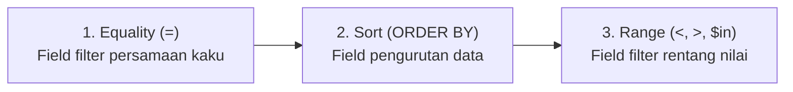

# 🍃 MongoDB - Modul 02: Indexing Mendalam, Aturan Sakti ESR & Explain Stats

Tanpa index, MongoDB terpaksa melakukan **Collection Scan (`COLLSCAN`)** yang membaca setiap file dokumen mentah dari disk satu per satu. Dengan index B-Tree yang tepat, pencarian 100 juta dokumen selesai dalam kurang dari $2\text{ milidetik}$.

---

## 1. Aturan Sakti Desain Index Majemuk: The ESR Rule

Saat membuat *Compound Index* yang melibatkan banyak field, **urutan penulisan field menentukan 100% apakah index bisa digunakan atau tidak**.

Ikuti **Aturan Emas ESR (Equality, Sort, Range)**:



### Contoh Kasus:
Aplikasi memiliki query:
```javascript
db.pesanan.find({
    status: "PAID",                    // 1. EQUALITY
    total_belanja: { $gte: 100000 }     // 3. RANGE
}).sort({ created_at: -1 });           // 2. SORT
```

- ❌ **Urutan SALAH**: `db.pesanan.createIndex({ total_belanja: 1, created_at: -1, status: 1 })`
  (Memicu sorting manual di RAM karena Range diletakkan di depan!).
- ✅ **Urutan BENAR (Sesuai Aturan ESR)**:
  ```javascript
  db.pesanan.createIndex({
      status: 1,        // [E] Equality Pertama
      created_at: -1,   // [S] Sort Kedua
      total_belanja: 1  // [R] Range Ketiga
  });
  ```
Dengan urutan ESR, MongoDB dapat melompat langsung ke data yang cocok dan membacanya dalam keadaan **sudah terurut secara alami tanpa membuang waktu sortir CPU**!

---

## 2. Index Khusus: Multikey, Partial & TTL

### A. Multikey Index (Indexing Elemen Array)
Jika field yang di-index berupa array, MongoDB otomatis membuat pointer terpisah untuk setiap elemen di dalam array tersebut:
```javascript
db.artikel.createIndex({ tags: 1 }); // Otomatis Multikey Index
```

### B. Partial Index (Hemat Ukuran RAM Index 80%)
Hanya meng-index dokumen yang memenuhi kondisi filter tertentu:
```javascript
// Hanya index email jika akun berstatus AKTIF:
db.pengguna.createIndex(
    { email: 1 },
    { partialFilterExpression: { status: "AKTIF" } }
);
```

### C. TTL Index (Auto-Delete Dokumen Kedaluwarsa)
Menghapus dokumen sesi atau log secara otomatis setelah durasi waktu tertentu:
```javascript
// Dokumen otomatis musnah 1 jam (3600 detik) setelah waktu 'login_at':
db.user_sessions.createIndex(
    { login_at: 1 },
    { expireAfterSeconds: 3600 }
);
```

---

## 3. Analisis Eksekusi Query: `explain("executionStats")`

Gunakan `.explain("executionStats")` untuk memverifikasi efisiensi query:

```javascript
db.pesanan.find({ status: "PAID" }).sort({ created_at: -1 }).explain("executionStats");
```

### 3 Metrik Kunci Evaluasi Performa:
1. **`stage`**:
   - `COLLSCAN`: 🔴 **BURUK!** Query memindai seluruh koleksi tabel tanpa index.
   - `IXSCAN`: 🟢 **BAGUS!** Query menelusuri B-Tree index.
2. **`totalDocsExamined` vs `nReturned`**:
   - Idealnya bernilai **$1:1$** (Artinya: untuk menghasilkan 10 dokumen, database hanya memeriksa 10 dokumen).
   - Jika `totalDocsExamined = 100.000` namun `nReturned = 5`, index kamu tidak selektif dan membuang banyak waktu pembacaan disk!
3. **`totalKeysExamined`**: Menunjukkan seberapa banyak pointer index yang ditelusuri.
