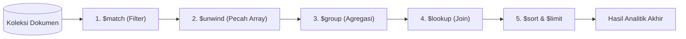

# 🍃 MongoDB - Modul 03: Aggregation Pipeline Lengkap

Jika operasi `.find()` adalah operasi query dasar, maka **Aggregation Framework** adalah mesin analitik dan pemrosesan data bertenaga tinggi di MongoDB. Bekerja seperti ban berjalan (*assembly line*), dokumen mengalir melalui serangkaian tahapan (*stages*) di mana setiap tahap mengubah dan memfilter data sebelum diteruskan ke tahap berikutnya.



---

## 1. Tahapan Utama (*Core Stages*) & Fungsinya

| Stage | Padanan SQL | Deskripsi |
|---|---|---|
| **`$match`** | `WHERE` / `HAVING` | Memfilter dokumen (Selalu letakkan di paling awal agar memanfaatkan index!). |
| **`$project`** | `SELECT col1, col2` | Memilih, membuang, atau mengubah format nama field. |
| **`$addFields`**| Computed Column | Menambahkan kolom kalkulasi baru tanpa menghapus kolom lama. |
| **`$group`** | `GROUP BY` | Mengelompokkan data berdasarkan key akumulasi (`$sum`, `$avg`, dll). |
| **`$unwind`** | *Table Flattening* | Mendekomposisi field array menjadi baris-baris dokumen tersendiri. |
| **`$lookup`** | `LEFT OUTER JOIN` | Menggabungkan data dari koleksi lain dalam database yang sama. |
| **`$sort`** | `ORDER BY` | Mengurutkan hasil (1 ascending, -1 descending). |
| **`$limit`** | `LIMIT` | Membatasi jumlah output dokumen. |
| **`$facet`** | Multi-Query | Menjalankan beberapa pipeline analitik independen dalam 1 panggilan. |

---

## 2. Praktik Kasus Nyata: Analitik Penjualan Produk

Mari kita hitung total omzet, rata-rata belanja, dan total item terjual per kategori produk:

```javascript
db.orders.aggregate([
  // 1. Ambil order yang sudah lunas dalam tahun 2026 saja
  {
    $match: {
      status: "COMPLETED",
      order_date: {
        $gte: ISODate("2026-01-01T00:00:00Z"),
        $lt: ISODate("2027-01-01T00:00:00Z")
      }
    }
  },

  // 2. Unwind array item pembelian
  // Jika 1 order beli 3 jenis barang, dokumen dipecah menjadi 3 baris
  {
    $unwind: "$items"
  },

  // 3. Kelompokkan berdasarkan kategori produk
  {
    $group: {
      _id: "$items.kategori",
      total_omzet: { $sum: { $multiply: ["$items.harga", "$items.qty"] } },
      total_terjual: { $sum: "$items.qty" },
      rata_rata_harga: { $avg: "$items.harga" },
      transaksi_unik: { $addToSet: "$_id" } // Array ID transaksi unik
    }
  },

  // 4. Tambahkan field baru untuk jumlah transaksi unik
  {
    $addFields: {
      jumlah_transaksi: { $size: "$transaksi_unik" }
    }
  },

  // 5. Urutkan dari omzet tertinggi
  {
    $sort: { total_omzet: -1 }
  }
]);
```

---

## 3. Relasi Data Antar Koleksi dengan `$lookup`

Meskipun MongoDB adalah NoSQL, kita sering perlu menggabungkan data dari koleksi terpisah (seperti menghubungkan Order dengan User profil).

### A. Lookup Standar (Kunci Foreign Field)
```javascript
db.orders.aggregate([
  {
    $lookup: {
      from: "users",          // Koleksi target
      localField: "user_id",  // Kolom di orders
      foreignField: "_id",    // Kolom di users
      as: "data_user"         // Output array hasil join
    }
  },
  // Karena user hanya satu, ubah array jadi objek:
  {
    $unwind: "$data_user"
  },
  {
    $project: {
      order_id: "$_id",
      total_bayar: 1,
      nama_pembeli: "$data_user.nama",
      email_pembeli: "$data_user.email"
    }
  }
]);
```

### B. Correlated Subquery Lookup (Pipeline Bersarang)
Jika Anda butuh kondisi join dinamis yang lebih kompleks:
```javascript
db.warehouses.aggregate([
  {
    $lookup: {
      from: "inventory",
      let: { warehouse_code: "$code" },
      pipeline: [
        {
          $match: {
            $expr: {
              $and: [
                { $eq: ["$warehouse_id", "$$warehouse_code"] },
                { $gt: ["$stok", 0] }
              ]
            }
          }
        }
      ],
      as: "available_stocks"
    }
  }
]);
```

---

## 4. Multi-Faceted Pipeline dengan `$facet`

Sangat populer untuk **Paginasi + Hitung Total Records** dalam satu kali request tanpa perlu memanggil `countDocuments()` terpisah!

```javascript
db.products.aggregate([
  { $match: { kategori: "Elektronik" } },
  {
    $facet: {
      // Cabang 1: Hitung total dokumen
      "totalCount": [
        { $count: "total" }
      ],
      // Cabang 2: Ambil data halaman ke-2 (10 item per halaman)
      "paginatedData": [
        { $sort: { harga: 1 } },
        { $skip: 10 },
        { $limit: 10 }
      ]
    }
  }
]);
```
Hasil kembalian langsung berupa objek dengan properti `totalCount` dan array `paginatedData`!
