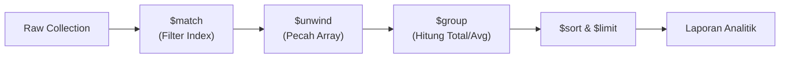

# 🍃 MongoDB - Modul 03: Aggregation Pipeline Lengkap ($lookup, $unwind & $facet)

Jika operasi `find()` hanya cocok untuk pencarian sederhana, **Aggregation Pipeline** adalah mesin pengolahan data analitik MongoDB yang memproses dokumen melalui serangkaian tahapan (*stages*) seperti pipa Unix (`data | stage1 | stage2 | result`).

---

## 1. Konsep Pipa Pemrosesan (Stages Flow)

Setiap tahapan menerima dokumen masukan, melakukan transformasi, dan meneruskan dokumen hasil ke tahapan berikutnya:



> [!TIP]
> **Aturan Optimasi**: Letakkan `$match` dan `$sort` **di tahap paling awal (Stage 1 & 2)** agar MongoDB bisa memanfaatkan B-Tree index dan memangkas jumlah dokumen sebelum masuk ke memori agregasi!

---

## 2. Bedah Kasus Produksi: Analisis Omset Penjualan per Kategori

```javascript
db.transaksi.aggregate([
    // Stage 1: Filter transaksi yang sudah lunas dalam 30 hari terakhir
    {
        $match: {
            status: "SELESAI",
            tanggal: { $gte: new Date(Date.now() - 30 * 24 * 60 * 60 * 1000) }
        }
    },

    // Stage 2: Pecah array 'items' agar setiap produk menjadi baris dokumen terpisah
    {
        $unwind: "$items"
    },

    // Stage 3: Kelompokkan berdasarkan kategori produk dan hitung metrik bisnis
    {
        $group: {
            _id: "$items.kategori", // Grouping Key
            total_omset: { $sum: { $multiply: ["$items.harga", "$items.qty"] } },
            total_terjual: { $sum: "$items.qty" },
            rata_rata_harga: { $avg: "$items.harga" },
            daftar_produk: { $addToSet: "$items.nama" } // Himpunan produk unik
        }
    },

    // Stage 4: Urutkan dari kategori omset tertinggi
    {
        $sort: { total_omset: -1 }
    },

    // Stage 5: Format ulang nama field keluaran agar rapi untuk Frontend DTO
    {
        $project: {
            _id: 0,
            kategori: "$_id",
            total_omset: 1,
            total_terjual: 1,
            rata_rata_harga: { $round: ["$rata_rata_harga", 2] }
        }
    }
]);
```

---

## 3. SQL JOIN di MongoDB: `$lookup`

Meskipun NoSQL mengutamakan denormalisasi, terkadang kita tetap perlu menggabungkan dua koleksi terpisah:

```javascript
db.pesanan.aggregate([
    {
        $lookup: {
            from: "pengguna",             // Koleksi target tujuan JOIN
            localField: "customer_id",     // Kolom referensi di tabel pesanan
            foreignField: "_id",          // Kolom primary key di tabel pengguna
            as: "info_customer"           // Output disimpan sebagai array
        }
    },
    // Ubah array 1 elemen menjadi objek tunggal datar:
    {
        $unwind: "$info_customer"
    }
]);
```

---

## 4. Trik Sakti: Paginasi Sempurna Sekali Eksekusi via `$facet`

Masalah klasik paginasi di backend: Kamu harus menjalankan **2 kali query terpisah** (Query 1: `count()` untuk total halaman, Query 2: `find().skip().limit()` untuk datanya).

Stage **`$facet`** menjalankan **kedua operasi tersebut secara paralel dalam 1 kali round-trip jaringan**:

```javascript
db.produk.aggregate([
    { $match: { kategori: "Elektronik" } },
    {
        $facet: {
            // Pipa Cabang A: Menghitung total seluruh dokumen yang cocok
            "total_count": [
                { $count: "total" }
            ],
            // Pipa Cabang B: Mengambil 10 data untuk halaman ke-2 (Skip 10)
            "data_halaman": [
                { $sort: { created_at: -1 } },
                { $skip: 10 },
                { $limit: 10 },
                { $project: { nama: 1, harga: 1 } }
            ]
        }
    }
]);
```
Hasil kembalian langsung berisi `{ total_count: [{ total: 145 }], data_halaman: [...] }` dalam 1 panggilan instan!
