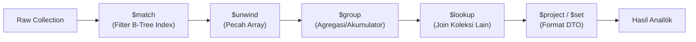
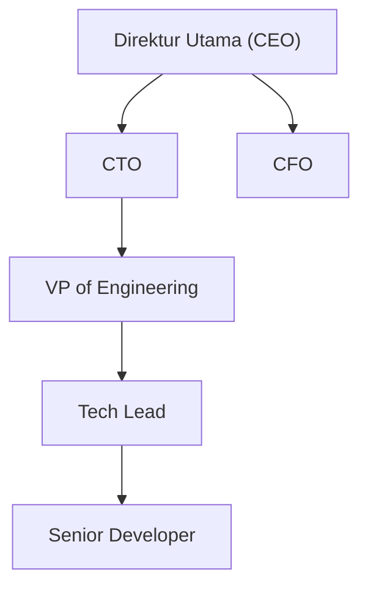

# 🍃 MongoDB - Modul 03: Aggregation Pipeline Lengkap ($lookup, $graphLookup & $setWindowFields)

Jika query `find()` dirancang untuk pencarian dokumen tunggal atau sederhana, **Aggregation Pipeline** adalah mesin analitik dan transformasi data tingkat lanjut di MongoDB yang memproses dokumen secara bertahap layaknya pipa Unix (`data | stage1 | stage2 | result`).

---

## 1. Arsitektur Pipeline & Engine Eksekusi (SBE vs Classic)

Setiap tahapan (*stage*) menerima kumpulan dokumen masukan, melakukan komputasi atau restrukturisasi, lalu mengalirkan hasilnya ke tahapan berikutnya:



> [!IMPORTANT]
> **Aturan 100 MB RAM & `allowDiskUse`**:
> Setiap stage agregasi memiliki batas memori internal sebesar **100 MB RAM**. Jika stage blocking seperti `$sort` atau `$group` melebihi 100MB tanpa dukungan index, query akan throw error `QueryExceededMemoryLimitNoDiskUseAllowed`.
> Solusinya: Aktifkan opsi `{ allowDiskUse: true }` untuk mengizinkan MongoDB menulis data sementara ke disk, atau optimalkan tahap awal dengan `$match` ber-index.

---

## 2. Bedah Kasus Produksi: Analisis Metrik E-Commerce

```javascript
db.transaksi.aggregate([
    // Stage 1: Pangkas data di awal menggunakan B-Tree index!
    {
        $match: {
            status: "SELESAI",
            tanggal: { $gte: new Date("2026-01-01") }
        }
    },

    // Stage 2: Pecah array 'items' menjadi baris terpisah
    {
        $unwind: {
            path: "$items",
            preserveNullAndEmptyArrays: false // Abaikan transaksi kosong
        }
    },

    // Stage 3: Hitung akumulasi omset dan kuantitas per kategori
    {
        $group: {
            _id: "$items.kategori",
            total_omset: { $sum: { $multiply: ["$items.harga", "$items.qty"] } },
            total_qty: { $sum: "$items.qty" },
            rata_rata_harga: { $avg: "$items.harga" },
            produk_unik: { $addToSet: "$items.nama" } // Himpunan produk unik (Set)
        }
    },

    // Stage 4: Urutkan kategori dengan omset terbesar
    {
        $sort: { total_omset: -1 }
    },

    // Stage 5: Format ulang field keluaran
    {
        $project: {
            _id: 0,
            kategori: "$_id",
            total_omset: 1,
            total_qty: 1,
            rata_rata_harga: { $round: ["$rata_rata_harga", 2] },
            jumlah_varian_produk: { $size: "$produk_unik" }
        }
    }
], { allowDiskUse: true });
```

---

## 3. SQL JOIN di MongoDB: `$lookup` Tingkat Lanjut

### A. Basic Equality Match (Simple JOIN)
```javascript
db.pesanan.aggregate([
    {
        $lookup: {
            from: "pelanggan",
            localField: "customer_id",
            foreignField: "_id",
            as: "customer"
        }
    },
    // Mengubah array 1 elemen menjadi objek datar tunggal:
    { $unwind: "$customer" }
]);
```

### B. Correlated Subqueries dengan `let` dan `pipeline` (Advanced JOIN)
Bisa memfilter, mengurutkan, dan membatasi data di koleksi target **SEBELUM** di-join (sangat hemat memori):

```javascript
// Mengambil data pengguna beserta 3 transaksi terakhirnya yang bernilai > Rp 100.000:
db.pengguna.aggregate([
    {
        $lookup: {
            from: "transaksi",
            let: { user_id: "$_id" }, // Definisikan variabel dari koleksi pengguna
            pipeline: [
                {
                    $match: {
                        $expr: {
                            $and: [
                                { $eq: ["$customer_id", "$$user_id"] }, // Cocokkan variabel
                                { $gt: ["$total", 100000] }
                            ]
                        }
                    }
                },
                { $sort: { tanggal: -1 } },
                { $limit: 3 },
                { $project: { _id: 1, total: 1, tanggal: 1 } }
            ],
            as: "transaksi_terbaru"
        }
    }
]);
```

---

## 4. Query Hierarkis / Rekursif: `$graphLookup`

Menggantikan recursive CTE di SQL untuk membaca struktur pohon (organisasi atasan-bawahan, kategori berjenjang, jaringan pertemanan):



```javascript
// Menelusuri seluruh jalur atasan dari seorang karyawan sampai ke CEO:
db.karyawan.aggregate([
    { $match: { email: "eka@dev.cloud" } },
    {
        $graphLookup: {
            from: "karyawan",
            startWith: "$manager_id",         // Titik awal traversal rekursif
            connectFromField: "manager_id",   // Field referensi induk
            connectToField: "_id",            // Target pencocokan
            as: "hirarki_atasan",             // Output array seluruh leluhur
            maxDepth: 5,                      // Batas kedalaman rekursi (Anti Infinite Loop)
            depthField: "tingkat_jabatan"      // Menyimpan kedalaman level (0, 1, 2, dst)
        }
    }
]);
```

---

## 5. Modern Window Functions: `$setWindowFields` (MongoDB 5.0+)

MongoDB 5.0+ memperkenalkan kapabilitas analitik analitis setara fungsi jendela SQL (`ROW_NUMBER()`, `DENSE_RANK()`, `LEAD()`, `LAG()`, Running Total):

```javascript
db.penjualan_harian.aggregate([
    {
        $setWindowFields: {
            partitionBy: "$wilayah", // PARTITION BY wilayah
            sortBy: { tanggal: 1 },  // ORDER BY tanggal ASC
            output: {
                // 1. Menghitung Running Total kumulatif penjualan:
                kumulatif_omset: {
                    $sum: "$nominal",
                    window: { documents: ["unbounded", "current"] }
                },
                // 2. Ranking penjualan harian dalam wilayah tersebut:
                ranking_harian: {
                    $denseRank: {}
                },
                // 3. Mengambil nilai penjualan hari sebelumnya (setara SQL LAG):
                omset_kemarin: {
                    $shift: {
                        output: "$nominal",
                        by: -1,
                        default: 0
                    }
                }
            }
        }
    }
]);
```

---

## 6. Paginasi & Multi-Facet Sekaligus via `$facet`

Menghindari masalah mengeksekusi 2 query backend terpisah (Query 1: `countDocuments`, Query 2: `find.skip.limit`). Dengan `$facet`, seluruh kebutuhan halaman diselesaikan dalam **1 kali round-trip**:

```javascript
db.produk.aggregate([
    { $match: { status: "PUBLISH", kategori: "Elektronik" } },
    {
        $facet: {
            // Pipa Cabang 1: Hitung total dokumen
            "metadata": [
                { $count: "total_data" }
            ],
            // Pipa Cabang 2: Ambil data halaman aktif
            "data": [
                { $sort: { created_at: -1 } },
                { $skip: 20 },
                { $limit: 10 },
                { $project: { nama: 1, harga: 1, stok: 1 } }
            ],
            // Pipa Cabang 3: Distribusi rentang harga (Histogram Facet)
            "distribusi_harga": [
                {
                    $bucket: {
                        groupBy: "$harga",
                        boundaries: [0, 500000, 2000000, 10000000, 50000000],
                        default: "Di Atas 50 Juta",
                        output: { count: { $sum: 1 } }
                    }
                }
            ]
        }
    }
]);
```

---

## 7. Array Expression Operators (`$filter`, `$map`, `$reduce`)

Memproses array tanpa perlu membongkarnya dengan `$unwind` (sangat menghemat CPU dan RAM):

```javascript
db.pesanan.aggregate([
    {
        $project: {
            kode_pesanan: 1,
            // 1. $filter: Ambil hanya item yang berharga > 100.000
            item_mahal: {
                $filter: {
                    input: "$items",
                    as: "item",
                    cond: { $gt: ["$$item.harga", 100000] }
                }
            },
            // 2. $map: Ekstrak hanya nama produknya saja
            nama_produk: {
                $map: {
                    input: "$items",
                    as: "item",
                    in: "$$item.nama"
                }
            },
            // 3. $reduce: Hitung total bobot kirim keseluruhan
            total_berat_gram: {
                $reduce: {
                    input: "$items",
                    initialValue: 0,
                    in: { $add: ["$$value", { $multiply: ["$$this.berat", "$$this.qty"] }] }
                }
            }
        }
    }
]);
```

---

## 8. Materialized Views On-Demand: `$merge`

Menyimpan hasil kalkulasi agregasi kompleks ke koleksi fisik tujuan secara inkremental tanpa menimpa data lama secara membabi buta:

```javascript
db.transaksi_mentah.aggregate([
    { $match: { tanggal: { $gte: new Date("2026-11-01") } } },
    {
        $group: {
            _id: "$toko_id",
            total_penjualan: { $sum: "$total" },
            transaksi_count: { $sum: 1 }
        }
    },
    {
        $merge: {
            into: "ringkasan_toko_bulanan",    // Koleksi tujuan
            on: "_id",                         // Primary key pencocokan
            whenMatched: "replace",            // Ganti jika sudah ada
            whenNotMatched: "insert"           // Buat baru jika belum ada
        }
    }
]);
```
Pipeline `$merge` memungkinkan pembuatan **Data Mart analitik real-time** langsung di dalam klaster MongoDB!
