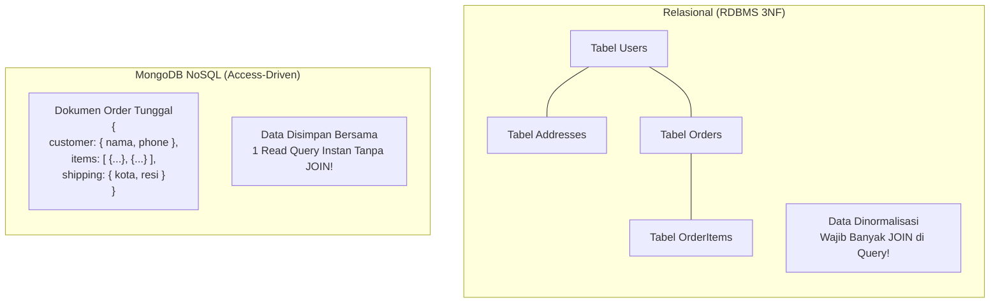
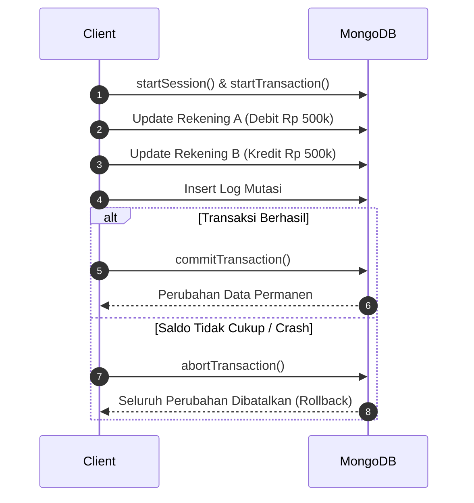

# 🍃 MongoDB - Modul 04: Desain Skema Produksi, Pola Desain & Transaksi ACID

Kekuatan terbesar sekaligus jebakan paling mematikan di MongoDB adalah kebebasan skema (*Flexible Schema*). Tanpa pemahaman pola akses data aplikasi (*query access patterns*), skema dokumen dapat memicu pembengkakan memori, fragmentasi storage, dan query yang lambat.

---

## 1. Filosofi Pemodelan Dokumen NoSQL

Dalam database relasional (RDBMS), skema dirancang berpatokan pada **Bentuk Normal (3NF)** untuk menghindari redundansi data. 

Di MongoDB, filosofi pemodelannya berbalik 180 derajat:
> *"Rancanglah skema dokumen berdasarkan bagaimana aplikasi kamu membaca data (Application Access Patterns), bukan berdasarkan bagaimana entitas dunia nyata terhubung secara teoritis."*



---

## 2. Matriks Keputusan: Embedding vs Referencing

Kapan harus menyematkan data (Embed) dan kapan harus memisahkan data (Reference)?

| Pola Relasi | Strategi | Kriteria Keputusan | Contoh Kasus Nyata |
|---|:---:|---|---|
| **Satu ke Sedikit (1:Few)** | **Embed** | Jumlah anak sedikit (< 20) dan selalu dibaca bersama induknya. | User dengan 2 alamat domisili. |
| **Satu ke Banyak (1:Many)** | **Reference (Parent)** | Jumlah anak banyak (ratusan/ribuan) atau sering bertambah tanpa batas. | Toko dengan 20.000 ulasan produk. Ulasan menyimpan `product_id`. |
| **Banyak ke Banyak (N:M)** | **Two-Way Reference** | Entitas independen yang sering dicari dari kedua sisi. | Siswa dan Kursus (Siswa punya array `course_ids`, Kursus punya array `student_ids`). |

---

## 3. Enam Pola Desain Skema Produksi (Production Design Patterns)

### A. The Subset Pattern (Solusi Halaman Produk Cepat)
Halaman detail produk di marketplace e-commerce membutuhkan review pelanggan. Menyematkan seluruh 50.000 review ke dalam dokumen produk akan meledakkan batas 16MB. Memisahkannya ke tabel terpisah membutuhkan `$lookup` yang berat.

**Solusi**: Simpan 5 review bintang 5 terbaru di dalam dokumen produk. Simpan sisa review lengkapnya di koleksi `reviews` terpisah!

```javascript
// Koleksi 'products' (Dokumen Ringan & Cepat):
{
    _id: ObjectId("6651..."),
    nama: "MacBook Pro M3 Max",
    harga: 45000000,
    rating_rata_rata: 4.9,
    total_review: 4850,
    // SUBSET: Hanya 5 ulasan terbaik untuk render UI instan:
    ulasan_terbaru: [
        { nama: "Eka", bintang: 5, komentar: "Sangat kencang!", tanggal: new Date() },
        { nama: "Budi", bintang: 5, komentar: "Layar luar biasa.", tanggal: new Date() }
    ]
}
```

### B. The Bucket Pattern (Time-Series & Telemetri IoT)
Mencegah anti-pattern menulis 1 dokumen per detik untuk data sensor, yang memicu index bloat raksasa:

```javascript
// 1 Dokumen Menampung Tepat 1 Jam Sampel Sensor (60 data per bucket):
{
    _id: ObjectId("..."),
    sensor_id: "SENSOR-JAKARTA-01",
    tanggal_jam: ISODate("2026-11-20T11:00:00Z"),
    jumlah_sampel: 60,
    suhu_min: 27.1,
    suhu_max: 31.4,
    suhu_avg: 29.2,
    // Array bounded 60 elemen:
    pembacaan: [
        { menit: 0, suhu: 28.1, kelembaban: 70 },
        { menit: 1, suhu: 28.3, kelembaban: 71 },
        // ... menit ke 59
    ]
}
```

### C. The Extended Reference Pattern
Menyalin hanya sebagian field yang sering dibaca dari koleksi lain untuk menghindari JOIN:
```javascript
// Di koleksi 'orders':
{
    _id: "ORD-9988",
    total: 1500000,
    // Salin nama dan email saja, profil lengkap tetap di koleksi 'users':
    customer: {
        id: ObjectId("6651..."),
        nama: "Eka Dev",
        nomor_telepon: "+62812345678"
    }
}
```

### D. The Attribute Pattern (E-Commerce Dynamic Specs)
Menghindari pembuatan ratusan index untuk barang yang spesifikasinya berbeda-beda (misal baju punya `ukuran/bahan`, sedangkan monitor punya `refresh_rate/panel`):

```javascript
// Gunakan pasangan Key-Value seragam:
{
    _id: "PROD-01",
    nama: "Monitor Gaming 27 Inch",
    atribut: [
        { k: "refresh_rate", v: "165Hz" },
        { k: "panel", v: "IPS" },
        { k: "resolusi", v: "2K QHD" }
    ]
}
// Cukup 1 compound index untuk melayani SEMUA query atribut:
db.produk.createIndex({ "atribut.k": 1, "atribut.v": 1 });
```

### E. The Computed Pattern (Pre-Aggregated Metrics)
Alih-alih menghitung `total_penjualan` dengan `$group` setiap kali user membuka dashboard, perbarui counter tersebut secara atomik menggunakan `$inc` setiap kali ada transaksi baru masuk.

---

## 4. ⚠️ Anti-Patterns Fatal di MongoDB

1. **Unbounded Arrays**: Membiarkan array bertambah tanpa batas (misal log aktivitas disimpan di array user selamanya). Menghabiskan limit 16MB dan memicu *document relocation* di disk.
2. **Over-Normalization**: Memecah semua hal ke koleksi terpisah layaknya tabel SQL MySQL, lalu menyatukannya dengan belasan `$lookup` bertingkat.
3. **Deep Nesting Hierarchy**: Membuat subdokumen bersarang lebih dari 5 level (sulit di-query dan menyulitkan update atomik).

---

## 5. Transaksi Multi-Dokumen ACID (MongoDB 4.0+)

Meskipun operasi mutasi pada satu dokumen selalu bersifat atomik secara bawaan, pemindahan saldo antar 2 rekening atau mutasi lintas koleksi membutuhkan jaminan **ACID (Atomicity, Consistency, Isolation, Durability)**.



### Implementasi Produksi dengan Retry Loop Otomatis:

```javascript
const { MongoClient } = require("mongodb");
const client = new MongoClient("mongodb://mongo-cluster:27017/?replicaSet=rs0");

async function transferDana(pengirimId, penerimaId, nominal) {
    const session = client.startSession();

    try {
        // withTransaction otomatis mengulang (retry) jika terjadi TransientTransactionError
        await session.withTransaction(async () => {
            const db = client.db("perbankan");
            const rekeningCol = db.collection("rekening");
            const mutasiCol = db.collection("riwayat_mutasi");

            // 1. Potong saldo pengirim (dengan guard saldo mencukupi):
            const debit = await rekeningCol.updateOne(
                { _id: pengirimId, saldo: { $gte: nominal } },
                { $inc: { saldo: -nominal } },
                { session } // WAJIB meneruskan parameter session!
            );

            if (debit.matchedCount === 0) {
                // Gagalkan transaksi sengaja -> otomatis ROLLBACK!
                throw new Error("Saldo tidak mencukupi atau rekening tidak valid.");
            }

            // 2. Tambah saldo penerima:
            await rekeningCol.updateOne(
                { _id: penerimaId },
                { $inc: { saldo: nominal } },
                { session }
            );

            // 3. Catat audit log mutasi:
            await mutasiCol.insertOne({
                pengirim: pengirimId,
                penerima: penerimaId,
                nominal: nominal,
                timestamp: new Date()
            }, { session });

        }, {
            readPreference: "primary",
            readConcern: { level: "snapshot" },
            writeConcern: { w: "majority" }
        });

        console.log("Transfer sukses dan terisolasi sempurna!");
    } catch (err) {
        console.error("Transaksi dibatalkan (ROLLBACK):", err.message);
        throw err;
    } finally {
        await session.endSession();
    }
}
```

> [!WARNING]
> **Aturan Wajib Transaksi ACID**:
> 1. Transaksi multi-dokumen **wajib berjalan di kluster Replica Set atau Sharded Cluster** (tidak bisa di standalone single instance).
> 2. Transaksi dibatasi waktu eksekusi maksimal **60 detik** (`transactionLifetimeLimitSeconds`). Jangan masukkan operasi lambat (seperti HTTP API call pihak ketiga) di dalam blok transaksi!
> 3. Operasi DDL (seperti `createIndex`, `createCollection`) **dilarang** di dalam blok transaksi.
