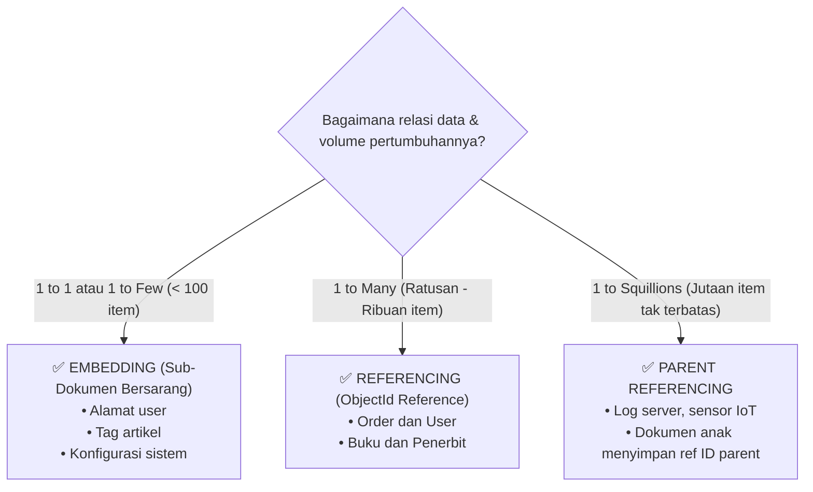
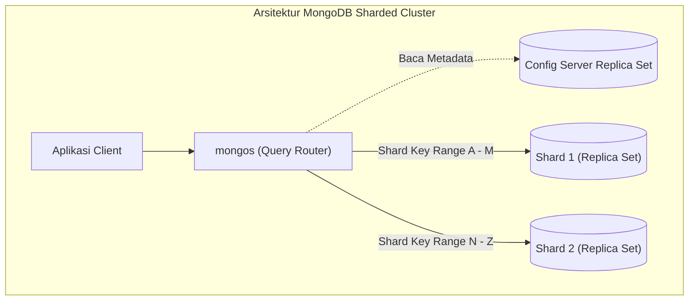

# 🍃 MongoDB - Modul 04: Transaksi ACID & Desain Skema

Dalam database relasional, desain skema berpusat pada normalisasi data ($3\text{NF}$). Namun dalam MongoDB, **desain skema didorong oleh pola query aplikasi Anda**. Menyimpan data bersama (*Embedding*) atau memisahkannya (*Referencing*) adalah keputusan arsitektur paling fundamental.

---

## 1. Aturan Emas: Embedding vs Referencing



### Tabel Perbandingan Embedding vs Referencing

| Aspek | Embedding (Bersarang) | Referencing (ID Terpisah) |
|---|---|---|
| **Kelebihan** | 1 kali read query langsung dapat semua data (tanpa `$lookup`). | Dokumen tetap ramping, tidak ada batasan ukuran 16MB. |
| **Kekurangan** | Dokumen membengkak. Batas maksimal 1 dokumen MongoDB adalah **16MB**. | Butuh query kedua atau tahapan `$lookup` yang lebih boros CPU. |
| **Pola Relasi Ideal** | *Contains*, data jarang berubah mandiri, query selalu bersama. | Data sering diakses terpisah, data tumbuh tanpa batas (*unbounded*). |

> [!WARNING]
> **Anti-Pattern: Unbounded Arrays!**
> Jangan pernah menyimpan array yang terus bertambah tanpa batas dalam satu dokumen (misal: menyimpan semua komentar YouTube dalam dokumen video). Saat video viral dan ada 500.000 komentar, ukuran dokumen akan menabrak limit 16MB dan query crash! Simpan komentar di koleksi tersendiri dengan menyimpan `video_id`.

---

## 2. Transaksi Multi-Dokumen ACID

Mulai MongoDB versi 4.0 (Replica Set) dan 4.2 (Sharded Cluster), MongoDB mendukung **transaksi ACID multi-dokumen** penuh, mirip dengan database SQL.

### Contoh Transaksi Finansial di Node.js
```javascript
import { MongoClient } from "mongodb";
const client = new MongoClient("mongodb://localhost:27017");

async function transferSaldo(pengirimId, penerimaId, nominal) {
  const session = client.startSession();

  try {
    // Jalankan seluruh operasi di dalam blok withTransaction
    await session.withTransaction(async () => {
      const accounts = client.db("bank").collection("accounts");

      // 1. Kurangi saldo pengirim (Pastikan saldo cukup)
      const resPengirim = await accounts.updateOne(
        { _id: pengirimId, saldo: { $gte: nominal } },
        { $inc: { saldo: -nominal } },
        { session }
      );

      if (resPengirim.matchedCount === 0) {
        throw new Error("Saldo tidak mencukupi atau akun tidak ditemukan!");
      }

      // 2. Tambah saldo penerima
      await accounts.updateOne(
        { _id: penerimaId },
        { $inc: { saldo: nominal } },
        { session }
      );

      // 3. Catat mutasi log
      await client.db("bank").collection("transfers").insertOne({
        dari: pengirimId,
        ke: penerimaId,
        nominal,
        waktu: new Date()
      }, { session });
    });

    console.log("Transaksi transfer berhasil 100%!");
  } catch (err) {
    console.error("Transaksi dibatalkan (Rollback otomatis):", err.message);
  } finally {
    await session.endSession();
  }
}
```

---

## 3. Arsitektur: Replica Set & Sharding



### A. Replica Set (High Availability)
- **Primary**: Satu-satunya node yang menerima operasi **Write**. Menulis semua perubahan data ke **Oplog** (*Operations Log*).
- **Secondary**: Node replika yang menyalin Oplog dari Primary secara asynchronous untuk operasi Read (*Read Preference: secondaryPreferred*).
- **Failover Otomatis**: Jika Primary mati atau unreachable selama 10 detik, node Secondary mengadakan pemilihan suara (*election*) untuk menentukan Primary baru.

### B. Sharding (Skalabilitas Horizontal)
- Digunakan ketika dataset mencapai Terabyte atau throughput write melampaui kapasitas 1 server.
- **Shard Key**: Kunci pembagian data. Sangat penting memilih Shard Key yang memiliki kardinalitas tinggi dan terdistribusi merata (hindari monotonically increasing keys seperti ID integer auto-increment karena akan membebani satu shard saja / *hotspot*).
