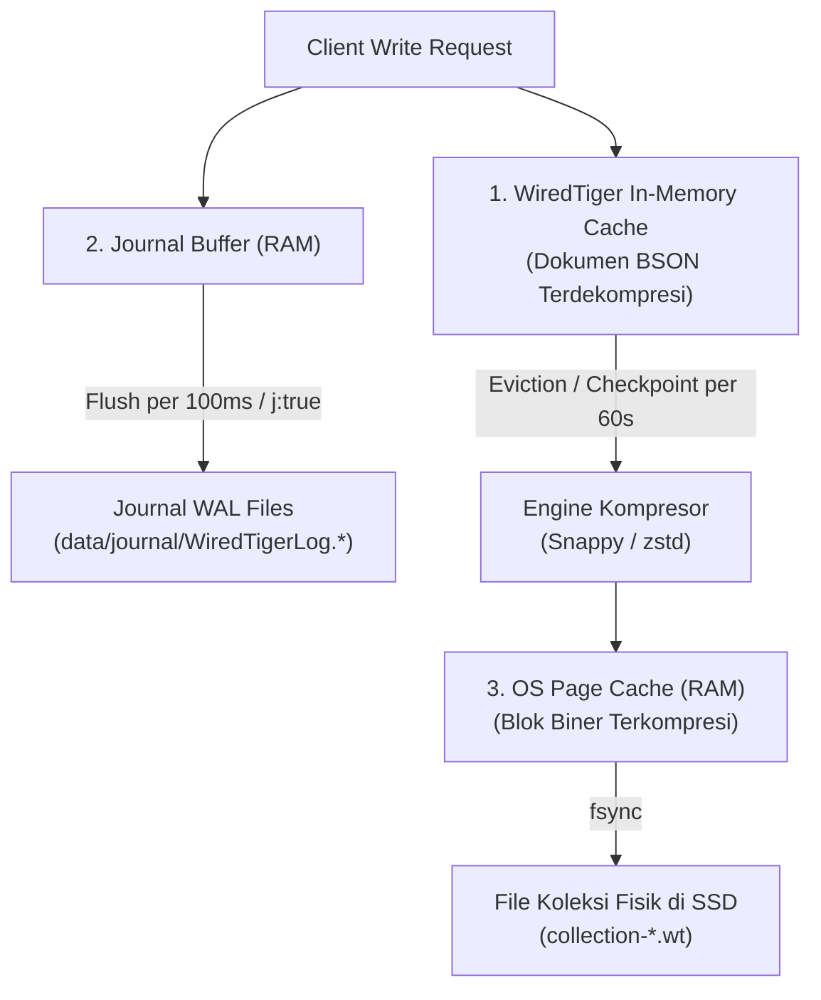
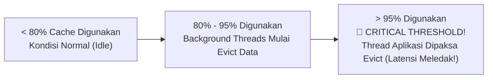
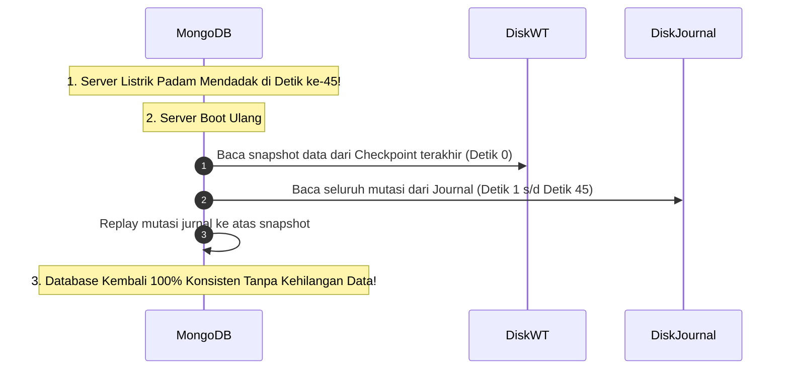

# 🍃 MongoDB - Modul 05: WiredTiger Storage Engine, Checkpoints & Journaling

Di balik kecepatan baca-tulis MongoDB terletak mesin penyimpanan bernama **WiredTiger Storage Engine**. WiredTiger menghadirkan **Document-Level Concurrency**, **Kompresi Data Otomatis**, dan manajemen memori canggih berbasis *Hazard Pointers* tanpa locking global.

---

## 1. Arsitektur Dual-Tier Memori WiredTiger

WiredTiger membagi beban memori menjadi dua tingkatan (*Dual-Tier Memory*): **WiredTiger Cache** dan **OS Filesystem Page Cache**.



### Rumus Perhitungan Default RAM Cache:
$$\text{wiredTigerCacheSizeGB} = \max\left(256\text{ MB}, \ 0.5 \times (\text{Total RAM Server} - 1\text{ GB})\right)$$

Contoh pada server produksi dengan 32 GB RAM:
$$\text{Ukuran Cache} = 0.5 \times (32 - 1) = 15.5\text{ GB RAM}$$

> [!NOTE]
> **Mengapa Hanya 50% RAM?**: 50% sisa RAM sengaja diserahkan kepada **OS Filesystem Page Cache**. WiredTiger menyimpan data di dalam cachenya dalam bentuk *uncompressed* (siap dibaca instan oleh CPU), sedangkan OS Page Cache menyimpan data dalam bentuk *compressed*. Desain ini mengoptimalkan pembacaan data berulang (*cached I/O*) tanpa membebani disk SSD fisik.

---

## 2. Siklus Eviction Memori & Hazard Pointers

Ketika data di dalam WiredTiger Cache mendekati kapasitas maksimum, engine mengaktifkan **Eviction Server** di background untuk membebaskan ruang memori:



### Ambang Batas Eviction (Eviction Triggers):
1. **80% Cache Terisi (Clean + Dirty)**: Thread background WiredTiger mulai mengompresi halaman bersih (*clean pages*) dan membuangnya dari RAM.
2. **20% Dirty Cache Terisi**: Data yang sudah dimutasi tapi belum di-flush ke disk mulai dijadwalkan untuk ditulis.
3. **95% Cache Terisi (Kondisi Krisis)**: Jika laju penulisan aplikasi melampaui kemampuan disk I/O, MongoDB akan **memaksa thread aplikasi client untuk melakukan eviction sendiri**. Dampaknya: latensi API aplikasi akan melonjak drastis (*application stall*).

### Konkurensi Tanpa Kunci: Hazard Pointers
WiredTiger mengimplementasikan *Lock-Free Read Operations* menggunakan teknik **Hazard Pointers**. Pembaca (reader threads) tidak pernah mengunci halaman memori, melainkan hanya menandai alamat halaman yang sedang dibaca. Thread eviction tidak akan pernah memindahkan atau menghapus halaman yang sedang dilindungi oleh hazard pointer.

---

## 3. Struktur Halaman B-Tree Fisik di Disk

File fisik koleksi MongoDB berekstensi `.wt` (contoh: `collection-12--8491029481.wt`). Di dalamnya terdapat struktur halaman B-Tree:

| Tipe Halaman | Ukuran Default | Fungsi Teknis |
|---|:---:|---|
| **Internal Pages** | 4 KB | Menampung kunci pencarian dan pointer referensi ke halaman anak di level bawahnya. |
| **Leaf Pages** | 32 KB | Menampung kunci data, RecordID, dan dokumen terkompresi. |
| **Overflow Pages** | Dinamis | Jika ukuran satu dokumen BSON > 32KB (misal 5MB), dokumen tersebut dipindahkan ke *overflow page* khusus agar tidak merusak kepadatan leaf page. |

---

## 4. Checkpoints vs Write-Ahead Journaling (WAL)

Bagaimana MongoDB menjamin data tidak korup saat server mati mendadak?

### A. Siklus Checkpoints (Setiap 60 Detik)
- Secara berkala (setiap **60 detik** atau jika ada mutasi data kotor mencapai **2 GB**), WiredTiger mengambil snapshot konsisten dari seluruh memori cache.
- Seluruh halaman kotor ditulis ke file `.wt` di disk, dan metadata checkpoint diperbarui secara atomik.
- Checkpoint membentuk **titik pemulihan konsisten (*consistent recovery point*)**.

### B. Write-Ahead Journaling (WAL)
Antara menit ke-1 dan menit ke-2, terdapat celah waktu 60 detik di mana data baru hanya ada di RAM. Jika listrik padam di detik ke-45, data diselamatkan oleh **Journal Files** (`data/journal/WiredTigerLog.*`):
- Seluruh operasi mutasi dicatat secara sekuensial ke dalam buffer jurnal dan di-flush ke disk setiap **100 milidetik** (atau instan jika client meminta `{ j: true }`).
- Ukuran file jurnal dibatasi pre-allocated **100 MB per file** untuk performa penulisan sekuensial maksimal.



---

## 5. Algoritma Kompresi: Snappy vs zlib vs zstd

WiredTiger mengompresi data pada level block leaf page sebelum diserahkan ke OS kernel:

```yaml
# Contoh konfigurasi di mongod.conf:
storage:
  wiredTiger:
    collectionConfig:
      blockCompressor: zstd # Opsi: snappy, zlib, zstd, none
    indexConfig:
      prefixCompression: true
```

| Kompresor | Rasio Kompresi Disk | Konsumsi CPU | Rekomendasi Beban Kerja |
|---|:---:|:---:|---|
| **Snappy (Default)** | Sedang ($\sim 50\%$) | **Sangat Ringan** | Default standar beban kerja OLTP dengan throughput tinggi. |
| **zstd (MongoDB 4.2+)** | **Tinggi ($\sim 70\%$)** | Ringan - Sedang | **Pilihan Terbaik Modern**: Menghemat disk setara zlib dengan kecepatan dekompresi mendekati Snappy! |
| **zlib** | Sangat Tinggi ($\sim 80\%$) | Berat | Cocok untuk koleksi data arsip historis (*Cold Storage* / Audit Log). |
| **Prefix Compression** | Tinggi pada Index | Ringan | Mengompresi entri index B-Tree yang memiliki prefiks kata berulang (selalu aktif otomatis). |

---

## 6. Fragmentasi Disk & Reclaiming Free Space (`compact`)

Saat kamu menghapus jutaan dokumen dengan `deleteMany()`, kamu akan menyadari bahwa **ukuran file disk fisik `.wt` sama sekali tidak berkurang**! Mengapa?

WiredTiger tidak mengembalikan blok kosong ke sistem operasi untuk menghindari overhead de-alokasi file system yang lambat. Sebaliknya, blok-blok kosong tersebut dimasukkan ke dalam **Freelist internal** untuk digunakan kembali (*reused*) oleh operasi penulisan dokumen baru berikutnya.

### Mengembalikan Ruang Disk Fisik ke OS:
Untuk memaksa pelepasan blok kosong kembali ke sistem operasi (Linux ext4/xfs):

```javascript
// Menjalankan defragmentasi dan pemadatan storage fisik koleksi:
// CATATAN: Operasi ini membutuhkan disk space ekstra untuk proses rewrite!
db.runCommand({ compact: "riwayat_transaksi" });
```

> [!WARNING]
> Di MongoDB 4.4+, perintah `compact` bisa berjalan secara online tanpa memblokir pembacaan dan penulisan di node Secondary, namun tetap dianjurkan dijalankan saat traffic rendah (*maintenance window*).

---

## 7. Pemisahan Disk I/O: Data vs Index Storage

Di server dengan beban write sangat tinggi, kamu bisa memisahkan file data dan file index ke dua disk SSD terpisah (misal `/mnt/nvme-data` dan `/mnt/nvme-index`) menggunakan flag `directoryForIndexes`:

```yaml
# /etc/mongod.conf:
storage:
  dbPath: /mnt/nvme-data/mongodb
  wiredTiger:
    engineConfig:
      directoryForIndexes: true # Index otomatis disimpan di subfolder terpisah
```
Kemudian buat symbolic link dari folder `index` ke mount point disk SSD kedua. Langkah ini menggandakan throughput total IOPS storage server kamu!

---

## 8. Diagnostik Kesehatan Cache: `db.serverStatus()`

Gunakan perintah shell ini untuk memantau apakah disk storage kamu mampu mengimbangi laju penulisan:

```javascript
const wt = db.serverStatus().wiredTiger.cache;

console.log({
    "Ukuran Cache Maksimum (Bytes)": wt["maximum bytes configured"],
    "Data di Cache Saat Ini (Bytes)": wt["bytes currently in the cache"],
    "Data Kotor Belum ke Disk (Dirty Bytes)": wt["tracked dirty bytes in the cache"],
    "Eviction oleh Thread Aplikasi": wt["pages written from cache to disk by application threads"]
});
```

> [!CAUTION]
> **Tanda Bahaya Disk Bottleneck**:
> Jika metrik `pages written from cache to disk by application threads` bernilai **lebih dari 0 dan terus bertambah**, ini berarti **Disk SSD kamu terlalu lambat untuk melakukan fsync flush**. Thread aplikasi backend terpaksa ikut membantu menulis ke disk, mengakibatkan request API aplikasi timeout!
