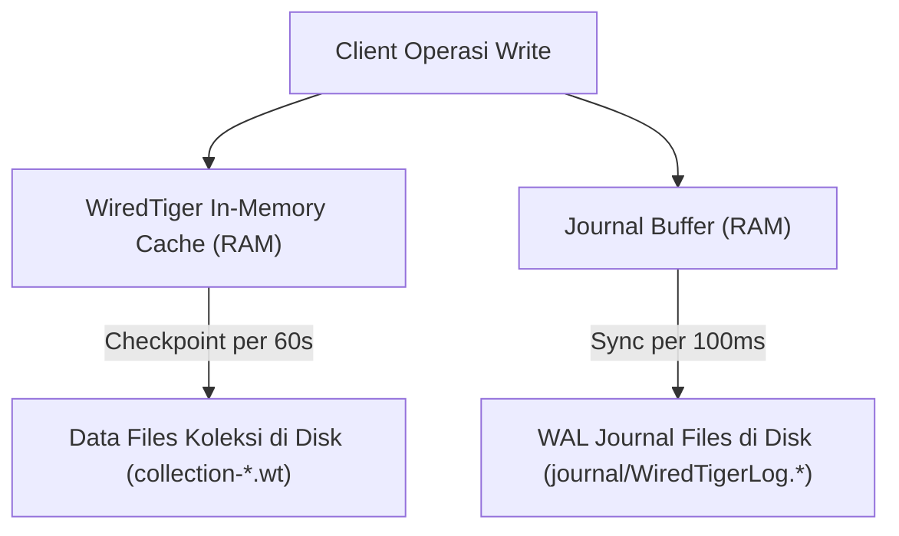

# 🍃 MongoDB - Modul 05: WiredTiger Storage Engine, Checkpoints & Journaling

Di balik kecepatan baca-tulis MongoDB terletak mesin penyimpanan bernama **WiredTiger Storage Engine**. WiredTiger menggantikan engine lawas (MMAPv1) dengan menghadirkan **Document-Level Locking**, **Kompresi Data Bawaan**, dan manajemen cache memori cerdas.

---

## 1. Arsitektur Cache Memori WiredTiger

WiredTiger mengelola *In-Memory Cache* sendiri yang terpisah dari OS Page Cache:

$$\text{Ukuran Default Cache} = 50\% \times (\text{Total RAM Server} - 1\text{ GB})$$
*(Pada server dengan 16 GB RAM, WiredTiger Cache akan menggunakan sekitar $7.5\text{ GB}$ RAM).*

---

## 2. Document-Level Concurrency Control

Di engine lama (MMAPv1), jika satu user meng-update dokumen, **seluruh koleksi atau seluruh database akan dikunci (*Collection-Level Lock*)**, sehingga user lain harus antre.

WiredTiger mengimplementasikan **Document-Level Concurrency (Kunci Tingkat Dokumen)**:
- Ribuan klien bisa menulis dan membaca secara simultan ke koleksi yang sama, **selama dokumen yang dimutasi berbeda**.
- Menggunakan kontrol konkurensi optimis: jika ada dua thread yang memodifikasi *dokumen yang sama persis*, salah satu transaksi akan diulang (*retried*).

---

## 3. Checkpoints & Pemulihan Crash via Journaling

Bagaimana MongoDB menjamin durabilitas data (*Durability ACID*) saat listrik mendadak padam?

### A. Checkpoints (Setiap 60 Detik)
- Secara default, setiap **60 detik** (atau saat data kotor mencapai 2GB), WiredTiger membekukan snapshot memori dan menulis seluruh halaman data kotor (*dirty pages*) ke file koleksi disk fisik.
- Checkpoint membentuk titik pemulihan konsisten (*consistent recovery point*).

### B. Journaling (Write-Ahead Logging / WAL)
Antara menit ke-1 dan menit ke-2 (sebelum checkpoint berikutnya tiba), ada jeda 60 detik di mana data baru hanya ada di RAM. Untuk mencegah data hilang jika server crash di detik ke-30:
- Setiap mutasi dicatat ke dalam **Journal Buffer** dan di-flush ke disk setiap **100 milidetik** (atau instan jika menggunakan write concern `j: true`).

### Skenario Pemulihan Setelah Server Mati Mendadak (Crash Recovery):
Saat MongoDB menyala kembali:
1. Membaca data disk fisik dari **titik Checkpoint terakhir**.
2. **Memutar ulang (*Replay*) seluruh catatan log di dalam Journal Files** yang terjadi setelah checkpoint tersebut hingga transaksi terakhir yang ter-commit.
3. Database kembali pulih 100% konsisten tanpa korupsi data!

---

## 4. Kompresi Data Bawaan (Snappy vs zlib)

WiredTiger mengompresi data sebelum ditulis ke disk tanpa membebani CPU secara signifikan:

| Algoritma Kompresi | Karakteristik | Kasus Penggunaan |
|---|---|---|
| **Snappy (Default)** | Rasio kompresi sedang (menghemat $\sim 50\% - 70\%$ ruang disk), penggunaan CPU sangat ringan. | Paling seimbang untuk beban kerja OLTP umum. |
| **zlib** | Rasio kompresi sangat tinggi (menghemat $\sim 70\% - 85\%$ ruang disk), namun memakan lebih banyak siklus CPU. | Sangat ideal untuk data arsip historis (*Cold Storage*). |
| **Prefix Compression** | Kompresi khusus untuk index B-Tree (menyimpan prefix teks berulang sekali saja). | Selalu aktif otomatis untuk semua index B-Tree. |
