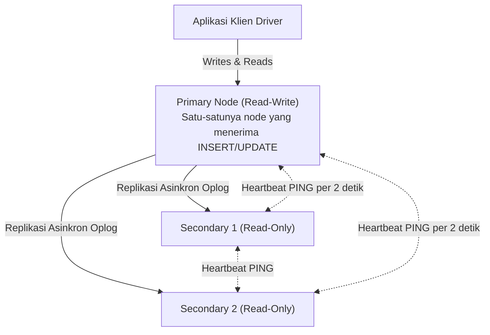
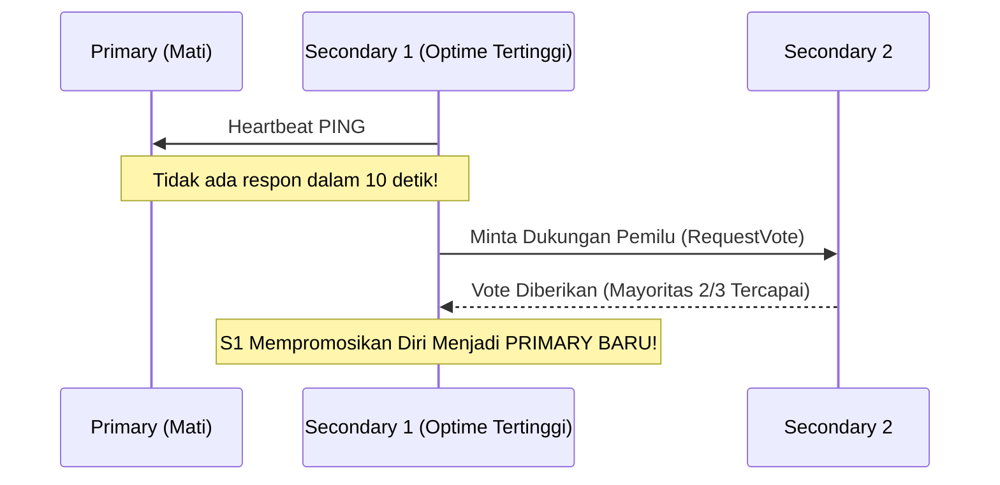

# 🍃 MongoDB - Modul 06: Replica Set, Oplog Internals & Konsensus Majority

Dalam lingkungan produksi, menjalankan MongoDB standalone adalah pantangan mutlak. MongoDB mengandalkan **Replica Set** untuk menjamin ketersediaan tinggi (*High Availability / Zero-Downtime Failover*) dan redundansi data.

---

## 1. Arsitektur Replica Set (Minimum 3 Node)

Sebuah Replica Set yang sehat terdiri dari jumlah anggota ganjil (minimal 3 node) untuk menghindari kondisi seri (*Split-Brain*):



- **Primary Node**: Menerima seluruh operasi penulisan (*Write Operations*).
- **Secondary Nodes**: Mereplikasi data secara konstan dari Primary dan bisa dikonfigurasi untuk melayani query pembacaan berat (*Read Preference: secondaryPreferred*).
- **Arbiter Node (Opsional)**: Node murah tanpa data yang hanya memiliki hak suara saat pemungutan suara (*voting*) jika kamu hanya memiliki 2 server data.

---

## 2. Jantung Replikasi: Operation Log (`oplog.rs`)

Replikasi MongoDB **bukan berupa replikasi fisik biner disk**, melainkan berbasis log logis bernama **Oplog**:
- Disimpan di koleksi khusus `local.oplog.rs` berjenis *Capped Collection* (koleksi melingkar dengan kapasitas tetap).
- **Sifat Idempotent**: Semua perintah mutasi diubah menjadi operasi idempoten deterministik (misal: `$inc: { saldo: 10 }` diubah menjadi `$set: { saldo: 150 }`). Jika Secondary mengulang log yang sama dua kali, hasil akhir data tetap konsisten!

---

## 3. Algoritma Pemilihan Otomatis (Raft-Like Election)

Jika Primary mendadak mati (server terbakar, kabel putus):



1. Anggota saling mengirimkan sinyal *Heartbeat* setiap **2 detik**.
2. Jika Primary tidak merespon dalam waktu **10 detik**, Secondary akan mencalonkan diri menjadi Primary baru.
3. Node yang memiliki data paling mutakhir (*Highest Oplog Timestamp*) dan berhasil mengumpulkan **suara mayoritas mutlak ($\frac{N}{2} + 1$)** akan dipromosikan menjadi **Primary Baru**.
4. Seluruh proses failover berlangsung otomatis dalam waktu **kurang dari 5 detik** tanpa intervensi manusia!

---

## 4. Menjamin Keamanan Data Transaksi: Write Concern & Read Concern

Dalam sistem finansial, kita harus memastikan data benar-benar tersimpan di banyak server sebelum mengembalikan respon `200 OK` ke pengguna:

```javascript
// Konfigurasi Keamanan Mutlak (Zero Data Loss):
await db.collection("pembayaran").insertOne(
    { transaksi_id: "TRX-9981", nominal: 500000 },
    {
        writeConcern: {
            // w: "majority" memastikan data SUDAH DITERIMA & DITULIS OLEH MAYORITAS NODE!
            w: "majority",
            // j: true memastikan data SUDAH DI-FLUSH KE DISK JOURNAL fisik!
            j: true,
            // Batas waktu timeout toleransi replikasi:
            wtimeout: 5000
        }
    }
);
```
Dengan `w: "majority"`, bahkan jika server Primary mati 1 milidetik setelah perintah dieksekusi, data dijamin **sudah ada di Secondary yang akan menjadi Primary baru**, mencegah anomali data hilang (*Rollback Data Loss*).
