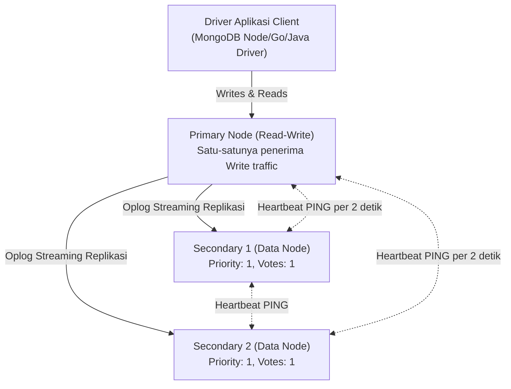
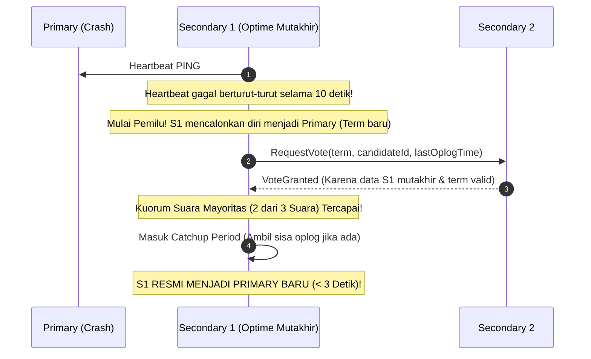

# 🍃 MongoDB - Modul 06: Replica Set, Oplog Internals, Elections & Read Preferences

Dalam lingkungan produksi, menjalankan MongoDB dalam mode *standalone* adalah pantangan mutlak. MongoDB mengandalkan **Replica Set** untuk menghadirkan ketersediaan tinggi (*High Availability*), toleransi bencana (*Zero-Downtime Automated Failover*), dan redundansi data terdistribusi.

---

## 1. Arsitektur Replica Set (PSS vs PSA)

Kluster Replica Set standar terdiri dari jumlah anggota pemilih (*voting members*) yang ganjil (minimal 3 node) untuk memastikan selalu tercapai kuorum suara mayoritas mutlak:



### PSS (Primary-Secondary-Secondary) vs PSA (Primary-Secondary-Arbiter)

| Aspek | PSS (3 Data Nodes) - Rekomendasi | PSA (2 Data Nodes + 1 Arbiter) |
|---|:---:|:---:|
| **Toleransi Kegagalan** | 1 Node data mati, 2 node tersisa **tetap bisa menerima Write `w: "majority"`**. | 1 Node data mati, sisa 1 node data **GAGAL menerima Write `w: "majority"`**! |
| **Beban Cache WiredTiger** | Normal dan seimbang di seluruh node. | **Rawan Cache Stalls**: Jika Secondary mati, Primary menahan dirty pages di RAM menunggu acknowledgment. |
| **Kebutuhan Storage** | 3x ukuran data penuh. | 2x ukuran data penuh (Arbiter tidak menyimpan data). |

> [!CAUTION]
> **Hindari Arbiter di Produksi**: Sejak MongoDB 4.4+, penggunaan Arbiter sangat tidak disarankan karena memicu degradasi performa cache memori saat salah satu node data mengalami downtime. Selalu prioritaskan arsitektur **PSS (3 Data Nodes)**.

---

## 2. Anggota Khusus: Hidden, Delayed & Non-Voting Members

MongoDB memungkinkan konfigurasi spesifik pada anggota Secondary untuk kebutuhan di luar traffic aplikasi:

```javascript
// Mengatur konfigurasi Replica Set di mongosh:
const cfg = rs.conf();

// 1. HIDDEN MEMBER (Untuk Reporting / BI / Backup):
// Menerima replikasi data, punya hak suara (votes: 1), tapi TERSEMBUNYI dari driver aplikasi:
cfg.members[1].priority = 0;  // Tidak boleh jadi Primary
cfg.members[1].hidden = true; // Sembunyi dari connection string aplikasi

// 2. DELAYED MEMBER (Jaring Pengaman Bencana Human-Error):
// Sengaja dibuat terlambat 1 jam (3600 detik) di belakang data Primary:
cfg.members[2].priority = 0;
cfg.members[2].hidden = true;
cfg.members[2].secondaryDelaySecs = 3600;

rs.reconfig(cfg);
```

> [!TIP]
> **Fungsi Delayed Member**: Jika ada developer yang tidak sengaja mengeksekusi `db.collection.deleteMany({})` di database produksi, kamu punya waktu 1 jam sebelum perintah penghapusan tersebut dieksekusi di Delayed Member! Kamu bisa langsung menghentikan proses replikasi dan memulihkan data dari node tersebut.

---

## 3. Jantung Replikasi: Operation Log (`oplog.rs`)

Replikasi MongoDB **bukan berupa penyalinan file disk fisik**, melainkan streaming log logis bernama **Oplog**:
- Disimpan di namespace `local.oplog.rs` berjenis *Capped Collection* (buffer melingkar FIFO dengan kapasitas disk tetap).
- **Sifat Idempoten Mutlak**: Semua mutasi non-deterministik diubah menjadi penugasan nilai pasti. 
  - Contoh: Jika aplikasi mengeksekusi `$inc: { view_count: 1 }`, Primary akan mencatat `$set: { view_count: 1042 }` di dalam oplog. Jika Secondary mengulang log yang sama dua kali karena kendala jaringan, data akhir tetap 100% konsisten.

```javascript
// Memeriksa kesehatan kapasitas Oplog:
rs.printReplicationInfo();

// Output:
// configured oplog size:   50000 MB
// log length start to end: 120.5 hours (Oplog Window)
```

> [!IMPORTANT]
> **Oplog Window**: Waktu rentang dari entri oplog tertua hingga terbaru disebut *Oplog Window*. Di produksi, pastikan Oplog Window mencakup minimal **24 hingga 72 jam**. Jika ada Secondary yang mati lebih lama dari durasi Oplog Window, node tersebut akan mengalami *Stale State* dan harus di-resync penuh dari awal.

### Mengubah Ukuran Oplog Secara Dinamis (MongoDB 4.4+):
```javascript
// Ubah ukuran oplog menjadi 60 GB secara online tanpa restart:
db.adminCommand({ replSetResizeOplog: 1, size: 61440 });
```

---

## 4. Algoritma Pemilihan Failover (Raft-Like Consensus)

Ketika node Primary mengalami crash (listrik padam, kernel panic, putus jaringan):



### Aturan Konsensus:
1. **Kuorum Mayoritas Mutlak**: Pemilu hanya sah jika kandidat mendapatkan suara minimal:
   $$\text{Kuorum} = \left\lfloor \frac{N}{2} \right\rfloor + 1$$
   *(Dari 3 node, butuh 2 suara. Dari 5 node, butuh 3 suara).*
2. **Kandidat Paling Mutakhir**: Node hanya akan memberikan suaranya jika kandidat memiliki stempel waktu oplog (*OpTime*) yang setara atau lebih mutakhir dari miliknya.
3. **Catchup Period**: Node yang terpilih menunggu hingga `catchUpTimeoutMillis` (default 15 detik) untuk menyedot sisa oplog yang belum sempat terdistribusi sebelum membuka traffic tulis.

---

## 5. Read Preferences & Geolocation Tag Sets

Secara default, seluruh query baca diarahkan ke **Primary**. Namun, kamu bisa mengalihkan beban baca ke Secondary menggunakan opsi **Read Preference**:

| Mode | Deskripsi | Risiko Anomali |
|---|---|---|
| **`primary`** (Default) | Selalu baca dari Primary. | Tidak ada. Konsistensi data mutlak. |
| **`primaryPreferred`** | Baca dari Primary; jika Primary down saat pemilu, baca dari Secondary. | Kemungkinan membaca data yang sedikit tertunda saat failover. |
| **`secondary`** | Selalu membaca dari Secondary. | **Eventual Consistency**: Kemungkinan membaca data yang belum ter-update (*Stale Reads*). |
| **`secondaryPreferred`** | Prioritas membaca dari Secondary; fallback ke Primary jika seluruh Secondary mati. | Cocok untuk pelaporan atau query analitik berat. |
| **`nearest`** | Baca dari node mana saja yang memiliki latensi jaringan terendah (berdasarkan ping round-trip). | Ideal untuk cluster multi-region global. |

### Routing Geografis Berbasis Tag Sets:
```javascript
// Hubungkan client dengan Tag Set data center terdekat:
const client = new MongoClient("mongodb://host1,host2,host3/?replicaSet=rs0", {
    readPreference: "secondaryPreferred",
    readPreferenceTags: [
        { datacenter: "jakarta", rack: "r1" }, // Coba rack lokal dulu
        { datacenter: "jakarta" },              // Fallback ke data center yang sama
        {}                                      // Fallback ke node mana saja
    ],
    maxStalenessSeconds: 90 // Jangan baca dari Secondary yang lagging > 90 detik!
});
```

---

## 6. Troubleshooting Replication Lag

Untuk mendiagnosis secondary yang tertinggal:

```javascript
rs.printSecondaryReplicationInfo();

// Output:
// source: mongo-sec-01:27017
//   syncedTo: Fri Nov 20 2026 11:20:01 GMT+0700
//   0 secs (0 hrs) behind the primary
```

### Penyebab Umum Replication Lag:
1. **I/O Disk Secondary Lambat**: Secondary harus menerapkan seluruh mutasi oplog secara paralel. Jika disk IOPS Secondary lebih rendah dari Primary, lag akan terus membengkak.
2. **Chained Replication**: Secara default, Secondary bisa mereplikasi dari Secondary lain (`chainingAllowed: true`). Jika node perantara lambat, node ujung akan ikut lagging.
   - Nonaktifkan jika ingin seluruh Secondary langsung mengambil dari Primary:
     ```javascript
     const cfg = rs.conf();
     cfg.settings.chainingAllowed = false;
     rs.reconfig(cfg);
     ```

---

## 7. Prosedur Graceful Maintenance & Step-Down

Ketika kamu perlu melakukan restart server Primary untuk patching kernel OS Linux atau upgrade versi MongoDB, **JANGAN PERNAH** langsung mematikan proses `mongod` secara paksa!

Gunakan perintah **`rs.stepDown()`**:

```javascript
// 1. Perintahkan Primary untuk mundur secara anggun:
// Parameter 60: Mencegah node ini mencalonkan diri lagi selama 60 detik
// Parameter 30: Menunggu Secondary mengejar oplog maksimal 30 detik sebelum mundur
rs.stepDown(60, 30);
```

### Efek Graceful Step-Down:
1. Primary menolak penulisan baru dan menunggu Secondary yang paling up-to-date menyerap seluruh sisa buffer oplog.
2. Primary melepas jabatannya dan bertransisi menjadi **Secondary**.
3. Pemilu kilat terjadi dan Secondary baru terpilih menjadi **Primary baru dalam < 2 detik**.
4. Kini mantan primary yang berstatus secondary bisa di-restart atau di-maintenance dengan aman tanpa downtime aplikasi!

### Membekukan Node Saat Maintenance (`rs.freeze()`):
Jika kamu sedang melakukan indexing atau perbaikan disk pada Secondary dan tidak ingin node tersebut tiba-tiba memicu pemilu:
```javascript
// Bekukan Secondary agar tidak mencalonkan diri menjadi Primary selama 2 jam (7200 detik):
rs.freeze(7200);

// Untuk mencairkan kembali:
rs.freeze(0);
```

---

## 8. Inisialisasi & Manajemen Anggota Dinamis

```javascript
// 1. Inisialisasi Replica Set Pertama Kali:
rs.initiate({
    _id: "rs0",
    members: [
        { _id: 0, host: "mongo-node-01.internal:27017", priority: 2 },
        { _id: 1, host: "mongo-node-02.internal:27017", priority: 1 },
        { _id: 2, host: "mongo-node-03.internal:27017", priority: 1 }
    ]
});

// 2. Menambahkan Node Baru ke Kluster secara Online:
rs.add({ host: "mongo-node-04.internal:27017", priority: 0, votes: 0 });

// 3. Menghapus Node dari Kluster:
rs.remove("mongo-node-04.internal:27017");

// 4. Memeriksa Status Kesehatan Seluruh Node:
rs.status(); // Periksa field: stateStr ('PRIMARY' / 'SECONDARY'), health (1 = sehat)
```
