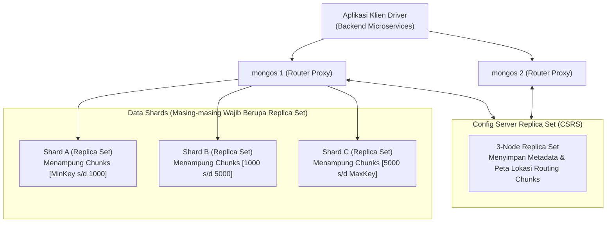
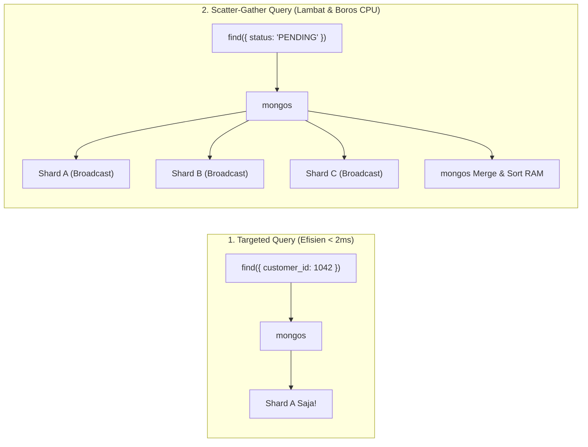
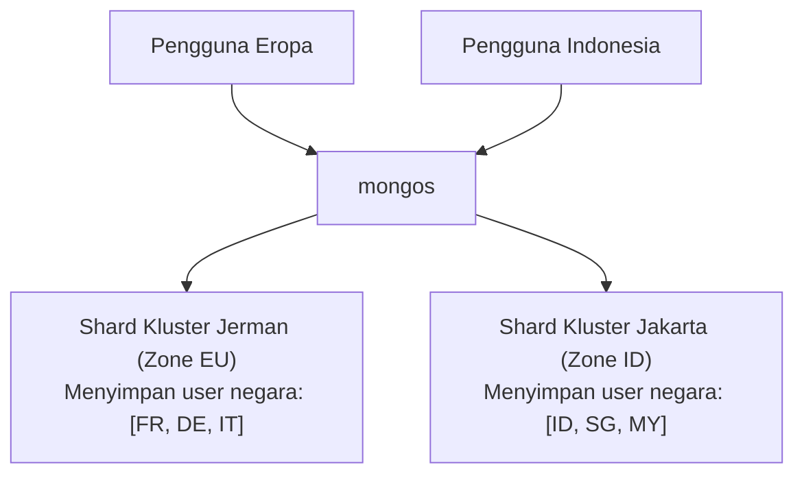

# 🍃 MongoDB - Modul 07: Sharding Cluster, Chunk Splitting & Shard Key Selection

Ketika volume data menembus puluhan terabyte atau throughput transaksi melampaui kemampuan hardware satu server fisik terbaik sekalipun, **Sharding (Horizontal Scaling)** mendistribusikan partisi data melintasi banyak kluster server independen tanpa batas.

---

## 1. Arsitektur Tiga Serangkai Sharded Cluster

Kluster Sharded MongoDB terdiri dari tiga komponen arsitektur yang bekerja secara terkoordinasi:



1. **`mongos` (Query Router)**: Proxy tanpa state (*stateless*) yang menerima koneksi dari aplikasi. `mongos` mencache routing table dari Config Server, meneruskan query ke shard yang relevan, menggabungkan hasil, dan mengembalikannya ke client.
2. **Config Server Replica Set (CSRS)**: Kluster khusus 3-node yang menyimpan metadata kluster, status balancer, dan pemetaan rentang chunk ke shard fisik.
3. **Data Shards**: Kluster penyimpanan data aktual. **Setiap Shard diwajibkan berupa Replica Set independen** demi toleransi kerusakan hardware.

---

## 2. Pola Eksekusi Query: Targeted vs Scatter-Gather

Efisiensi query pada cluster sharding sangat bergantung pada apakah query kamu menyertakan **Shard Key**:



- **Targeted Query (Single-Shard)**: Query menyertakan shard key. `mongos` langsung tahu shard mana yang menyimpan data dan hanya mengontak 1 server.
- **Scatter-Gather (Multi-Shard Broadcast)**: Query tidak menyertakan shard key. `mongos` terpaksa menyebarkan request ke **seluruh shard yang ada di kluster**, menunggu respon dari semuanya, lalu melakukan in-memory merge-sort sebelum merespons client.

---

## 3. Strategi Pemilihan Shard Key (The Golden Rules)

Pemilihan Shard Key adalah keputusan arsitektur paling kritis. Shard key yang buruk akan menciptakan ketimpangan beban (*hotspotting*) dan merusak performa kluster.

### Tiga Syarat Mutlak Shard Key:
1. **Kardinalitas Tinggi (*High Cardinality*)**: Memiliki banyak nilai unik. Jangan pernah shard berdasarkan field status seperti `{ status: 1 }` yang hanya memiliki nilai `"AKTIF"` dan `"NONAKTIF"`, karena kluster hanya bisa dibagi menjadi 2 chunk!
2. **Frekuensi Rendah (*Low Frequency*)**: Tidak ada satu nilai tunggal yang mewakili mayoritas data.
3. **Penyebaran Non-Monotonik (*Anti-Hotspotting*)**: Hindari field yang nilainya selalu naik berurutan (seperti autoincrement ID, timestamp `created_at`, atau `ObjectId`). Jika di-shard secara rentang, **100% penulisan baru akan menghantam satu Shard terakhir saja**, sementara shard lain menganggur!

---

## 4. Tipe Sharding: Hashed, Ranged & Compound

### A. Hashed Sharding (Distribusi Acak Merata)
MongoDB menghitung hash MD5 dari nilai key untuk menentukan target chunk:
```javascript
// 1. Shard berdasarkan Hash MD5 customer_id:
sh.enableSharding("ecommerce");
db.pesanan.createIndex({ customer_id: "hashed" });
sh.shardCollection("ecommerce.pesanan", { customer_id: "hashed" });
```
- **Kelebihan**: Distribusi penulisan dijamin 100% merata ke seluruh shard (anti-hotspot).
- **Kekurangan**: Query rentang (`$gt`, `$lt`) berubah menjadi scatter-gather query.

### B. Compound Shard Key (Pola Multi-Tenant Terbaik)
Kombinasikan field prefix berdaya pisah tinggi dengan field bervariasi tinggi:
```javascript
// Pola Multi-Tenant SaaS:
// Tenant membatasi query ke shard tertentu, user_id menyebarkan data di dalam tenant:
sh.shardCollection("saas_app.audit_logs", { tenant_id: 1, user_id: "hashed" });
```

### C. Refine Shard Key (MongoDB 4.4+)
Dahulu, shard key bersifat permanen. Di MongoDB 4.4+, kamu bisa menambahkan suffix ke shard key yang ada tanpa re-sharding total:
```javascript
// Tambahkan field 'order_id' ke shard key 'customer_id' yang sudah ada:
sh.refineCollectionShardKey("ecommerce.pesanan", { customer_id: 1, order_id: 1 });
```

---

## 5. Zone Sharding (Tag-Aware Geo-Sharding)

Zone Sharding memungkinkan kamu mengikat rentang data tertentu ke grup server fisik di lokasi geografis spesifik untuk kepatuhan hukum data (misal: GDPR Uni Eropa):



```javascript
// 1. Berikan Tag Zona pada Shard Fisik:
sh.addShardTag("shard-frankfurt-01", "ZONE_EU");
sh.addShardTag("shard-jakarta-01", "ZONE_ID");

// 2. Petakan rentang Shard Key ke Zona:
sh.addTagRange(
    "aplikasi.pengguna",
    { negara: "DE", user_id: MinKey },
    { negara: "DE", user_id: MaxKey },
    "ZONE_EU"
);
sh.addTagRange(
    "aplikasi.pengguna",
    { negara: "ID", user_id: MinKey },
    { negara: "ID", user_id: MaxKey },
    "ZONE_ID"
);
```

---

## 6. Mekanisme Chunk Splitting, Balancer & Jumbo Chunks

Data di dalam shard dipecah menjadi unit-unit logis bernama **Chunks** (default: **$64\text{ MB}$**).

### A. Auto-Splitting & The Balancer
1. Ketika penulisan data baru menyebabkan sebuah chunk melampaui 64MB, `mongos` otomatis membelah (*split*) chunk tersebut menjadi 2 chunk (@32MB).
2. **The Balancer**: Proses background yang berjalan di Config Server. Jika jumlah chunk antar-shard tidak seimbang (melebihi *migration threshold*), Balancer akan memindahkan chunk melintasi jaringan ke shard lain secara online tanpa downtime aplikasi.

### Mengatur Jendela Waktu Balancer (Off-Peak Hours):
Agar migrasi chunk tidak membebani bandwidth jaringan di jam kerja sibuk:
```javascript
// Balancer hanya aktif dari jam 02:00 pagi hingga 05:00 pagi:
use config;
db.settings.updateOne(
    { _id: "balancer" },
    { $set: { activeWindow: { start: "02:00", stop: "05:00" } } },
    { upsert: true }
);
```

### B. Mitigasi Bencana "Jumbo Chunks"
> [!WARNING]
> **Apa itu Jumbo Chunk?**: Chunk yang ukurannya melebihi kapasitas maksimum (misal > 200MB) namun **TIDAK BISA DIBELAH (Cannot Split)** oleh MongoDB karena seluruh dokumen di dalam chunk tersebut memiliki nilai shard key yang **persis sama** (akibat low-cardinality shard key).
> Balancer akan menolak memindahkan Jumbo Chunk!

```javascript
// 1. Temukan Jumbo Chunks di kluster:
sh.status({ verbose: true }); // Cari tag 'jumbo'

// 2. Jika nilai shard key masih memungkinkan di-split secara paksa:
sh.splitAt("ecommerce.pesanan", { customer_id: "CUST-9999", order_id: 150000 });
```
Solusi jangka panjang untuk Jumbo Chunk permanen adalah menggunakan fitur **Refine Shard Key** dengan menambahkan field pembeda lain berdaya pisah tinggi.

---

## 7. Setup Kluster Sharding Langkah Demi Langkah

Berikut adalah perintah operasional saat pertama kali merangkai kluster sharded di `mongosh`:

```javascript
// 1. Hubungkan mongosh ke salah satu instance router 'mongos' port 27017:
// mongosh "mongodb://mongos-01.internal:27017"

// 2. Daftarkan Shard Replica Sets ke router:
sh.addShard("shard01-rs/shard01-node1.internal:27017,shard01-node2.internal:27017");
sh.addShard("shard02-rs/shard02-node1.internal:27017,shard02-node2.internal:27017");

// 3. Aktifkan fitur Sharding pada Database target:
sh.enableSharding("perbankan");

// 4. Buat Index yang sama persis dengan calon Shard Key:
db.transaksi.createIndex({ rekening_id: "hashed" });

// 5. Aktifkan Sharding pada Koleksi:
sh.shardCollection("perbankan.transaksi", { rekening_id: "hashed" });

// 6. Verifikasi Distribusi Data Antar-Shard:
db.transaksi.getShardDistribution();
```

### Membaca Hasil `getShardDistribution()`:
```text
Shard shard01-rs at shard01-rs/...
 data : 48.2 GB docs : 12,410,290 chunks : 752
 estimated data per chunk : 64.09 MB

Shard shard02-rs at shard02-rs/...
 data : 47.9 GB docs : 12,380,110 chunks : 749
 estimated data per chunk : 63.95 MB

Totals
 data : 96.1 GB docs : 24,790,400 chunks : 1501
 Shard shard01-rs contains 50.15% data, 50.06% docs in cluster
 Shard shard02-rs contains 49.85% data, 49.94% docs in cluster
```
Hasil di atas menunjukkan **keseimbangan 50% : 50% sempurna** antar-shard tanpa ketimpangan beban!

---

## 8. Kapan Sebaiknya TIDAK Melakukan Sharding?

> [!TIP]
> **Aturan Emas Engineering**: Sharding menambah kompleksitas operasional, latensi jaringan antar-hop, dan kesulitan backup secara signifikan.
> **JANGAN lakukan sharding jika**:
> 1. Total data kamu masih **di bawah 2 Terabyte** (1 server modern dengan NVMe SSD sanggup menampung hingga 10TB dengan mudah).
> 2. Beban query lambat disebabkan oleh **kurangnya index B-Tree yang tepat** (index yang buruk tidak akan sembuh dengan sharding!).
> 3. Kamu belum mencoba scaling vertikal (*Scale-Up* RAM dan CPU instance).
> 
> Gunakan sharding hanya ketika kapasitas storage SSD fisik habis, write throughput melampaui kemampuan 1 Primary node, atau regulasi hukum mewajibkan isolasi data geografis (Zone Sharding).
