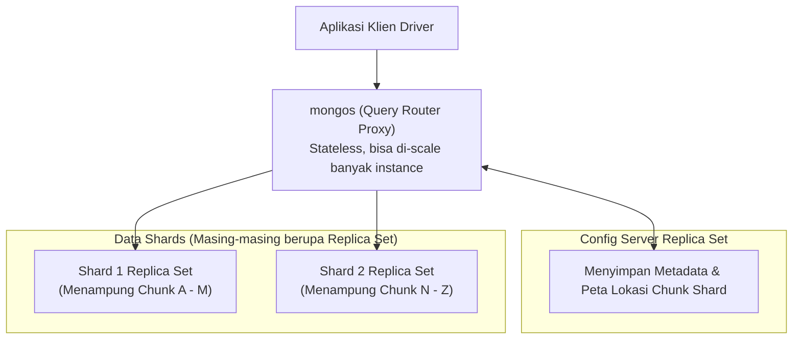
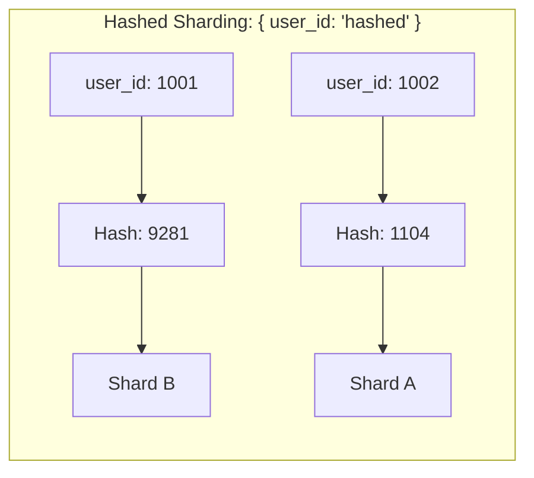

# 🍃 MongoDB - Modul 07: Sharding Cluster, Chunk Splitting & Shard Key Selection

Ketika volume data menembus puluhan terabyte atau jutaan IOPS yang melebihi batas hardware satu server fisik, **Sharding (Horizontal Scaling)** mendistribusikan data melintasi banyak kluster server independen.

---

## 1. Arsitektur Tiga Serangkai Sharded Cluster

Kluster Sharded MongoDB terdiri dari 3 komponen utama:



1. **`mongos` (Query Router)**: Router tanpa state (*stateless proxy*) yang menerima request klien, memeriksa peta lokasi ke Config Server, meneruskan query ke Shard yang tepat, dan menggabungkan hasilnya kembali ke klien.
2. **Config Servers**: Kluster Replica Set khusus yang menyimpan metadata kluster dan pemetaan rentang data (*Chunk Routing Table*).
3. **Shards**: Server pekerja aktual. **Setiap Shard diwajibkan berupa Replica Set tersendiri** untuk menjamin redundansi.

---

## 2. Pemilihan Shard Key: Keputusan Paling Krusial

> [!CAUTION]
> **Peringatan Kritis**: Memilih Shard Key yang salah adalah bencana terbesar di MongoDB. Di versi lama, Shard Key tidak bisa diubah setelah dibuat!

### Kriteria Shard Key yang Baik:
1. **Kardinalitas Tinggi (*High Cardinality*)**: Memiliki banyak variasi nilai unik (misal: `user_id` unik, bukan status `"AKTIF"`/`"NONAKTIF"` yang hanya punya 2 nilai).
2. **Frekuensi Rendah**: Tidak ada satu nilai tertentu yang muncul pada 80% data.
3. **Menghindari Pola Monotonik Naik (*Anti-Hotspotting*)**: Jika kamu menggunakan timestamp atau autoincrement ID sebagai shard key rentang, **semua operasi penulisan baru akan menumpuk hanya di satu Shard terakhir (*Hotspot Shard*)**, sementara shard lain menganggur!

---

## 3. Ranged Sharding vs Hashed Sharding



| Tipe Sharding | Cara Kerja | Kelebihan | Kekurangan |
|---|---|---|---|
| **Hashed Sharding (Direkomendasikan)** | MongoDB menghitung hash MD5 dari field key. | **Distribusi Bebas Hotspot**: Data dengan ID berurutan otomatis disebar merata ke seluruh Shard. | Query rentang (`$gt`, `$lt`) harus disebar ke seluruh shard (*Scatter-Gather Query*). |
| **Ranged Sharding** | Data dikelompokkan berdasarkan rentang alfabet atau numerik berurutan. | Sangat cepat untuk query rentang karena hanya menargetkan 1 Shard tertentu (*Targeted Query*). | Rawan terjadi *Hotspotting* jika key terus naik secara sekuensial. |

### Mengaktifkan Hashed Sharding:
```javascript
// 1. Buat index hashed pada collection:
sh.enableSharding("toko_online");
db.pesanan.createIndex({ customer_id: "hashed" });

// 2. Aktifkan sharding pada collection:
sh.shardCollection("toko_online.pesanan", { customer_id: "hashed" });
```

---

## 4. Mekanisme Chunk Splitting & The Balancer

1. Data di dalam Shard dibagi menjadi unit-unit logis bernama **Chunks** (default berukuran **$64\text{ MB}$**).
2. **Chunk Splitting**: Saat ukuran chunk mencapai batas 64MB karena penambahan data baru, `mongos` otomatis membelah chunk tersebut menjadi dua chunk berukuran masing-masing 32MB.
3. **The Balancer**: Background process di cluster yang memantau keseimbangan beban:
   - Jika satu Shard memiliki jauh lebih banyak chunk dibanding shard lain, Balancer secara otomatis **memigrasikan chunk melintasi jaringan ke Shard yang lebih longgar secara online tanpa downtime**.
